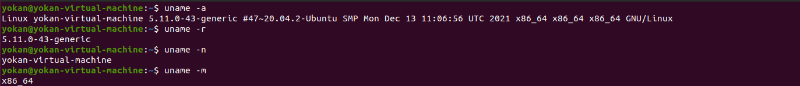
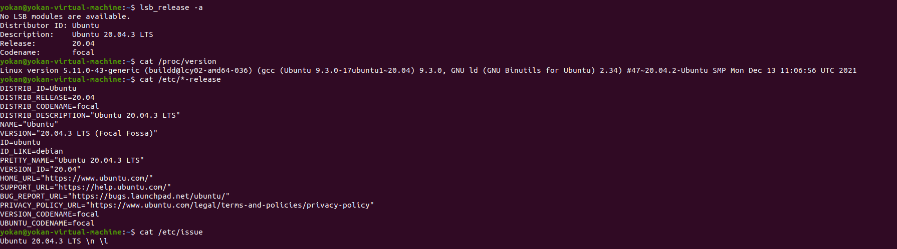

# 1、内核，操作系统和设备信息

```
uname -a  打印所有可用的系统信息
uname -r  内核版本
uname -n  系统主机名。
uname -m  查看系统内核架构（64位/32位）
hostname  系统主机名
lsb_release -a   发行版信息
cat /proc/version  内核信息
cat /etc/*-release  发行版信息
cat /etc/issue    发行版信息
cat /proc/cpuinfo  CPU信息
```




