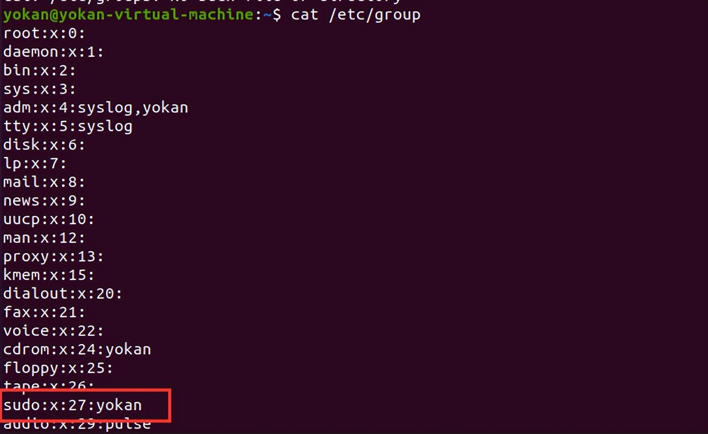

# 2、用户和群组

> GitHub 仓库源文件：[点击打开网页渲染版](https://github.com/ben2023niao/ben-ops-notes/blob/main/doc/md/202304141557-%E5%AE%89%E5%85%A8%E4%B8%8E%E5%A0%A1%E5%9E%92%E6%9C%BA%2B%E5%AE%89%E5%85%A8%E8%BF%90%E7%BB%B4%2B%E7%9F%A5%E8%AF%86%E7%AC%94%E8%AE%B0-2%E3%80%81%E7%94%A8%E6%88%B7%E5%92%8C%E7%BE%A4%E7%BB%84.md)

```
cat /etc/passwd     列出系统上的所有用户
cat /etc/shadow     查看用户Hash
cat /etc/group      列出系统上的所有组
groups              当前用户所在的组
groups test         test用户所在的组
getent group xxx      xxx组里的用户

grep -v -E "^#" /etc/passwd | awk -F: '$3 == 0 { print $1}'      列出所有的超级用户账户
awk -F: 'length($2)==0 {print $1}' /etc/shadow  #查看是否存在空口令用户
awk '/\$1|\$6/{print $1}' /etc/shadow #查看远程登录的账号

whoami              查看当前用户
w                   谁目前已登录，他们正在做什么
who                 命令用于显示系统中有哪些使用者正在上面
last                最后登录用户的列表
lastlog             所有用户上次登录的信息
lastlog –u %username%  有关指定用户上次登录的信息
```




