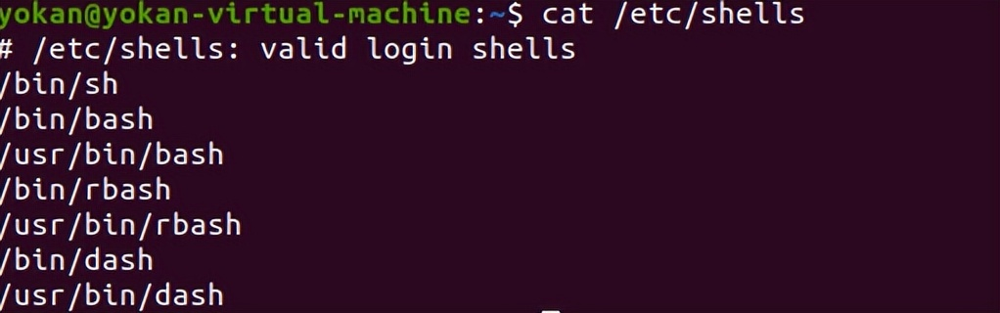

# 4、环境信息

```
env 显示所有的环境变量
set 显示本地环境变量
echo $PATH 环境变量中的路径信息
export [-fnp][变量名称]=[变量设置值] 显示和设置环境变量
pwd 输出工作目录
cat /etc/profile 显示默认系统变量
cat /etc/shells 显示可用的shell
ls -la /etc/*.conf 查看etc下所有配置文件
```


