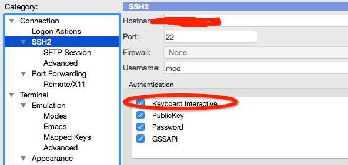
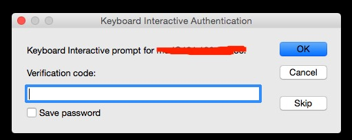

# SSH 谷歌验证码登录

为了增强安全需要两步验证(two-factor authentication)。 本文说说如何使用Google Authenticator  + SSH public key 等服务器进行两步验证。

## 依赖关系

| 1 | yum install git pam-devel make gcc-c++ wget -y |

| --- | --- |

## google authenticator

| 1 | yum install google-authenticator |

| --- | --- |

需要先安装EPEL源。或者源码安装，如下：

| 123 | cd google-authenticator/libpam./bootstrap.shmake && make install |

| --- | --- |

## google-authenticator生成密钥信息

| 12345678910111213141516171819202122232425262728293031 | google-authenticator  Do you want authentication tokens to be time-based (y/n) y二维码地址https://[www.google.com/chart?chs=200x200&chld=M|0&cht=qr&chl=](http://www.google.com/chart?chs=200x200&chld=M|0&cht=qr&chl=)<otpauth://totp/root@localhost%3Fsecret%XXXXXXXXXXXXXX>Your new secret key is: XXXXXXXXXXXXYour verification code is 000000紧急码,只能使用一次Your emergency scratch codes are:  80801116  43011118  34981118  88321117  93711113 Do you want me to update your "/root/.google_authenticator" file (y/n) y Do you want to disallow multiple uses of the same authenticationtoken? This restricts you to one login about every 30s, but it increasesyour chances to notice or even prevent man-in-the-middle attacks (y/n) y#每30秒生成一个tokenBy default, tokens are good for 30 seconds and in order to compensate forpossible time-skew between the client and the server, we allow an extratoken before and after the current time. If you experience problems with poortime synchronization, you can increase the window from its defaultsize of 1:30min to about 4min. Do you want to do so (y/n) y If the computer that you are logging into isn't hardened against brute-forcelogin attempts, you can enable rate-limiting for the authentication module.By default, this limits attackers to no more than 3 login attempts every 30s.Do you want to enable rate-limiting (y/n) y |

| --- | --- |

生成的5个一次性紧急验证码，用于紧急情况下，使用过一次后该验证码即失效了。

## 配置ssh使用google authenticator

| 123 | vi /etc/pam.d/sshdauth sufficient pam_google_authenticator.so#auth       include      password-auth |

| --- | --- |

添加一行并注释一行。

| 123456 | vi /etc/ssh/sshd_configPubkeyAuthentication yesChallengeResponseAuthentication yesAuthenticationMethods publickey,keyboard-interactivePasswordAuthentication noUsePAM yes |

| --- | --- |

重启sshd服务。

可能会报如下错误：

Starting sshd: /etc/ssh/sshd_config: line 89: Bad configuration option: AuthenticationMethods
/etc/ssh/sshd_config: terminating, 1 bad configuration options

是由于OpenSSH 版本6.2以上才支持AuthenticationMethods。需要改成下面的参数：

RequiredAuthentications2 publickey,keyboard-interactive

## 手机端安装Google authenticator

Andorid版   <https://play.google.com/store/apps/details?id=com.google.android.apps.authenticator2>

iOS版   <https://itunes.apple.com/cn/app/google-authenticator/id388497605>

手机端打开google 身份验证器,扫二维码或者输入secret key

也可以安装chrome的google authenticator扩展。

ssh登录服务器就会提示你输入Verification code:

## secureCRT设置keyboard interactive需要放在第一位。注意：使用password + google authenticator，如果使用公钥登录的话，会跳过google authenticator验证直接登录服务器的。
