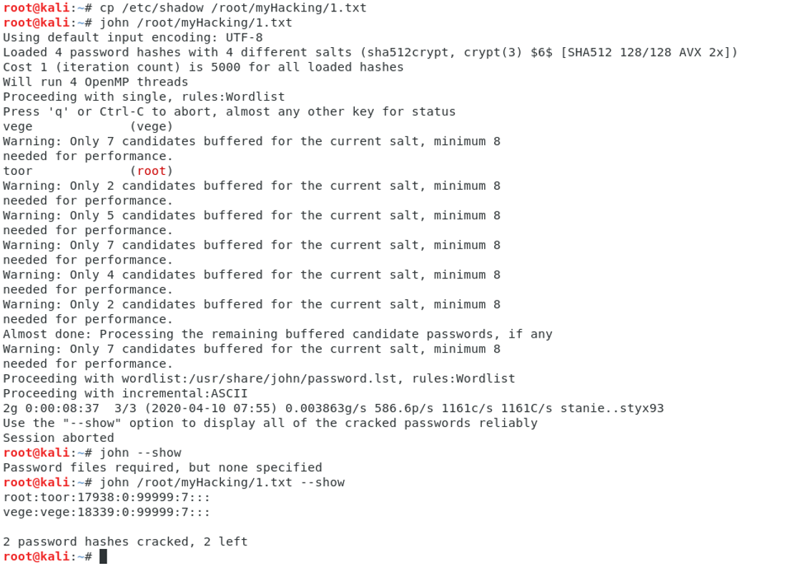

# SSH密码爆破-John the rapper破解

> GitHub 仓库源文件：[点击打开网页渲染版](https://github.com/ben2023niao/ben-ops-notes/blob/main/doc/md/202304141557-%E5%AE%89%E5%85%A8%E4%B8%8E%E5%A0%A1%E5%9E%92%E6%9C%BA%2B%E5%AE%89%E5%85%A8%E8%BF%90%E7%BB%B4%2B%E7%9F%A5%E8%AF%86%E7%AC%94%E8%AE%B0-SSH%E5%AF%86%E7%A0%81%E7%88%86%E7%A0%B4-John%20the%20rapper%E7%A0%B4%E8%A7%A3.md)

```
cp /etc/shadow shadow.txt //直接保存shadow文件
unshadow /etc/passwd /etc/shadow >shadow.txt //如果有unshadow的话，也可以把这两个文件整合

john --wordlist=pass.txt shadow.txt //利用字典进行破解
john --show shadow.txt //查看破解信息
```


