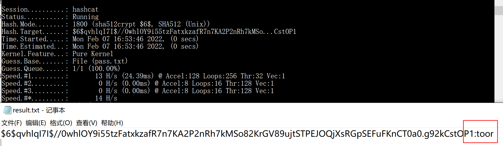
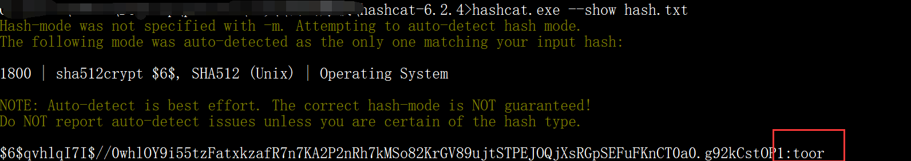

# SSH密码爆破-hashcat破解（大字典推荐使用hashcat)

> GitHub 仓库源文件：[点击打开网页渲染版](https://github.com/ben2023niao/ben-ops-notes/blob/main/doc/md/202304141557-%E5%AE%89%E5%85%A8%E4%B8%8E%E5%A0%A1%E5%9E%92%E6%9C%BA%2B%E5%AE%89%E5%85%A8%E8%BF%90%E7%BB%B4%2B%E7%9F%A5%E8%AF%86%E7%AC%94%E8%AE%B0-SSH%E5%AF%86%E7%A0%81%E7%88%86%E7%A0%B4-hashcat%E7%A0%B4%E8%A7%A3%EF%BC%88%E5%A4%A7%E5%AD%97%E5%85%B8%E6%8E%A8%E8%8D%90%E4%BD%BF%E7%94%A8hashcat%29.md)

> hashcat的使用可以看这篇文章<https://xz.aliyun.com/t/4008>

将/etc/shadow文件，提取密码字段保存hash.txt

```
$6$qvhlqI7I$//0whlOY9i55tzFatxkzafR7n7KA2P2nRh7kMSo82KrGV89ujtSTPEJOQjXsRGpSEFuFKnCT0a0.g92kCstOP1
```

```
hashcat -m 1800 -a 0 -o result.txt hash.txt pass.txt --force

-m 是指定那种加密类型，1800是SHA-512(Unix)的代号，具体–help来查看；
-a  是指定攻击模式,0代表Straight模式,使用字典进行破解尝试;
-o 是破解出来的信息输出结果文件,输出到found.txt文件中;
hash.txt 是我们上面保存的加密密码文件；
pass.txt 是我们的爆破密码，越大越精越好；
--force 忽略破解过程中的警告信息,跑单条hash可能需要加上此选项
```


也可以使用**hashcat hash --show**来显示结果


