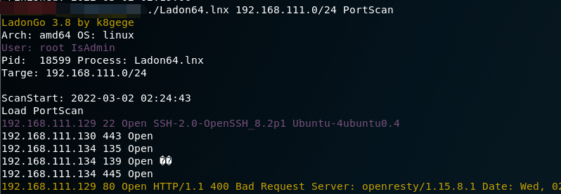

# 端口扫描

> GitHub 仓库源文件：[点击打开网页渲染版](https://github.com/ben2023niao/ben-ops-notes/blob/main/doc/md/202304141557-%E5%AE%89%E5%85%A8%E4%B8%8E%E5%A0%A1%E5%9E%92%E6%9C%BA%2B%E5%AE%89%E5%85%A8%E8%BF%90%E7%BB%B4%2B%E7%9F%A5%E8%AF%86%E7%AC%94%E8%AE%B0-%E7%AB%AF%E5%8F%A3%E6%89%AB%E6%8F%8F.md)

就正常端口扫描，没什么好说的。针对高危端口，按照渗透测试流程进行渗透，这里就不具体展开了。

常用比如Ladon、fscan等等

<https://github.com/k8gege/LadonGo>

