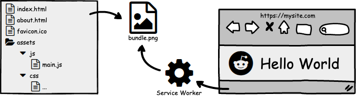
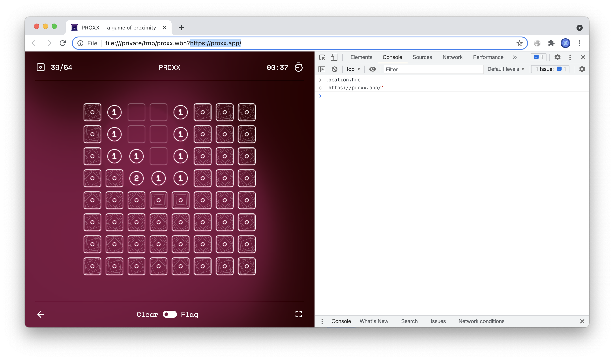
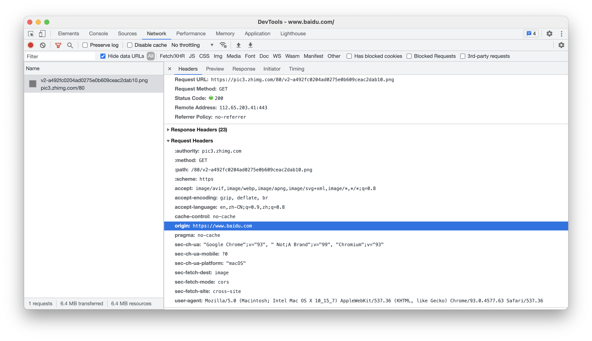
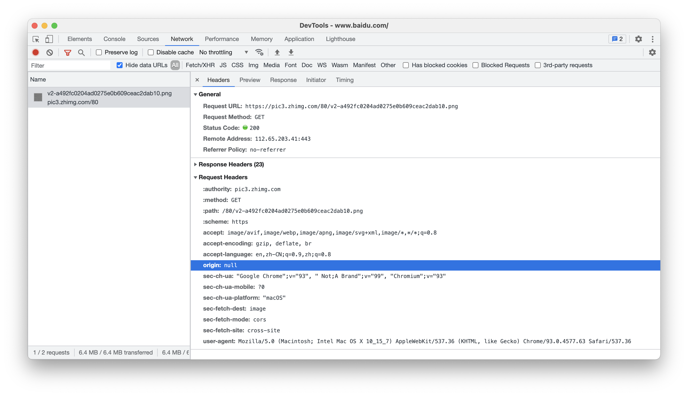

# 免费 CDN 玩法 —— 将整个网站打包成一个图片文件

## 演示 GitHub: [https://etherdream.github.io/web2img](https://etherdream.github.io/web2img/)

Web2Img 是一个将你的 web 文件捆绑到单个图像中的工具，并在运行时通过 Service Worker 提取它们。

您可以将图像托管站点用作免费 CDN，以节省带宽成本。

## 资源合并

前端开发者都知道，过多的请求对性能影响很大。而且有些 CDN 不仅按流量收费，请求数也收费，如果网页里有大量小文件，显然不划算。

为此不少开发者将零碎的小文件进行合并优化，例如 JS/CSS 合并在一起，图片合并成精灵图等。

不过传统的合并方式有一定的局限性，只能合并同类型的文件。例如 JS、CSS 等文本格式的数据可以合并，但 JS 和图片显然无法合并，毕竟一个是文本格式，一个是二进制格式。而且合并过程需对现有资源进行修改，最终发布的文件与原始文件差异很大。

有没有什么办法，可将任何类型的资源并成在一起，并且不改变原始文件？

## 类似方案

Google 推出了一个 `Web Bundles` 方案，可将任意类型的资源打包成一个文件：

细节可参考：<https://web.dev/web-bundles/>

不过 `Web Bundles` 注重的是离线分享。如文中所提到，在没有网络的飞机上，可将网页小游戏通过单个文件的方式分享给旁边的人一起玩。

演示可见，通过本地文件打开的网站仍保留原始 URL。

由于 `Web Bundles` 目前仍未正式启用，需在 flags 中手动开启，因此该方案仍无法解决本文提出的问题。

## 通用方案

事实上，我们大可不必关心资源类型，将所有文件都当做二进制文件合并在一起，运行时再通过 JS 提取。

但是，网页里的资源引用的仍是原始 URL，例如 ``。怎样才能让网页使用 JS 提供的数据，而不是从原始 URL 加载？

这就需要借助 HTML5 的一个黑科技 —— Service Worker。它能拦截网页产生的 HTTP 请求，并能控制返回内容。这样即可实现所有资源都从单个文件中提取！

### 初始化

既然要调用 Service Worker，那么是否得修改现有的 HTML 文件，在其中添加脚本？

事实上不需要！用户首次访问时，无论访问哪个路径，后端都返回 Service Worker 安装页；安装完成后页面自动刷新，这时请求即可被 Service Worker 拦截，从而使用资源包中的 HTML 文件。

至于实现其实很简单，使用 `404.html` 即可！

### 免费空间

虽然我们将资源请求数降低到只有 1 个，但流量仍然是存在的。并且任何一个资源更新都得重新下载整个资源包，导致流量成本进一步增长。

有没有什么办法，可大幅降低流量成本？很简单，使用免费 CDN 即可。你可将资源包发布 GitHub、NPM 等空间，然后通过 jsdelivr、unpkg 等免费 CDN 加速。

这样，你的网站只需提供 `404.html` 和 sw.js 两个极小的文件即可，其他所有内容都可从免费空间获取！

演示站点：<https://fanhtml5.github.io/>

原始文件：<https://github.com/fanhtml5/test-site> (多个文件，总共数 MB)

发布文件：<https://github.com/fanhtml5/fanhtml5.github.io> (只有两个，压缩后不到 2kB)

### 图片空间

类似 jsdelivr、unpkg 这么好用的免费 CDN 并不多，用在这里太过浪费，作为开发者也不建议过度使用它们。

我们可使用更低廉更广泛的免费空间 —— 各大网站的贴图相册，例如知乎、B 站、简书等文章的贴图，它们不仅支持 CORS，而且允许空 referrer，完全可用于存储数据。

参照之前写的《[利用 canvas 实现数据压缩](https://www.cnblogs.com/index-html/p/canvas_data_compress.html)》文章，我们可将原始数据编码成图片像素，从而可将任意文件写入图片并上传到相册；运行时再解码还原，将原始文件写入 Storage Cache 供 Service Worker 使用。

至于稳定性，可将图片上传到多个站点作冗余。如果加载失败或 Hash 不正确则使用下一个备用图片，从而大幅提升稳定性和安全性。

## 隐私保护

为了尽可能减少隐私泄露，同时防止外链限制，我们可通过 `referrer-policy` 对 referrer 进行隐藏。例如：

```
var img = new Image()
img.crossOrigin = true
img.referrerPolicy = 'no-referrer'
img.src = 'https://pic3.zhimg.com/80/v2-a492fc0204ad0275e0b609ceac2dab10.png'
```

这样请求中就没有 `Referer` 头了。



不过需注意的是，为了能读取图片中的像素数据，必须使用 CORS 模式，即设置 `crossOrigin` 属性。这种模式下请求会出现 `Origin` 头。虽然大部分网站不会使用该头限制外链，但它会泄露你的站点域名。这仍不完美。

为了能隐藏 `Origin` 请求头，这里使用一种简单古老但有效的黑科技 —— 使用无源的页面加载图片，例如通过 Data URI 创建的 iframe：

```html
var iframe = document.createElement('iframe')
iframe.src = `data:text/html,
<script>
  var img = new Image();
  img.crossOrigin = true;
  img.src = 'https://pic3.zhimg.com/80/v2-a492fc0204ad0275e0b609ceac2dab10.png';
</script>
`
document.body.appendChild(iframe)
```

这个方案虽然无法让 `Origin` 请求头消失，但可将其设置为 `null`，从而保护你的站点域名不被泄露。



图片加载完成后，再通过 `postMessage` 将像素数据发送给主页面。这样即可同时隐藏 `Referer` 和 `Origin` 信息，最大程度防止隐私泄露！
