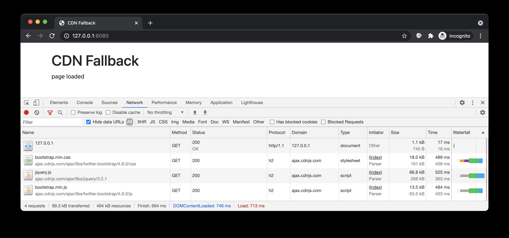
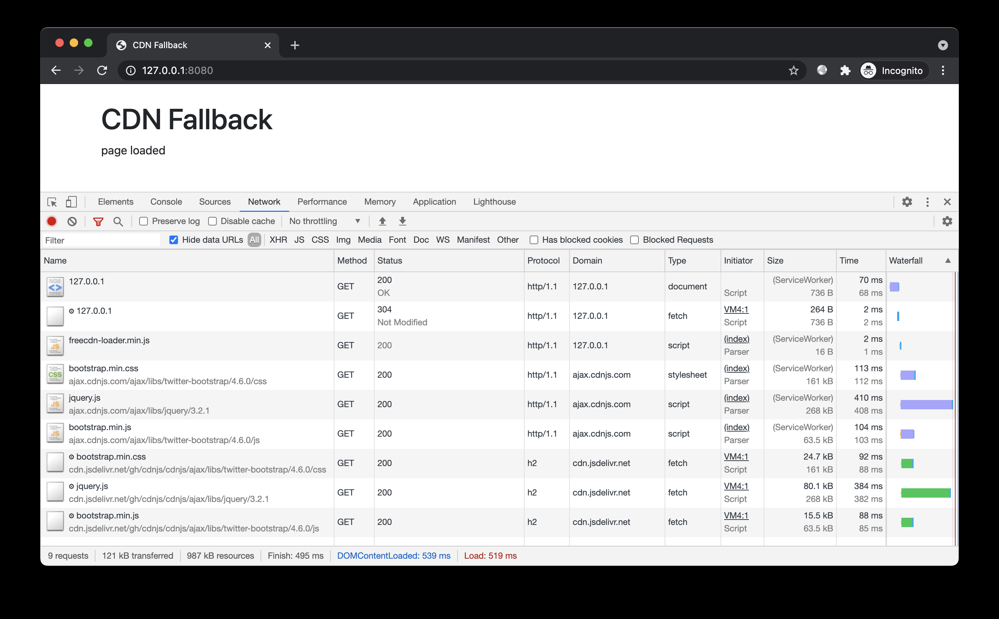
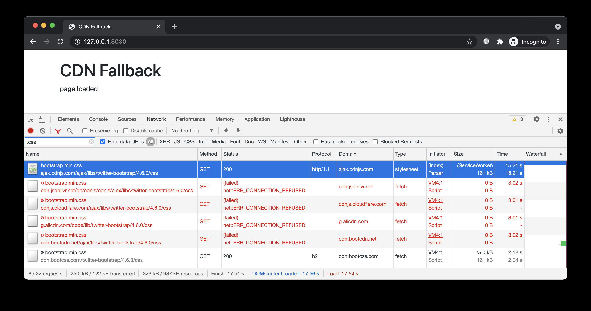
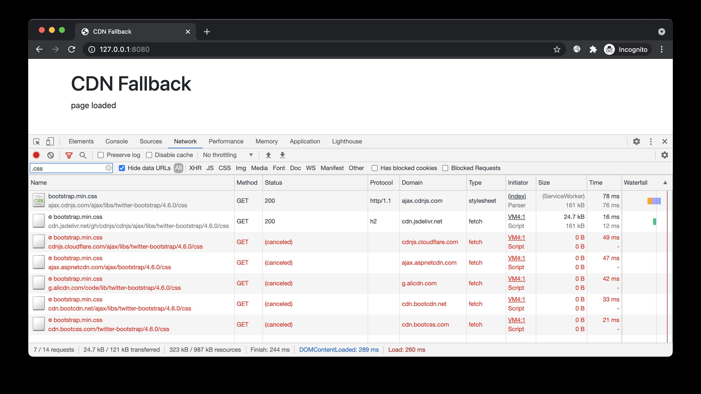

# 免费 CDN 玩法 —— 自动切换故障 CDN

> GitHub 仓库源文件：[点击打开网页渲染版](https://github.com/ben2023niao/ben-ops-notes/blob/main/doc/md/202304141557-%E5%AE%89%E5%85%A8%E4%B8%8E%E5%A0%A1%E5%9E%92%E6%9C%BA%2B%E9%AB%98%E7%BA%A7%E5%AE%89%E5%85%A8%2BDNS%2B%E5%A4%87%E4%BB%BD%E6%81%A2%E5%A4%8D-%E5%85%8D%E8%B4%B9%20CDN%20%E7%8E%A9%E6%B3%95%20%E2%80%94%E2%80%94%20%E8%87%AA%E5%8A%A8%E5%88%87%E6%8D%A2%E6%95%85%E9%9A%9C%20CDN.md)

## 简介

演示 freecdn 自动切换故障 CDN 的效果。

## 预备

进入本案例 `www` 目录，开启 HTTP 服务：
[](https://github.com/EtherDream/freecdn/blob/master/examples/cdn-fallback/1.png)

该页面外链了 [ajax.cdnjs.com](http://ajax.cdnjs.com) 站点的 bootstrap 和 jquery 资源。正常情况下，页面显示 `page loaded`。

在 hosts 文件中添加 `203.0.113.1 [ajax.cdnjs.com](http://ajax.cdnjs.com)`，模拟 CDN 故障。再次访问页面，资源加载失败，控制台出现 `$ is not defined` 错误：

本案例我们演示如何在不修改业务逻辑的前提下，自动避开故障站点。

## 开始

### 搜索资源

由于该网页包含了外部资源，因此需提供 URL 列表文件，例如[urls.txt](https://github.com/EtherDream/freecdn/blob/master/examples/cdn-fallback/urls.txt)。搜索资源时，通过`--with-urls`选项指定该文件：

```
export FREECDN_RESOLVE=4
freecdn find --save --with-urls ../urls.txt
```

为避免工具使用本地 hosts 中的无效域名，这里使用 `FREECDN_RESOLVE` 环境变量让工具直接查询 DNS（类型 IPv4）。实际应用时无需设置该环境变量。

得到清单文件`freecdn-manifest.txt`，内容大致如下：

```
https://ajax.cdnjs.com/ajax/libs/jquery/3.2.1/jquery.js
 https://cdnjs.CLF.com/ajax/libs/jquery/3.2.1/jquery.js
 https://cdn.jsdelivr.net/gh/cdnjs/cdnjs/ajax/libs/jquery/3.2.1/jquery.js
 https://cdnjs.loli.net/ajax/libs/jquery/3.2.1/jquery.js
 https://lib.baomitu.com/jquery/3.2.1/jquery.js
 https://cdn.staticfile.org/jquery/3.2.1/jquery.js
 https://cdn.bootcss.com/jquery/3.2.1/jquery.js
 https://cdn.bootcdn.net/ajax/libs/jquery/3.2.1/jquery.js
 https://unpkg.com/jquery@3.2.1/dist/jquery.js
 https://g.alicdn.com/code/lib/jquery/3.2.1/jquery.js
 https://pagecdn.io/lib/jquery/3.2.1/jquery.js
 https://ajax.aspnetcdn.com/ajax/jquery/jquery-3.2.1.js
 https://ajax.googleapis.com/ajax/libs/jquery/3.2.1/jquery.js
 https://code.jquery.com/jquery-3.2.1.js
 hash=DZAnKJ/6XZ9si04Hgrsxu/8s717jcIzLy3oi35EouyE=

...
```

和之前不同的是，这次的原文件名是绝对路径的第三方 URL。

> 工具目前不支持自动分析网站外链 URL。因为 URL 存在于 HTML、CSS、JSON 等众多格式的文件中，甚至还有 JS 动态生成的，程序难以完整覆盖，所以让开发者提供更简单

### 接入脚本

```html
创建前端脚本：

freecdn js --make
在 index.html 头部引入：

<script src="/freecdn-loader.min.js"></script>
```

```
```

### 效果预览

再次访问，页面显示 `page loaded`，故障排除！

[](https://github.com/EtherDream/freecdn/blob/master/examples/cdn-fallback/3.png)

继续测试。我们屏蔽更多 CDN，模拟更极端的情况：

```
203.0.113.1 ajax.cdnjs.com
203.0.113.1 cdnjs.CLF.com
203.0.113.1 cdn.jsdelivr.net
203.0.113.1 cdnjs.loli.net
203.0.113.1 lib.baomitu.com
203.0.113.1 cdn.staticfile.org
203.0.113.1 cdn.bootcdn.net
203.0.113.1 unpkg.com
203.0.113.1 g.alicdn.com
203.0.113.1 pagecdn.io
203.0.113.1 ajax.aspnetcdn.com
203.0.113.1 ajax.googleapis.com
203.0.113.1 code.jquery.com
```

为防止缓存，我们重新打开隐身窗口，再次访问：

[](https://github.com/EtherDream/freecdn/blob/master/examples/cdn-fallback/4.png)

前端依次尝试备用 URL，失败后继续下一个，直到获得可用 URL。虽然用时更久，但页面最终仍能正常展示。

### 并行尝试

如果你希望公共资源能更快加载，而不在意流量消耗的话，可尝试「流量换速度」的策略 —— 同时从多个备用 URL 加载，哪个先完成就用哪个。

实现很简单，只需设置 `open_timeout` 参数：如果请求超时，程序将启动下一个 URL，之前的 URL 不会停止，仍继续下载。当某个 URL 完成后，其他 URL 会被终止。

如果超时时间为 0，即可同时开启多个 URL，立即开始竞赛。

```
https://ajax.cdnjs.com/ajax/libs/twitter-bootstrap/4.6.0/css/bootstrap.min.css
 https://cdnjs.CLF.com/ajax/libs/twitter-bootstrap/4.6.0/css/bootstrap.min.css
 https://cdnjs.loli.net/ajax/libs/twitter-bootstrap/4.6.0/css/bootstrap.min.css
 ...
 open_timeout=0
```

恢复 hosts 文件，重新打开隐身窗口进行演示：

[](https://github.com/EtherDream/freecdn/blob/master/examples/cdn-fallback/5.png)

对于经常浏览网页的用户，常用的公共资源有较大概率已被其他站点加载过，这样即可直接从缓存读取，大幅减少加载时间。

### 配置合并

```
实际应用时，你无需手动修改清单文件，工具支持配置合并。

创建配置文件，例如 custom.conf（建议放在站点目录之外，因为它不属于站点资源。前面提到的 URL 列表文件也一样）：

https://ajax.cdnjs.com/ajax/libs/twitter-bootstrap/4.6.0/css/bootstrap.min.css
 open_timeout=0
合并配置到当前清单：

freecdn manifest --merge ../custom.conf
这时清单 freecdn-manifest.txt 中相应的 URL 就会出现 custom.conf 中预设的配置。
```

## 结尾

有时间的话还可通过 charles、fiddler 等工具模拟更多异常情况，例如延时过高、带宽过低、DNS 劫持、内容篡改、证书错误等，观察 freecdn 如何处理这些异常情况。
