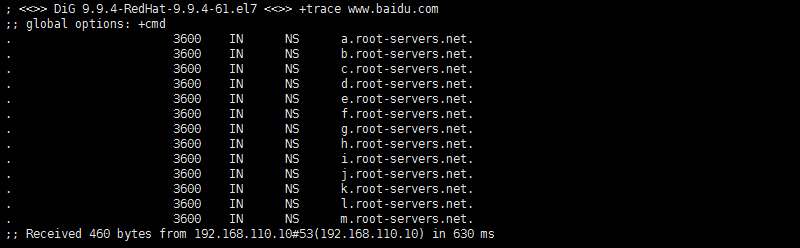
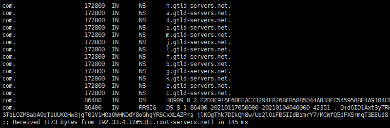
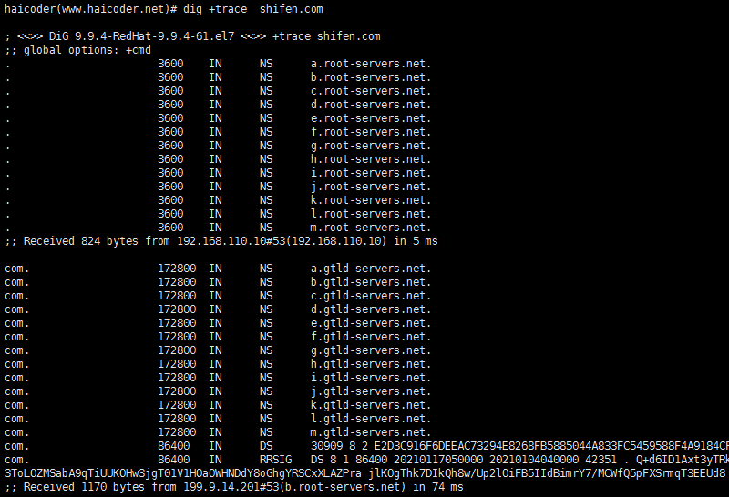
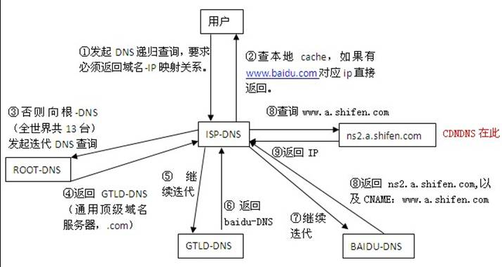
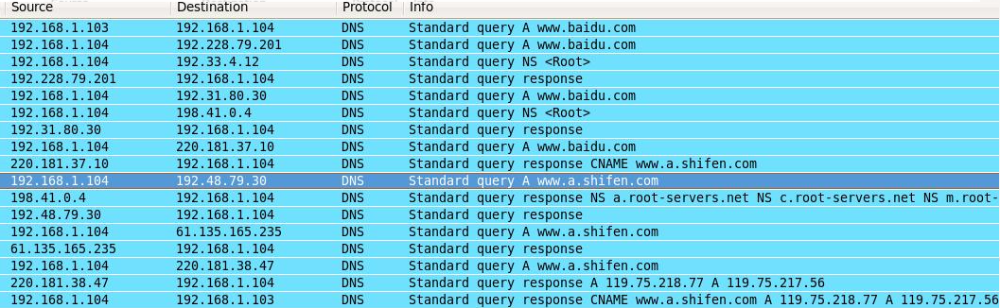
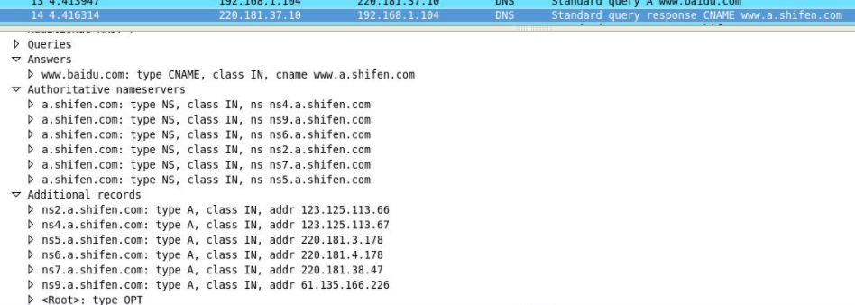

# DNS域名解析过程

> GitHub 仓库源文件：[点击打开网页渲染版](https://github.com/ben2023niao/ben-ops-notes/blob/main/doc/md/202304141557-%E5%AE%89%E5%85%A8%E4%B8%8E%E5%A0%A1%E5%9E%92%E6%9C%BA%2B%E9%AB%98%E7%BA%A7%E5%AE%89%E5%85%A8%2BDNS%2B%E7%9F%A5%E8%AF%86%E7%AC%94%E8%AE%B0-DNS%E5%9F%9F%E5%90%8D%E8%A7%A3%E6%9E%90%E8%BF%87%E7%A8%8B.md)

## DNS基本概念

### 根域

就是所谓的 “.”，其实我们的网址 `[www.baidu.com](http://www.baidu.com)` 在配置当中应该是 `[www.baidu.com](http://www.baidu.com)`.（最后有一点），一般我们在浏览器里输入时会省略后面的点，而这也已经成为了习惯。根域服务器我们知道有 13 台，但是这是错误的观点。

根域服务器只是具有 13 个 IP 地址，但机器数量却不是 13 台，因为这些 IP 地址借助了任播的技术，所以我们可以在全球设立这些 IP 的镜像站点，你访问到的这个 IP 并不是唯一的那台主机。

### 域的划分

根域下来就是顶级域或者叫一级域，有两种划分方式，一种互联网刚兴起时的按照行业性质划分的 com.，net. 等，一种是按国家划分的如 cn.，jp.，等。具体多少你可以自己去查，我们这里不关心。

每个域都会有域名服务器，也叫权威域名服务器。[Baidu.com](http://Baidu.com) 就是一个顶级域名，而 `[www.baidu.com](http://www.baidu.com)` 却不是顶级域名，他是在 [baidu.com](http://baidu.com) 这个域里的一叫做 www 的主机。

一级域之后还有二级域，三级域，只要我买了一个顶级域，并且我搭建了自己 BIND 服务器（或者其他软件搭建的）注册到互联网中，那么我就可以随意在前面多加几个域了（当然长度是有限制的）。

比如 a.`[www.baidu.com](http://www.baidu.com)`，在这个网址中，`[www.baidu.com](http://www.baidu.com)` 变成了一个二级域而不是一台主机，主机名是 a。

### 域名服务器

能提供域名解析的服务器，上面的记录类型可以是 A(address)记录，NS 记录（name server），MX（mail），CNAME 等。

A 记录是什么意思呢，就是记录一个 IP 地址和一个主机名字，比如我这个域名服务器所在的域 [test.baidu.com](http://test.baidu.com)，我们知道这是一个二级的域名，然后我在里面有一条 A 记录,记录了主机为 a 的 IP，查到了就返回给你了。

如果我现在要想 [baidu.com](http://baidu.com) 这个域名服务器查询 [a.test.baidu.com](http://a.test.baidu.com)，那么这个顶级域名服务器就会发现你请求的这个网址在 [test.baidu.com](http://test.baidu.com) 这个域中，我这里记录了这个二级域的域名服务器 [test.baidu.com](http://test.baidu.com) 的 NS 的 IP。我返回给你这个地址你再去查主机为 a 的主机把。

这些域内的域名服务器都称为权威服务器，直接提供 DNS 查询服务。（这些服务器可不会做递归哦）

## DNS解析过程

那么我们的 DNS 是怎么解析一个域名的呢？

1. 现在我有一台计算机，通过 ISP 接入了互联网，那么 ISP 就会给我分配一个 DNS 服务器，这个 DNS 服务器不是权威服务器，而是相当于一个代理的 dns 解析服务器，他会帮你迭代权威服务器返回的应答，然后把最终查到 IP 返回给你。
2. 现在的我计算机要向这台 ISPDNS 发起请求查询 `[www.baidu.com](http://www.baidu.com)` 这个域名了，(这里其实准确来说不是 ISPDNS，而应该是用户自己电脑网络设置里的 DNS，并不一定是 ISPDNS。比如也有可能你手工设置了 203.0.113.1)。
3. ISPDNS 拿到请求后，先检查一下自己的缓存中有没有这个地址，有的话就直接返回。这个时候拿到的 ip 地址，会被标记为非权威服务器的应答。
4. 如果缓存中没有的话，ISPDNS 会从配置文件里面读取 13 个根域名服务器的地址（这些地址是不变的，直接在 BIND 的配置文件中）。
5. 然后像其中一台发起请求。
6. 根服务器拿到这个请求后，知道他是 com. 这个顶级域名下的，所以就会返回 com 域中的 NS 记录，一般来说是 13 台主机名和 IP。
7. 然后 ISPDNS 向其中一台再次发起请求，com 域的服务器发现你这请求是 [baidu.com](http://baidu.com) 这个域的，我一查发现了这个域的 NS，那我就返回给你，你再去查。（目前百度有 4 台 [baidu.com](http://baidu.com) 的顶级域名服务器）。
8. ISPDNS 不厌其烦的再次向 [baidu.com](http://baidu.com) 这个域的权威服务器发起请求，[baidu.com](http://baidu.com) 收到之后，查了下有 www 的这台主机，就把这个 IP 返回给你了，
9. 然后 ISPDNS 拿到了之后，将其返回给了客户端，并且把这个保存在高速缓存中。

下面我们来用 nslookup 这个工具详细来说一下解析步骤：

从上图我们可以看到:

1. 第一行 Server 是：DNS 服务器的主机名 – 203.0.113.1
2. 第二行A ddress 是： 它的 IP 地址 – 203.0.113.1#53
3. 下面的 Name 是：解析的 URL – `[www.jsjzx.com](http://www.jsjzx.com)`
4. Address 是：解析出来的 IP – 192.168.110

但是也有像百度这样的 DNS 比较复杂的解析:

你会发现百度有一个 cname = `[www.a.shifen.com](http://www.a.shifen.com)` 的别名。这是怎么一个过程呢？我们用 dig 工具来跟踪一下，Dig 工具会在本地计算机做迭代，然后记录查询的过程。

第一步是向我这台机器的 ISPDNS 获取到根域服务区的 13 个 IP 和主机名 [b-j].[root-servers.net](http://root-servers.net).。

第二步是向其中的一台根域服务器（Servername 就是末行小括号里面的）发送 `[www.baidu.com](http://www.baidu.com)` 的查询请求，他返回了 com. 顶级域的服务器 IP（未显示）和名称，

第三步，便向 com. 域的一台服务器 203.0.113.1 请求 `[www.baidu.com](http://www.baidu.com)`，他返回了 [baidu.com](http://baidu.com) 域的服务器 IP（未显示）和名称，百度有四台顶级域的服务器

第四步呢，向百度的顶级域服务器（203.0.113.1）请求 `[www.baidu.com](http://www.baidu.com)`，他发现这个 www 有个别名，而不是一台主机，别名是 `[www.a.shifen.com](http://www.a.shifen.com)`。

按照一般的逻辑，当 dns 请求到别名的时候，查询会终止，而是重新发起查询别名的请求，所以此处应该返回的是 `[www.a.shifen.com](http://www.a.shifen.com)` 而已。但是为什么返回 [a.shifen.com](http://a.shifen.com) 的这个域的 NS 呢？

我们可以尝试下面的这个命令：dig +trace [shifen.com](http://shifen.com) 看看有什么结果：

你会发现第三步时 [shifen.com](http://shifen.com) 这个顶级域的域名服务器和 [baidu.com](http://baidu.com) 这个域的域名服务器是同一台主机（即：[dns.baidu.com](http://dns.baidu.com)）！当我拿到 `[www.baidu.com](http://www.baidu.com)` 的别名 `[www.a.shifen.com](http://www.a.shifen.com)` 的时候，我本来需要重新到 com 域查找 [shifen.com](http://shifen.com) 域的 NS，但是因为这两个域在同一台 NS 上，所以直接向本机发起了，

[shifen.com](http://shifen.com) 域发现请求的 `[www.a.shifen.com](http://www.a.shifen.com)` 是属于 [a.shifen.com](http://a.shifen.com) 这个域的，于是就把 [a.shifen.com](http://a.shifen.com) 的这个 NS 和 IP 返回，让我到 [a.shifen.com](http://a.shifen.com) 这个域的域名服务器上查询 `[www.a.shifen.com](http://www.a.shifen.com)`。

于是我便从 ns X .[a.shifen.com](http://a.shifen.com) 中一台拿到了一条 A 记录，最终的最终也便是 `[www.baidu.com](http://www.baidu.com)` 的 IP 地址了。【此处也可以用 dig +trace `[www.a.shifen.com](http://www.a.shifen.com)`】跟踪一下，用一个图来说明一下(图中第三步的全世界只有 13 台是错误的)

以下内容为在虚拟机中搭建 local dns 服务器得到的实验数据，纠正上述结论。在上面的分析中，我们用 dig 工具进行了追踪，但是 dig 没有继续追踪当我们从 [baidu.com](http://baidu.com) 拿到 cname 和 [ns2.a.shifen.com](http://ns2.a.shifen.com) 的 IP 之后的事情。

我们就所以然的下结论认为 local dns 会向 [ns2.a.shifen.com](http://ns2.a.shifen.com) 请求 `[www.a.shifen.com](http://www.a.shifen.com)`。其实这个想法是错误，在自己的本地搭建一个 local dns，抓取整个解析过程中是所有包，看看就明白拉。

实际的结果是虽然 [dns.baidu.com](http://dns.baidu.com) 返回了 [a.shifen.com](http://a.shifen.com) 域的服务器地址和 IP，但是 local dns 并不是直接向上述返回的 IP 请求 `[www.a.shifen.com](http://www.a.shifen.com)`，而是再一次去请求 com 域，得到 [shifen.com](http://shifen.com) 域的服务器（也就是 [baidu.com](http://baidu.com) 的那四台），然后又请求 `[www.a.shifen.com](http://www.a.shifen.com)`，返回 [a.shifen.com](http://a.shifen.com) 的域的服务器，最后才是去请求 `[www.a.shifen.com](http://www.a.shifen.com)`，

虽然上面已经返回了 IP，但是实验的结果就是再走一遍 [shifen.com](http://shifen.com) 域的查询。

上图就是 localdns 在解析 `[www.baidu.com](http://www.baidu.com)` 的抓包全过程。蓝色那条就是在收到 cname 和响应的 [a.shifen.com](http://a.shifen.com) 的域名服务器 IP 地址之后，继续向 com 域请求 [shifen.com](http://shifen.com)。

这个图充分说明了返回 cname 的同时也返回了 [ns2.a.shifen.com](http://ns2.a.shifen.com) 的 IP。

## 相关术语

| 类型 | 编码 | 内容 |

| --- | --- | --- |

| A | 1 | 将 DNS 域名映射到 IPv4 地址，基本作用是说明一个域名对应了哪些 IPv4 地址 |

| NS | 2 | 权威名称服务器记录，用于说明这个区域有哪些 DNS 服务器负责解析 |

| CNAME | 5 | 别名记录，主机别名对应的规范名称 |

| SOA | 6 | 起始授权机构记录，NS 记录说明了有多台服务器在进行解析，但哪一个才是主服务器，NS 并没有说明，SOA 记录了说明在众多 NS 记录里哪一台才是主要的服务器 |

| PTR | 12 | IP 地址反向解析，是 A 记录的逆向记录，作用是把 IP 地址解析为域名 |

| MX | 15 | 邮件交换记录，指定负责接收和发送到域中的电子邮件的主机 |

| TXT | 16 | 文本资源记录，用来为某个主机名或域名设置的说明 |

| AAAA | 28 | 将 DNS 域名映射到 IPv6 地址，基本作用是说明一个域名对应了哪些 IPv6 地址 |

## 总结

因此总结一下便是：

1. 本机向 local dns 请求 `[www.baidu.com](http://www.baidu.com)`
2. local dns 向根域请求 `[www.baidu.com](http://www.baidu.com)`，根域返回 com. 域的服务器 IP
3. 向 com. 域请求 `[www.baidu.com](http://www.baidu.com)`，com. 域返回 [baidu.com](http://baidu.com) 域的服务器 IP
4. 向 [baidu.com](http://baidu.com) 请求 `[www.baidu.com](http://www.baidu.com)`，返回 cname `[www.a.shifen.com](http://www.a.shifen.com)` 和 [a.shifen.com](http://a.shifen.com) 域的服务器 IP
5. 向 root 域请求 `[www.a.shifen.com](http://www.a.shifen.com)`
6. 向 com. 域请求 `[www.a.shifenc.om](http://www.a.shifenc.om)`
7. 向 [shifen.com](http://shifen.com) 请求
8. 向 [a.shifen.com](http://a.shifen.com) 域请求
9. 拿到 `[www.a.shifen.com](http://www.a.shifen.com)` 的 IP
10. local dns 返回本机 `[www.baidu.com](http://www.baidu.com)` cname `[www.a.shifen.com](http://www.a.shifen.com)` 以及 `[www.a.shifen.com](http://www.a.shifen.com)` 的 IP
