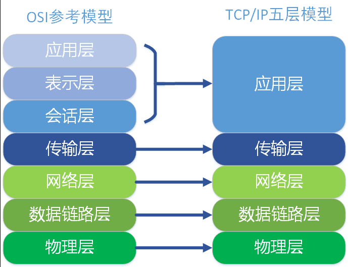
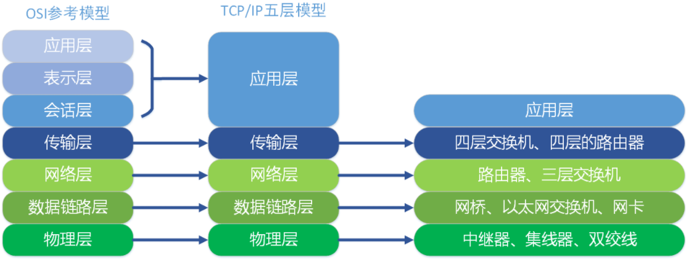
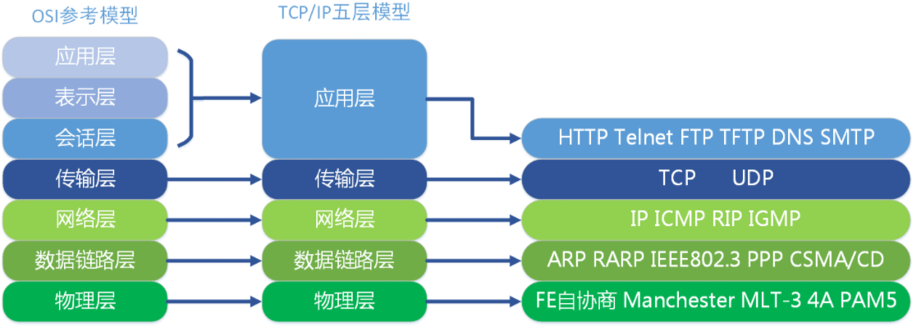
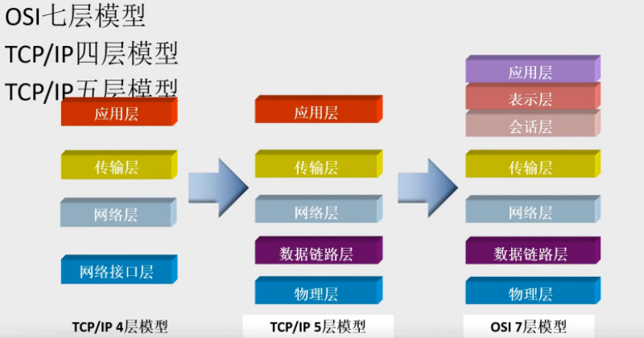
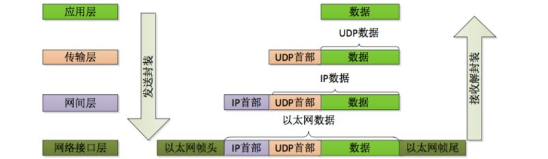
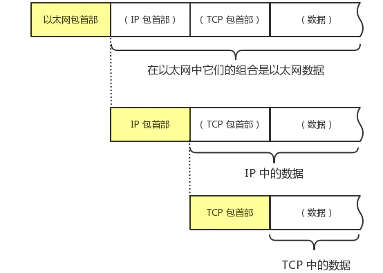

# TCP/IP四层模型

## TCP/IP四层模型

TCP/IP 四层模型包括网络接口层、网络层、传输层和应用层。数据链路层包括操作系统中的设备驱动程序、计算机中对应的网络接口卡，网络层包括处理分组在网络中的活动，比如分组的选路。

传输层主要为两台主机上的应用提供端到端的通信，应用层负责处理特定的应用程序细节。

## TCP/IP五层模型

TCP/IP 是事实标准，分 4 层。**[OSI 模型](https://haicoder.net/http/http-osi.html)** 是国际标准，分 7 层。讲课的时候，一般把他们综合起来讲，就说是 5 层。他把网络接口层分开为数据链路层和物理层了。也就说说 TCP/IP 五层模型包括物理层、数据链路层、网络层、传输层和应用层。

TCP/IP 五层协议和 OSI 的七层协议对应关系如下：

在每一层都工作着不同的设备，比如我们常用的交换机就工作在数据链路层的，一般的路由器是工作在网络层的：

在每一层实现的协议也各不同，即每一层的服务也不同。下图列出了每层主要的协议：

## OSI七层TCP/IP四层与五层

OSI 七层模型与 TCP/IP 的四层以及 TCP/IP 的五层模型对应关系，如下图所示：

## TCP/IP四层模型详解

### 网络接口层

#### 作用

1. 实现网卡接口的网络驱动，以处理数据在以太网线等物理媒介上的传输。
2. 网络驱动程序隐藏了不同物理网络的不同电气特性，为上层协议提供一个统一的接口。

#### 协议应用

ARP 和 RARP(Reverse Address Resolve Protocol)即逆地址解析协议，该协议实现了 IP 地址和物理地址(MAC 地址)之间的转换。

### 网络层

#### 作用

网络有分局域网(LAN, Local Area Network)和广域网(WAN, Wide Area Network)。对于后者通常需要使用众多分级的路由器来连接分散的主机或者 LAN，即通讯的两台主机一般不是直接连接，而是通过多个中间节点(路由器)连接的，从而形成网络拓扑连接。

1. 网络层的任务之一就是选择这些中间节点，以确定两台主机间的通讯路径。
2. 其次网络层对上层协议隐藏了网络拓扑连接的细节，在使得传输层看来通讯双方是直接连接的。

#### 协议应用

IP 协议: IP 协议(Internet Protocol)是网络层最核心的协议，它根据数据包的目的 IP 地址来决定如何投递该数据包。若数据包不可直接发送给目标主机，那么 IP 协议就为它寻找一个合适的下一跳路由器，并将数据包交付给该路由器去转发，如此循环直至到达目标主机或者发送失败而丢弃该数据包。

ICMP 协议: ICMP 协议(Internet Control Message Protocol，因特网控制报文协议)是 IP 协议的补充，用于检测网络的连接状态，如 ping 应用程序就是 ICMP 协议的使用。ICMP 包发送是不可靠的，所以不能依靠接收 ICMP 包解决网络问题；ICMP 与 TCP/UDP 不同，它们是传输层协议，虽然都具有类型域和代码域，但是前者和后者不同，ping 用到的 ICMP 协议，不是端口。ICMP 协议使用的是 IP 协议而非使用下层协议提供的的服务，所以严格来讲它并非网络层协议，而是网络层程序。

### 传输层

#### 作用

传输层的作用是为应用程序提供端对端通讯的 ”错觉”，即为应用程序隐藏了数据包跳转的细节，负责数据包的收发、链路超时重连等。

#### 协议应用

TCP 协议: TCP 协议(Transmission Control Protocol, 传输控制协议)为应用程序提供可靠的、面向连接的、基于流的服务，具有超时重传、数据确认等方式来确保数据包被正确发送到目的端。因此 TCP 服务是可靠的，使用 TCP 协议通讯的双方必须先建立起 TCP 连接，并在系统内核中为该连接维持一些必要的数据结构，比如连接的状态，读写缓冲区，多个定时器等。当通讯结束时双方必须关闭连接以释放这些内核数据。基于流发送意思是数据是没有长度限制，它可源源不断地从通讯的一段流入另一端。

UDP 协议: UDP 协议(User Datagram Protocol, 用户数据报协议)与 TCP 协议相反，它为应用程序提供的是不可靠的、无连接的基于数据报的服务。

无连接: 通讯双方不保持一个长久的联系，因此应用程序每次发送数据都要明确指定接收方的地址；

基于数据报的服务: 这是相对于数据流而言的，每个 UDP 数据报都有一个长度，接收端必须以该长度为最小单位将其内容一次性读出，否则数据将被截断。UDP 不具有发送时是被重发功能，所以 UDP 协议在内核实现中无需为应用程序的数据保存副本，当 UDP 数据报被成功发送之后，UDP 内核缓冲区中该数据报就被丢弃了。

SCTP 协议: SCTP(Stream Control Transmission Protocol, 流控制传输协议)是为了在因特网上传输电话信号而设计的。

### 应用层

#### 作用

前面所述的三层负责处理网络通讯的相关细节，这部分需要稳定高效，因此它们是在操作系统的内核空间中，而应用层是在用户空间实现的，负责处理众多业务逻辑，如文件传输、网络管理。

#### 协议应用

telne 协议: 远程登录协议，它使我们能在本地完成远程任务。

OSPF 协议: OSPF 协议(Open Shorttest Path First, 开放最短路径优先)是一种动态路由更新协议，用于路由器之间的通讯，以告知对方自身的路由信息。

DNS协议: DNS 协议(Domain Name Service, 域名服务)提供机器域名到 IP 地址的转换。另外注意，ping 是应用程序而非协议，它利用网络层的 ICMP 协议监测网络连接。

应用层协议可以跳过传输层直接使用网络层提供的服务，比如 ping 程序和 OSPF 协议；又可以既使用 TCP 服务，又可以使用 UDP 服务，如 DNS 协议。

## 四层模型传输数据过程

TCP/IP 四层模型数据传输过程如下：

TCP 传输过程如下：

## TCP/IP四层模型总结

第一层：应用层，主要有负责 web 浏览器的 HTTP 协议， 文件传输的 FTP 协议，负责电子邮件的 SMTP 协议，负责域名系统的 DNS 等。

第二层：传输层，主要是有可靠传输的 TCP 协议，特别高效的 UDP 协议。主要负责传输应用层的数据包。

第三层：网络层，主要是 IP 协议。主要负责寻址（找到目标设备的位置）。

第四层：数据链路层，主要是负责转换数字信号和物理二进制信号。
