# 某虚拟币项目被黑排查

> GitHub 仓库源文件：[点击打开网页渲染版](https://github.com/ben2023niao/ben-ops-notes/blob/main/doc/md/202304141557-%E5%AE%89%E5%85%A8%E4%B8%8E%E5%A0%A1%E5%9E%92%E6%9C%BA%2B%E9%AB%98%E7%BA%A7%E5%AE%89%E5%85%A8%2BJava%2B%E6%BC%8F%E6%B4%9E-%E6%9F%90%E8%99%9A%E6%8B%9F%E5%B8%81%E9%A1%B9%E7%9B%AE%E8%A2%AB%E9%BB%91%E6%8E%92%E6%9F%A5.md)

问题描述
通过第三方平台上传线上服务器的Jar包，众多安全厂家分析结果报告中， 结算2的listener-inner 和 admin-api 纸飞机相关java服务jar包有一下问题：

1. 结算2 listener-inner：
jar包检测结果<https://www.virustotal.com/gui/file/5628a8dfc39dace08af7e6a13f170546b54537bbf45c9ea371d7973775b17aa8/relations>

检测报告中指出，计算2的listener-inner服务连接了三个异常ip：
203.0.113.1
203.0.113.1
203.0.113.1

我们的代码逻辑只请求波场域名获取链上的交易数据，波场当前域名解析以及历史域名解析记录中没有以上三个异常ip

以下是波场域名解析记录
<https://site.ip138.com/api.trongrid.io/>

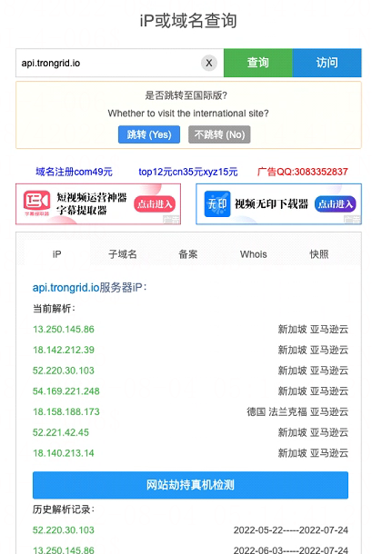

对三个ip继续追查得到了以下信息：
<https://www.virustotal.com/gui/ip-address/203.0.113.1/details>

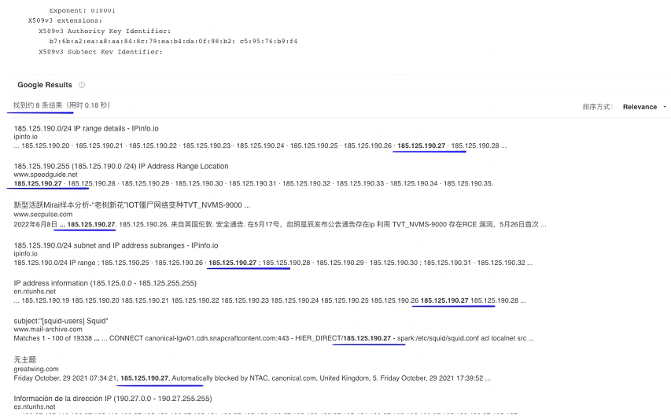
google找到以上8条对改ip搜索的记录以及问题排查的记录
在安全脉搏上找到以上3个异常ip的记录以及对此漏洞的描述以及详细的漏洞攻击复现过程和结果
<https://www.secpulse.com/archives/180578.html>

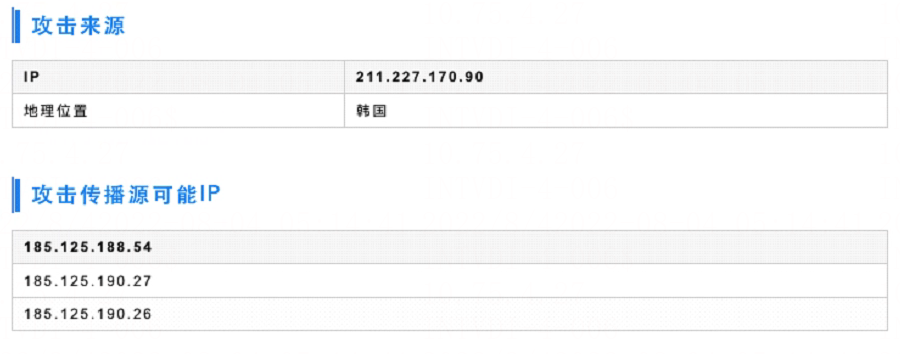
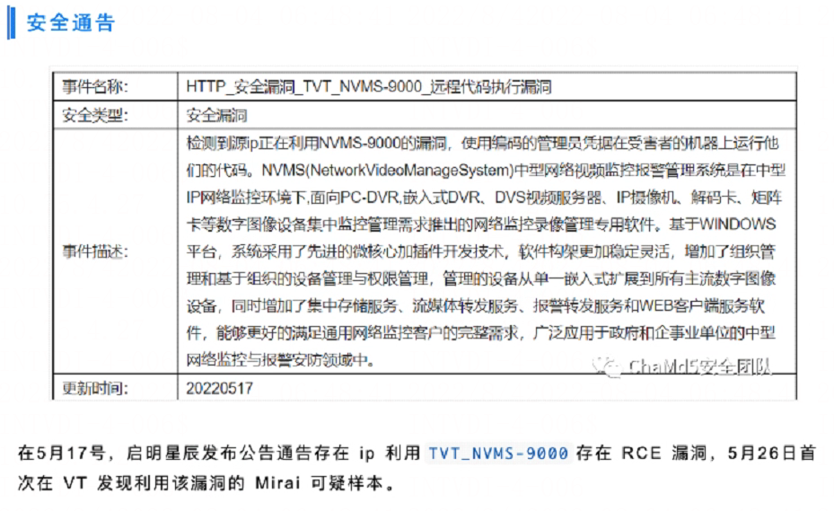

2. 纸飞机服务 admin-api
jar包检测结果:
<https://www.virustotal.com/gui/file/ab272542c7853a5025bf7d3104e19114eb7393139b7717090c8ec9b3b93a2bcd/behavior>

结果中显示jar包启动以后在服务器做了以下操作：
⦁ Files Opened 读取了服务器/etc下的大量配置文件
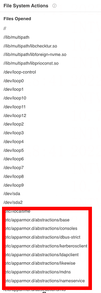
⦁ Files Written 写入服务器/etc下配置文件不明字符串以及对/run /proc /sys 等大量系统文件写入不明内容
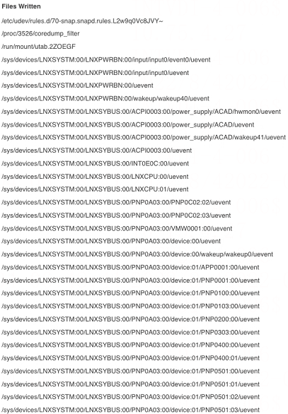

⦁ Files Deleted 删除文件包括 /etc 、run /tmp /var/lib 等大量文件
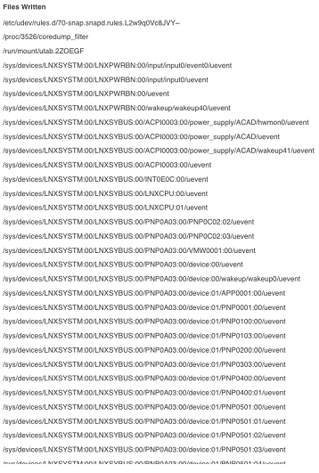

⦁ Files With Modified Attributes 修改系统挂载文件属性

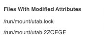

⦁ Files Dropped 销毁/run /sys /tmp /var 等大量文件

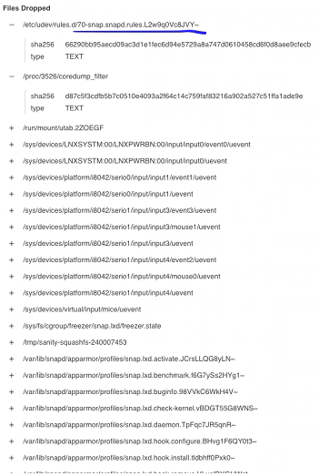

⦁ Process And Service Actions 程序和服务在服务器上执行大量shell命令

运行systemctl udevadm mount systemd udevadm control dumpe2fs /lib/udev/bcache-export-cached /sbin/multipath 等相关系统命令
取消挂载目录 取消挂载目录 运行 /sbin下超级管理员cmd 等操作

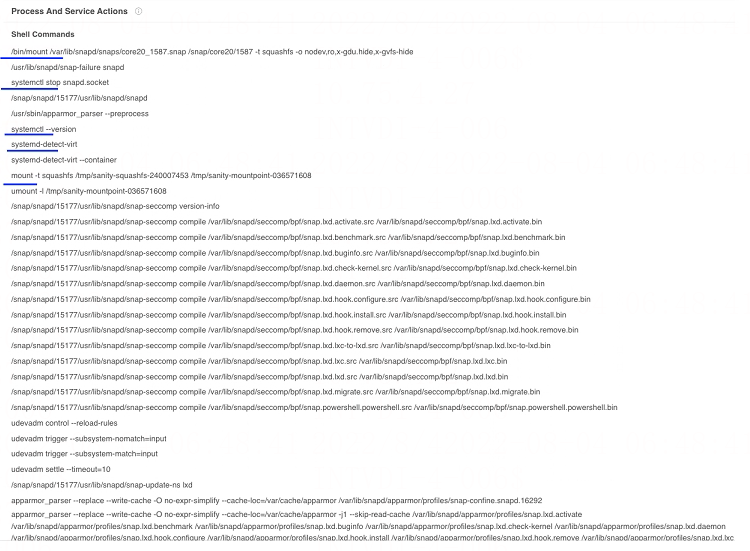

⦁ Services Stopped 停止了 snapd.socket 网络连接socket

⦁ Processes Tree 服务启动后运行的一些进程信息

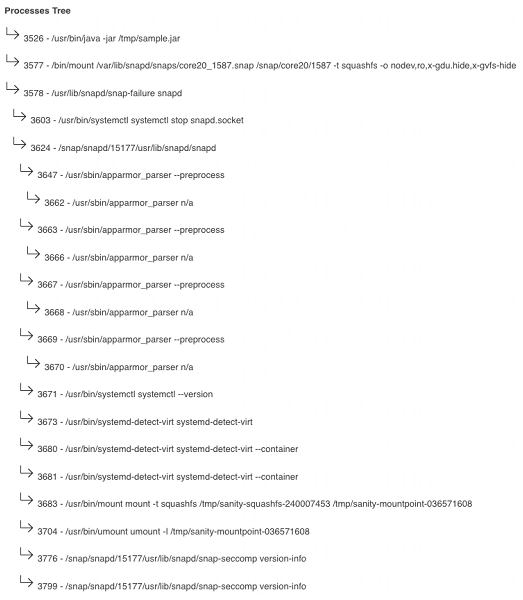

⦁ Highlighted Actions 重点突出的动作
设置服务器网卡ens34网卡
获取当前主机地址，输出到之前设置的网卡ip， 以及一些其他不明操作

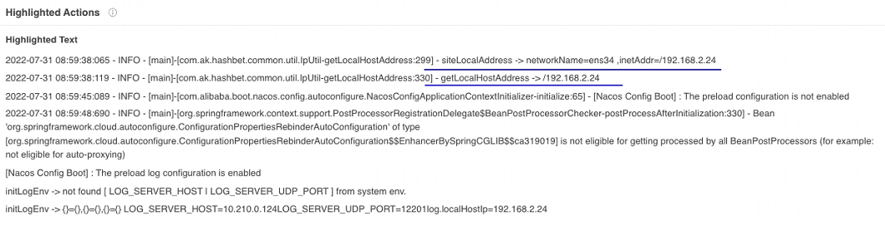

以上连接可以点击查看详细jar包扫描结果、漏洞描述结果、波场域名历史域名解析ip等
