# 显著提高大型 Java 项目启动速度的尝试

> GitHub 仓库源文件：[点击打开网页渲染版](https://github.com/ben2023niao/ben-ops-notes/blob/main/doc/md/202304141557-%E5%AE%89%E5%85%A8%E4%B8%8E%E5%A0%A1%E5%9E%92%E6%9C%BA%2B%E9%AB%98%E7%BA%A7%E5%AE%89%E5%85%A8%2BLinux%2BJava-%E6%98%BE%E8%91%97%E6%8F%90%E9%AB%98%E5%A4%A7%E5%9E%8B%20Java%20%E9%A1%B9%E7%9B%AE%E5%90%AF%E5%8A%A8%E9%80%9F%E5%BA%A6%E7%9A%84%E5%B0%9D%E8%AF%95.md)

原文地址 <https://juejin.cn/post/7117815437559070734>

线上的业务 jar 包基本上普遍比较庞大，动不动一个 jar 包上百 M，启动时间在分钟级，拖慢了我们在故障时快速扩容的响应。于是做了一些分析，看看 Java 程序启动慢到底慢在哪里，如何去优化，目前的效果是大部分大型应用启动时间可以缩短 30%~50%

主要有下面这些内容

- 修改 async-profiler 源码，只抓取启动阶段 main 线程的 wall 时间火焰图（✅）
- 重新实现 JarIndex（✅）
- 结合 JarIndex 重新自定义类加载器，启动提速 30%+（✅）
- SpringBean 加载耗时 timeline 可视化分析（✅）
- SpringBean 的可视化依赖分析（✅）
- 基于依赖拓扑的 SpringBean 的异步加载（❌）

## 优化效果

我们来看下实际的效果，项目 1 稍微小型一点，启动耗时从 70s 降低到 46s

**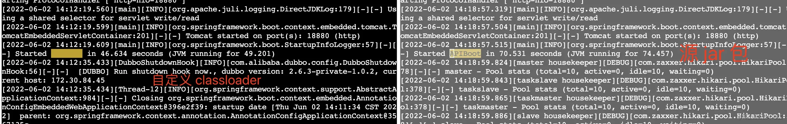**

第二个 jar 包更大一点，效果更明显，启动耗时从 220s 减少到 123s

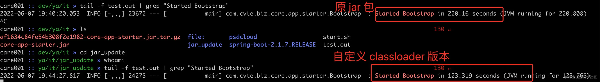

## 无观测不优化

秉承着无观测不优化的想法，首先我们要知道启动慢到底慢在了哪里。我之前分享过很多次关于火焰图的使用，结果很多人遇到问题就开始考虑火焰图，但是一个启动慢其实是一个时序问题，不是一个 hot CPU 热点问题。很多时候慢，不一定是 cpu 占用过高，很有可能是等锁、等 IO 或者傻傻的 sleep。
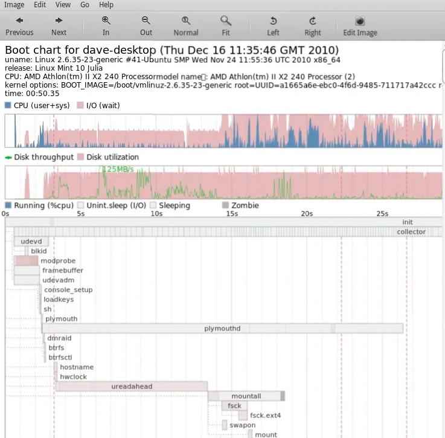

在 Linux 中有一个杀手级的工具 bootchart 来分析 linux 内核启动的问题，它把启动过程中所有的 IO、CPU 占用情况都做了详细的划分，我们可以很清楚的看到各个时间段，时间耗在了哪里，基于这个 chart，你就可以看看哪些过程可以延后处理、异步处理等。

在 Java 中，暂时没有类似的工具，但是又想知道时间到底耗在了哪里要怎么做呢，至少大概知道耗在了什么地方。在生成热点调用火焰图的时候，我们通过 arthas 的几个简单的命令就可以生成，它底层用的是 async-profiler 这个开源项目，它的作者 apangin 做过一系列关于 jvm profiling 相关的分享，感兴趣的同学可以去看看。

## async-profiler 底层原理简介

async-profiler 是一个非常强大的工具，使用 jvmti 技术来实现。它的 NB 之处在于它利用了 [libjvm.so](http://libjvm.so) 中 JVM 内部的 API `AsyncGetCallTrace` 来获取 Java 函数堆栈，精简后的伪代码如下：

**async-profiler**

```c
static bool vm_init(JavaVM *vm) {
 std::cout << "vm_init" << std::endl;

 // 从 libjvm.so 中获取 AsyncGetCallTrace 的函数指针句柄
 void *libjvm = dlopen("libjvm.so", RTLD_LAZY);
 _asyncGetCallTrace = (AsyncGetCallTrace) dlsym(libjvm, "AsyncGetCallTrace");
}
// 事件回调
void recordSample(void *ucontext, uint64_t counter, jint event_type, Event *event) {
 std::cout << "Profiler::recordSample: " << std::endl;
 ASGCT_CallFrame frames[maxFramesToCapture];
 ASGCT_CallTrace trace;
 trace.frames = frames;
 trace.env = getJNIEnv(g_jvm);
 // 调用 AsyncGetCallTrace 获取堆栈
 _asyncGetCallTrace(&trace, maxFramesToCapture, ucontext);
}
```

你可能要说获取个堆栈还需要搞这么复杂，jstack 等工具不是实现的很好了吗？其实不然。

jstack 等工具获取函数堆栈需要 jvm 进入到 safepoint，对于采样非常频繁的场景，会严重的影响 jvm 的性能，具体的原理不是本次内容的重点这里先不展开。

async-profiler 除了可以生成热点调用的火焰图，它还提供了 `Wall-clock profiling` 的功能，这个功能其实就是固定时间采样所有的线程（不管线程当前是 Running、Sleeping 还是 Blocked），它在文档中也提到了，这种方式的 profiling 适合用来分析应用的启动过程，我们姑且用这个不太精确的方式来粗略测量启动阶段耗时在了哪些函数里。

但是这个工具会抓取所有的线程的堆栈，按这样的方式抓取的 wall-clock 火焰图没法看，不信你看。

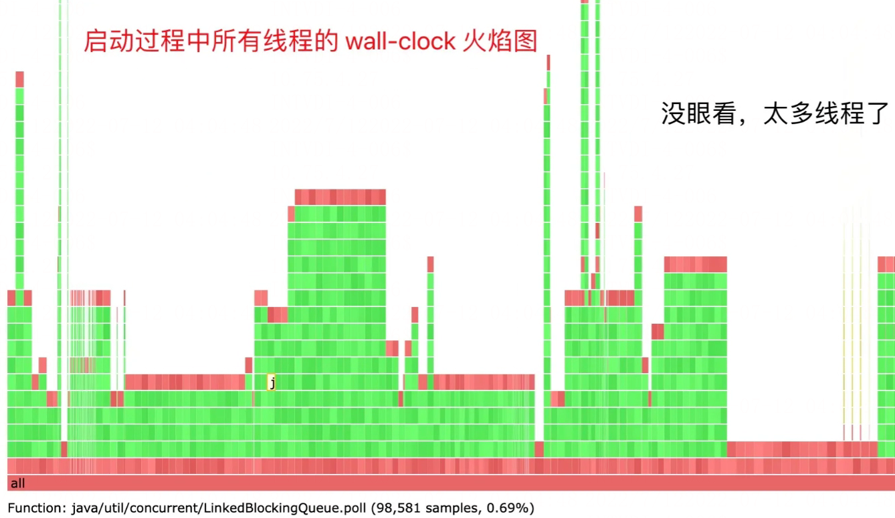

就算你找到了 main 线程，在函数耗时算占比的时候也不太方便，我们关心的其实只是 main 线程（也就是加载 jar 包，执行 spring 初始化的线程），于是我做了一些简单的修改，让 async-profiler 只取抓取 main 线程的堆栈。

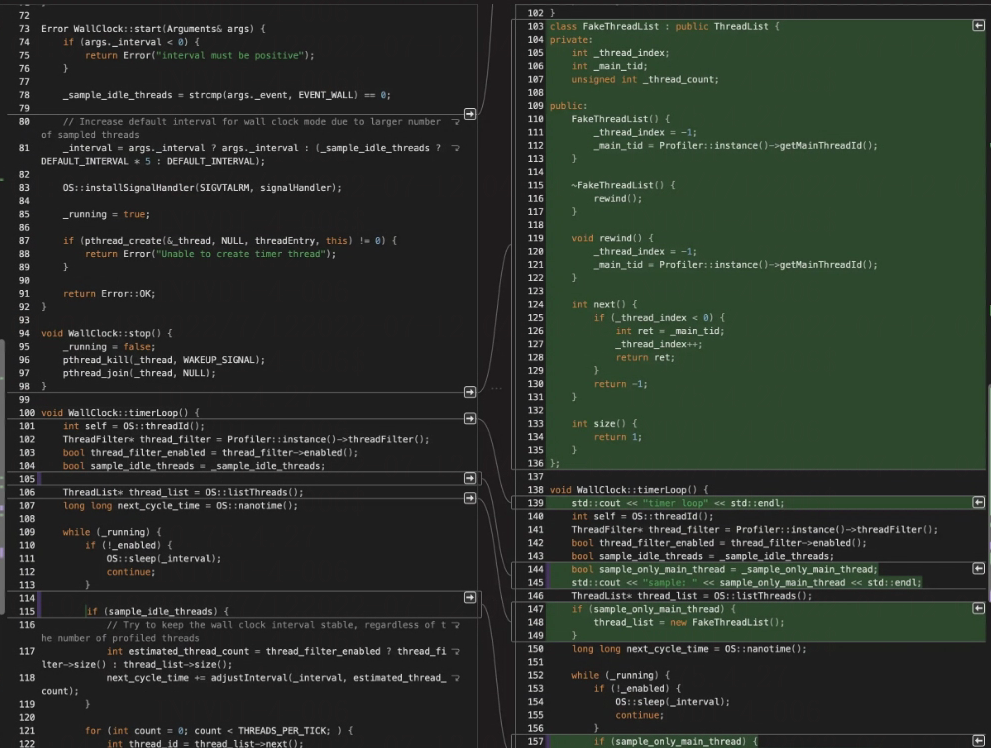

重新编译运行

**重新编译运行**

```
java
-agentpath:/path/to/libasyncProfiler.so=start,event=wall,interval=1ms,threads,file=profile.html
-jar xxx.jar
```

这样生成的火焰图就清爽多了，这样就知道时间耗在了什么函数上。
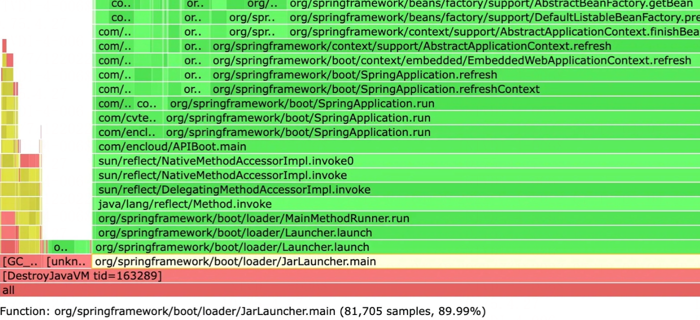

接下来就是分析这个 wall-clock 的火焰图，点开几个调用栈仔细分析，发现很多时间花费在类和资源文件查找和加载（挺失望的，java 连这部分都做不好）
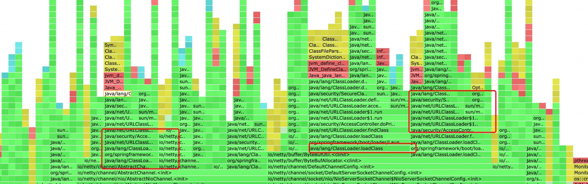

继续分析代码看看类加载在做什么。

## Java 垃圾般实现的类查找加载

Java 的类加载不出意外最终都走到了 [java.net](http://java.net).URLClassLoader#findClass 这里。

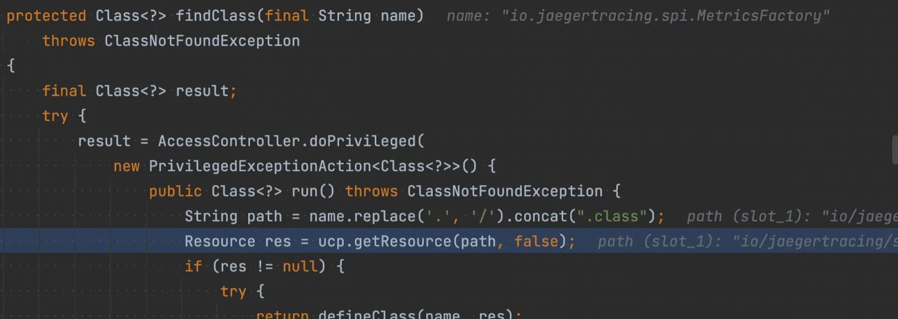

这里的 ucp 指的是 URLClassPath，也就是 classpath 路径的集合。对于 SpringBoot 的应用来说，classpath 已经在 META-INF 里写清楚了。

```
Spring-Boot-Classes: BOOT-INF/classes/
Spring-Boot-Lib: BOOT-INF/lib/
```

此次测试的程序 `BOOT-INF/lib/` 有 300 多个依赖的 jar 包，当加载某个类时，除了 `BOOT-INF/classes/` 之外 Java 居然要遍历那 300 个 jar 包去查看这些 jar 包中是否包含某个类。
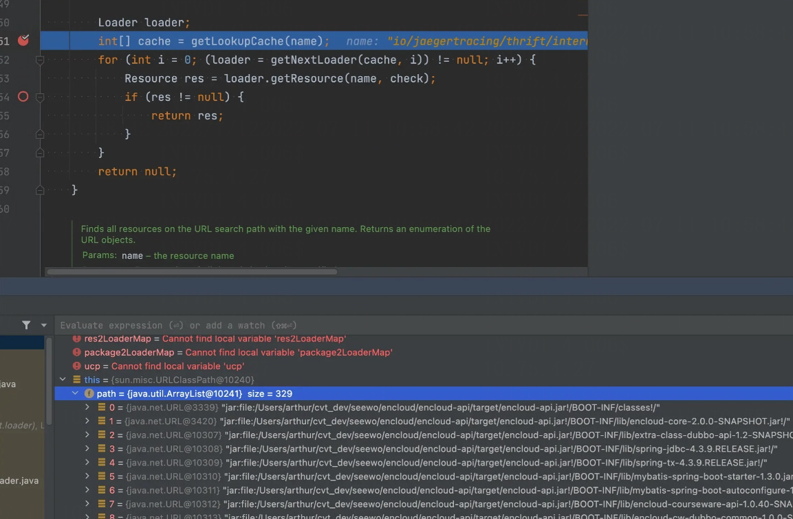

我在 loader.getResource 上注入了一下打印，看看这些函数调用了多少次。

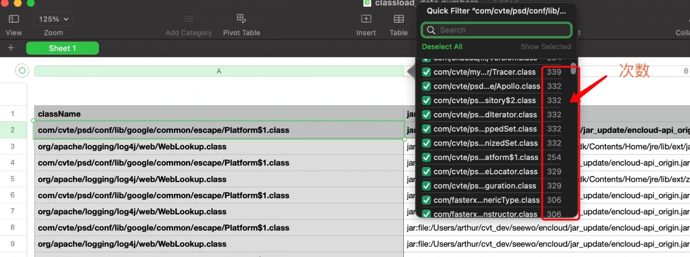

可以看到太丧心病狂了，加载一个类，居然要调用 `loader.getResource` 去 jar 包中尝试几百次。我就按二分之一 150 来算，如果加载一万个类，要调用这个函数 150W 次。

请忽略源码中的 LookupCache 特性，这个特性看起来是为了加速 jar 包查找的，但是这个特性看源码是一个 oracle 商业版的才有的特性，在目前的 jdk 中是无法启用的。（推测，如果理解不对请告知我）

于是有了一些粗浅的想法，为何不告诉 java 这个类在那个 jar 里？做索引这么天然的想法为什么不实现。

以下面为例，项目依赖三个 jar 包，foo.jar、bar.jar、baz.jar，其中分别包含了特定包名的类，理想情况下我们可以生成一个索引文件，如下所示。

foo.jar
com/foo1
com/foo2

bar.jar
com/bar
com/bar/barbar

baz.jar
com/baz

这就是我们接下来要介绍的 JarIndex 技术。

## JarIndex 技术

其实 Jar 在文件格式上是支持索引技术的，称为 JarIndex，通过 `jar -i` 就可以在 `META-INF/` 目录下生成 `INDEX.LIST` 文件。别高兴的太早，这个 JarIndex 目前无法真正起到作用，有下面几个原因：

- INDEX.LIST 文件生成不正确，尤其是目前最流行的 fatjar 中包含 jar 列表的情况
- classloader 不支持（那不是白忙活吗）

首先来看 INDEX.LIST 文件生成不正确的问题，随便拿一个 jar 文件，使用 `jar -i` 生成一下试试。

```
JarIndex-Version: 1.0

encloud-api_origin.jar
BOOT-INF
BOOT-INF/classes
BOOT-INF/classes/com
BOOT-INF/classes/com/encloud
....
META-INF
META-INF/maven
META-INF/maven/com.encloud
META-INF/maven/com.encloud/encloud-api
BOOT-INF/lib
org
org/springframework
org/springframework/boot
org/springframework/boot/loader
org/springframework/boot/loader/jar
org/springframework/boot/loader/data
org/springframework/boot/loader/archive
org/springframework/boot/loader/util
```

可以看到在 BOOT-INF/lib 目录中的类索引并没有在这里生成，这里面可是有 300 多个 jar 包。

同时生成不对的地方还有，org 目录下只有文件夹并没有 class 文件，org 这一行不应该在 INDEX.LIST 文件中。

第二个缺陷才是最致命的，目前的 classloader 不支持 JarIndex 这个特性。

所以我们要做两个事情，生成正确的 JarIndex，同时修改 SpringBoot 的 classloader 让其支持 JarIndex。

## 生成正确的 JarIndex

这个简单，就是遍历 jar 包里的类，将其所在的包名抽取出来。SpringBoot 应用有三个地方存放了 class：

- BOOT-INF/classes
- BOOT-INF/lib
- jar 包根目录下 `org/springframework/boot/loader`

生成的时候需要考虑到上面的情况，剩下的就简单了。遍历这些目录，将所有的包含 class 文件的包名过滤过来就行。

大概生成的结果是：

```
JarIndex-Version: 1.0

encloud-api.jar

/BOOT-INF/classes
com/encloud
com/encloud/app/controller
com/encloud/app/controller/v2

/
org/springframework/boot/loader
org/springframework/boot/loader/archive
org/springframework/boot/loader/data
org/springframework/boot/loader/jar
org/springframework/boot/loader/util

/BOOT-INF/lib/spring-core-4.3.9.RELEASE.jar
org/springframework/asm
org/springframework/cglib
org/springframework/cglib/beans
org/springframework/cglib/core

/BOOT-INF/lib/guava-19.0.jar
com/google/common/annotations
com/google/common/base
com/google/common/base/internal
com/google/common/cache

... other jar ...
```

除了加载类需要查找，其实还有不少资源文件需要查找，比如 spi 等扫描过程中需要，顺带把资源文件的索引也生成一下写入到 RES_INDEX.LIST 中，原理类似，这里展开。

## 自定义 classloder

生成了 INDEX.LIST 文件，接下来就是要实现了一个 classloader 能支持一步到位通过索引文件去对应的 jar 包中去加载 class，核心的代码如下：

**自定义 classloder**

```python
public class JarIndexLaunchedURLClassLoader extends URLClassLoader {
 public JarIndexLaunchedURLClassLoader(boolean exploded, Archive rootArchive, URL[] urls, ClassLoader parent) {
 super(urls, parent);
 initJarIndex(urls); // 根据 INDEX.LIST 创建包名到 jar 文件的映射关系
 }

 @Override
 protected Class<?> loadClass(String name, boolean resolve) throws ClassNotFoundException {
 Class<?> loadedClass = findLoadedClass(name);
 if (loadedClass != null) return loadedClass;
 // 如果是 loader 相关的类，则直接加载，不用找了，就在 jar 包的根目录下
 if (name.startsWith("org.springframework.boot.loader.") || name.startsWith("com.seewo.psd.bootx.loader.")) {
 Class<?> result = loadClassInLaunchedClassLoader(name);
 if (resolve) {
 resolveClass(result);
 }
 return result;

 }
 // skip java.*, org.w3c.dom.* com.sun.* ，这些包交给 java 默认的 classloader 去处理
 if (!name.startsWith("java") && !name.contains("org.w3c.dom.")
 && !name.contains("xml") && !name.startsWith("com.sun")) {
 int lastDot = name.lastIndexOf('.');
 if (lastDot >= 0) {
 String packageName = name.substring(0, lastDot);
 String packageEntryName = packageName.replace('.', '/');
 String path = name.replace('.', '/').concat(".class");
 // 通过 packageName 找到对应的 jar 包
 List<JarFileResourceLoader> loaders = package2LoaderMap.get(packageEntryName);
 if (loaders != null) {
 for (JarFileResourceLoader loader : loaders) {
 ClassSpec classSpec = loader.getClassSpec(path); // 从 jar 包中读取文件
 if (classSpec == null) {
 continue;
 }
 // 文件存在，则加载这个 class
 Class<?> definedClass = defineClass(name, classSpec.getBytes(), 0, classSpec.getBytes().length, classSpec.getCodeSource());
 definePackageIfNecessary(name);
 return definedClass;
 }
 }
 }
 }
 // 执行到这里，说明需要父类加载器来加载类（兜底）
 definePackageIfNecessary(name);
 return super.loadClass(name, resolve);
 }
}
```

到这里我们基本上就实现了一个支持 JarIndex 的类加载器，这里的改动经实测效果已经效果非常明显。
除此之外，我还发现查找一个已加载的类是一个非常高频执行的操作，于是可以在 JarIndexLaunchedURLClassLoader 之前再加一层缓存（思想来自 sofa-boot）

**JarIndexLaunchedURLClassLoader**

```python
public class CachedLaunchedURLClassLoader extends JarIndexLaunchedURLClassLoader {
 private final Map<String, LoadClassResult> classCache = new ConcurrentHashMap<>(3000);
 @Override
 protected Class<?> loadClass(String name, boolean resolve) throws ClassNotFoundException {
 return loadClassWithCache(name, resolve);
 }
 private Class<?> loadClassWithCache(String name, boolean resolve) throws ClassNotFoundException {
 LoadClassResult result = classCache.get(name);
 if (result != null) {
 if (result.getEx() != null) {
 throw result.getEx();
 }
 return result.getClazz();
 }
 try {
 Class<?> clazz = super.findLoadedClass(name);
 if (clazz == null) {
 clazz = super.loadClass(name, resolve);
 }
 if (clazz == null) {
 classCache.put(name, LoadClassResult.NOT_FOUND);
 }
 return clazz;
 } catch (ClassNotFoundException exception) {
 classCache.put(name, new LoadClassResult(exception));
 throw exception;
 }
}
```

注意：这里为了简单示例直接用 ConcurrentHashMap 来缓存 class，更好的做法是用 guava-cache 等可以带过期淘汰的 map，避免类被永久缓存。

## 如何不动 SpringBoot 的代码实现 classloader 的替换

接下的一个问题是如何不修改 SpringBoot 的情况下，把 SpringBoot 的 Classloader 替换为我们写的呢？

大家都知道，SpringBoot 的 jar 包启动类其实并不是我们项目中写的 main 函数，其实是

`org.springframework.boot.loader.JarLauncher`，这个类才是真正的 jar 包的入口。

```python
package org.springframework.boot.loader;
public class JarLauncher extends ExecutableArchiveLauncher {
 public static void main(String[] args) throws Exception {
 new JarLauncher().launch(args);
 }
}
```

那我们只要替换这个入口类就可以接管后面的流程了。如果只是替换那很简单，修改生成好的 jar 包就可以了，但是这样后面维护的成本比较高，如果在打包的时候就替换就好了。SpringBoot 的打包是用 spring-boot-maven-plugin 插件

```
<plugin>
 <groupId>org.springframework.boot</groupId>
 <artifactId>spring-boot-maven-plugin</artifactId>
</plugin>
```

最终生成的`META-INF/MANIFEST.MF`文件如下

```
$ cat META-INF/MANIFEST.MF
Manifest-Version: 1.0
Implementation-Title: encloud-api
Implementation-Version: 2.0.0-SNAPSHOT
Archiver-Version: Plexus Archiver
Built-By: arthur
Implementation-Vendor-Id: com.encloud
Spring-Boot-Version: 1.5.4.RELEASE
Implementation-Vendor: Pivotal Software, Inc.
Main-Class: org.springframework.boot.loader.JarLauncher
Start-Class: com.encloud.APIBoot
Spring-Boot-Classes: BOOT-INF/classes/
Spring-Boot-Lib: BOOT-INF/lib/
Created-By: Apache Maven 3.8.5
Build-Jdk: 1.8.0_332
Implementation-URL: http://projects.spring.io/spring-boot/parent/enclo
 ud-api/
```

为了实现我们的需求，就要看 spring-boot-maven-plugin 这个插件到底是如何写入 `Main-Class` 这个类的，经过漫长的 maven 插件源码的调试，发现这个插件居然提供了扩展点，可以支持修改 `Main-Class`，它提供了一个 layoutFactory 可以自定义

```
<plugin>
 <groupId>org.springframework.boot</groupId>
 <artifactId>spring-boot-maven-plugin</artifactId>
 <executions>
 <execution>
 <goals>
 <goal>repackage</goal>
 </goals>
 <configuration>
 <layoutFactory implementation="com.seewo.psd.bootx.loader.tools.MyLayoutFactory"/>
 </configuration>
 </execution>
 </executions>
 <dependencies>
 <dependency>
 <groupId>com.seewo.psd.bootx</groupId>
 <artifactId>bootx-loader-tools</artifactId>
 <version>0.1.1</version>
 </dependency>
 </dependencies>
</plugin>
```

实现这个

```python
package com.seewo.psd.bootx.loader.tools;
import org.springframework.boot.loader.tools.*;
import java.io.File;
import java.io.IOException;
import java.util.Locale;
public class MyLayoutFactory implements LayoutFactory {
 private static final String NESTED_LOADER_JAR = "META-INF/loader/spring-boot-loader.jar";
 private static final String NESTED_LOADER_JAR_BOOTX = "META-INF/loader/bootx-loader.jar";

 public static class Jar implements RepackagingLayout, CustomLoaderLayout {
 @Override
 public void writeLoadedClasses(LoaderClassesWriter writer) throws IOException {
 // 拷贝 springboot loader 相关的文件到 jar 根目录
 writer.writeLoaderClasses(NESTED_LOADER_JAR);
 // 拷贝 bootx loader 相关的文件到 jar 根目录
 writer.writeLoaderClasses(NESTED_LOADER_JAR_BOOTX);
 }
 @Override
 public String getLauncherClassName() {
 // 替换为我们自己的 JarLauncher
 return "com.seewo.psd.bootx.loader.JarLauncher";
 }
 }
}
```

接下来实现我们自己的 JarLauncher

```python
package com.seewo.psd.bootx.loader;
import java.net.URL;
public class JarLauncher extends org.springframework.boot.loader.JarLauncher {
 @Override
 protected ClassLoader createClassLoader(URL[] urls) throws Exception {
 return new CachedLaunchedURLClassLoader(urls, getClass().getClassLoader());
 }
 public static void main(String[] args) throws Exception {
 new JarLauncher().launch(args);
 }
}
```

重新编译就可以实现替换

```
$ cat META-INF/MANIFEST.MF
Manifest-Version: 1.0
...
Main-Class: com.seewo.psd.bootx.loader.JarLauncher
...
```

到这里，我们就基本完成所有的工作，不用改一行业务代码，只用改几行 maven 打包脚本，就可以实现支持 JarIndex 的类加载实现。

## 优化效果

我们来看下实际的效果，项目 1 稍微小型一点，启动耗时从 70s 降低到 46s

****

第二个 jar 包更大一点，效果更明显，启动耗时从 220s 减少到 123s


## 未完待续

其实优化到这里，还远远没有达到我想要的目标，为什么启动需要这么长时间，解决了类查找的问题，那我们来深挖一下 Spring 的初始化。

Spring bean 的初始化是串行进行的，于是我先来做一个可视化 timeline，看看到底是哪些 Bean 耗时很长。

## Spring Bean 初始化时序可视化

因为不会写前端，这里偷一下懒，利用 APM 的工具，把数据上报到 jaeger，这样我们就可以得到一个包含调用关系的timeline 的界面了。jaeger 的网址在这里：[www.jaegertracing.io/](https://link.juejin.cn?target=https://www.jaegertracing.io/ "https://www.jaegertracing.io/")

首先我们继承 DefaultListableBeanFactory 来对 createBean 的过程做记录。

```python
public class BeanLoadTimeCostBeanFactory extends DefaultListableBeanFactory {
 private static ThreadLocal<Stack<BeanCreateResult>> parentStackThreadLocal = new ThreadLocal<>();
 @Override
 protected Object createBean(String beanName, RootBeanDefinition rbd, Object[] args) throws BeanCreationException {
 // 记录 bean 初始化开始
 Object object = super.createBean(beanName, rbd, args);
 // 记录 bean 初始化结束
 return object;
 }
```

接下来我们实现 ApplicationContextInitializer，在 initialize 方法中替换 beanFactory 为我们自己写的。

```python
public class BeanLoadTimeCostApplicationContextInitializer implements ApplicationContextInitializer<ConfigurableApplicationContext>, Ordered {
 public BeanLoadCostApplicationContextInitializer() {
 System.out.println("in BeanLoadCostApplicationContextInitializer()");
 }
 @Override
 public void initialize(ConfigurableApplicationContext applicationContext) {
 if (applicationContext instanceof GenericApplicationContext) {
 System.out.println("BeanLoadCostApplicationContextInitializer run");
 BeanLoadTimeCostBeanFactory beanFactory = new BeanLoadTimeCostBeanFactory();
 Field field = GenericApplicationContext.class.getDeclaredField("beanFactory");
 field.setAccessible(true);
 field.set(applicationContext, beanFactory);
 }
 }
}
```

接下来将记录的状态上报到 jaeger 中，实现可视化堆栈显示。

```c
public void reportBeanCreateResult(BeanCreateResult beanCreateResult) {
 Span span = GlobalTracer.get().buildSpan(beanCreateResult.getBeanClassName()).withStartTimestamp(beanCreateResult.getBeanStartTime() * 1000).start();
 try (Scope ignore = GlobalTracer.get().scopeManager().activate(span)) {
 for (BeanCreateResult item : beanCreateResult.getChildren()) {
 Span childSpan = GlobalTracer.get().buildSpan(item.getBeanClassName()).withStartTimestamp(item.getBeanStartTime() * 1000).start();
 try (Scope ignore2 = GlobalTracer.get().scopeManager().activate(childSpan)) {
 printBeanStat(item);
 } finally {
 childSpan.finish(item.getBeanEndTime() * 1000);
 }
 }
 } finally {
 span.finish(beanCreateResult.getBeanEndTime() * 1000);
 }
}
```

通过这种方式，我们可以很轻松的看到 spring 启动阶段 bean 加载的 timeline，生成的图如下所示。
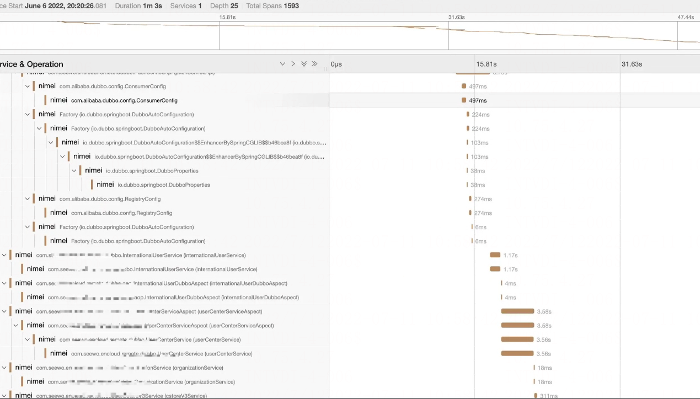|

这对我们进一步优化 bean 的加载提供了思路，可以看到 bean 的依赖关系和加载耗时具体耗在了哪个 bean。通过这种方式可以在 SpringBean 串行加载的前提下，把 bean 的加载尽可能的优化。

## SpringBean 的依赖分析

更好一点的方案是基于 SpringBean 的依赖关系做并行加载。这个特性 2011 年前就有人提给了 Spring，具体看这个 issue：[github.com/spring-proj…](https://link.juejin.cn?target=https://github.com/spring-projects/spring-framework/issues/13410 "https://github.com/spring-projects/spring-framework/issues/13410")

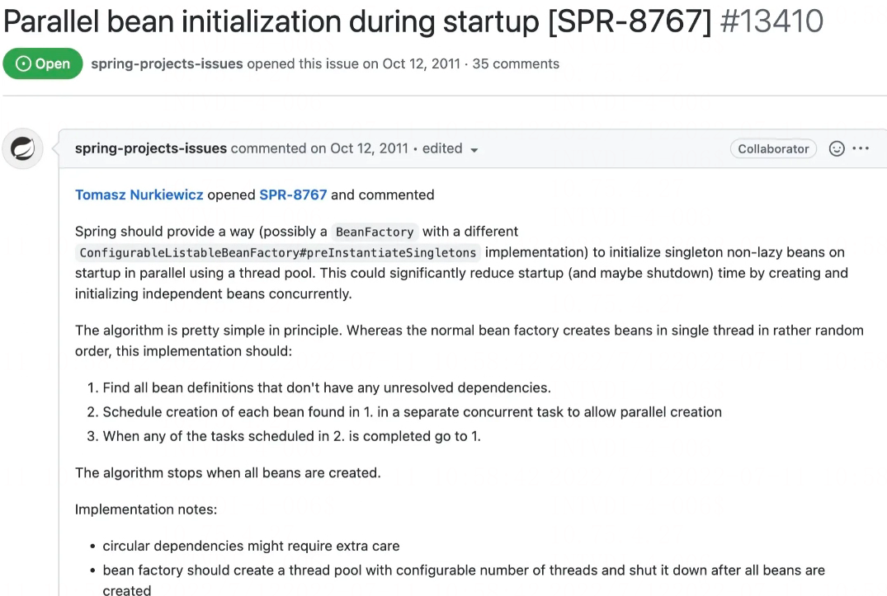

就在去年，还有人去这个 issue 下去恭祝这个 issue 10 周年快乐。


做并行加载确实有一些难度，真实项目的 Spring Bean 依赖关系非常复杂，我把 Spring Bean 的依赖关系导入到 neo4j 图数据库，然后进行查询

```
MATCH (n)
RETURN n;
```

得到的图如下所示。一方面 Bean 的数量特别多，还有复杂的依赖关系，以及循环依赖。


基于此依赖关系，我们是有机会去做 SpringBean 的并行加载的，这部分还没实现，希望后面有机会可以完整的实现这块的逻辑，个人感觉可以做到 10s 内启动完一个超大的项目。

## Java 启动优化的其它技术

Java 启动的其它技术还有 Heap Archive、CDS，以及 GraalVM 的 AOT 编译，不过这几个技术目前都有各自的缺陷，还无法完全解决目前我们遇到的问题。

## 后记

这篇文章中用到的技术只是目前比较粗浅的尝试，如果大家有更好的优化，可以跟我交流，非常感谢。
