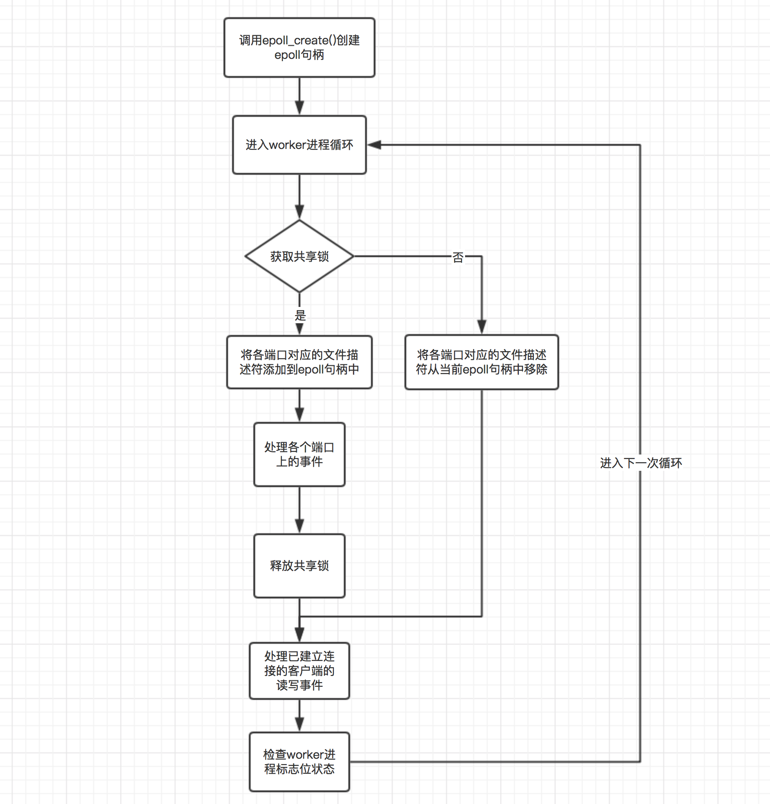

# Nginx惊群

## 惊群效应是什么

惊群效应（thundering herd）是指多进程（多线程）在同时阻塞等待同一个事件的时候（休眠状态），如果等待的这个事件发生，那么他就会唤醒等待的所有进程（或者线程），但是最终却只能有一个进程（线程）获得这个时间的 “控制权”，对该事件进行处理，而其他进程（线程）获取 “控制权” 失败，只能重新进入休眠状态，这种现象和性能浪费就叫做惊群效应。

## 惊群效应消耗了什么

**[Linux](https://haicoder.net/linux/linux-tutorial.html)** 内核对用户进程（线程）频繁地做无效的调度、上下文切换等使系统性能大打折扣。上下文切换（context switch）过高会导致 CPU 像个搬运工，频繁地在寄存器和运行队列之间奔波，更多的时间花在了进程（线程）切换，而不是在真正工作的进程（线程）上面。

直接的消耗包括 CPU 寄存器要保存和加载（例如程序计数器）、系统调度器的代码需要执行。间接的消耗在于多核 cache 之间的共享数据。为了确保只有一个进程（线程）得到资源，需要对资源操作进行加锁保护，加大了系统的开销。目前一些常见的服务器软件有的是通过锁机制解决的，比如 **[Nginx](https://haicoder.net/nginx/nginx-tutorial.html)**（它的锁机制是默认开启的，可以关闭）；还有些认为惊群对系统性能影响不大，没有去处理，比如 Lighttpd。

## Nginx惊群效应

对于 Nginx 的惊群问题，我们首先需要理解的是，在 Nginx 启动过程中，master 进程会监听配置文件中指定的各个端口，然后 master 进程就会调用 fork() 方法创建各个子进程，根据进程的工作原理，子进程是会继承父进程的全部内存数据以及监听的端口的，也就是说 worker 进程在启动之后也是会监听各个端口的。

关于惊群，指的就是当客户端有新建连接的请求到来时，就会触发各个 worker 进程的连接建立事件，但是只有一个 worker 进程能够正常处理该事件，而其他的 worker 进程会发现事件已经失效，从而重新循环进入等待状态。这种由于一个事件而 “惊” 起了所有 worker 进程的现象就是惊群问题。很明显，如果所有的 worker 进程都被触发了，那么这将消耗大量的资源。

### 解决方式

在 Nginx 中，每个 worker 进程被创建的时候，都会调用 ngx_worker_process_init() 方法初始化当前 worker 进程，这个过程中有一个非常重要的步骤，即每个 worker 进程都会调用 epoll_create() 方法为自己创建一个独有的 epoll 句柄。

对于每一个需要监听的端口，都有一个文件描述符与之对应，而 worker 进程只有将该文件描述符通过 epoll_ctl() 方法添加到当前进程的 epoll 句柄中，并且监听 accept 事件，此时才会被客户端的连接建立事件触发，从而处理该事件。从这里也可以看出，worker 进程如果没有将所需要监听的端口对应的文件描述符添加到该进程的 epoll 句柄中，那么其是无法被触发对应的事件的。

基于这个原理，nginx 就使用了一个共享锁来控制当前进程是否有权限将需要监听的端口添加到当前进程的 epoll 句柄中，也就是说，只有获取锁的进程才会监听目标端口。通过这种方式，就保证了每次事件发生时，只有一个 worker 进程会被触发。如下图所示为 worker 进程工作循环的一个示意图：


这里关于图中的流程，需要说明的一点是，每个 worker 进程在进入循环之后就会尝试获取共享锁，如果没有获取到，就会将所监听的端口的文件描述符从当前进程的 epoll 句柄中移除（即使并不存在也会移除），这么做的主要目的是防止丢失客户端连接事件，即使这可能造成少量的惊群问题，但是并不严重。

试想一下，如果按照理论，在当前进程释放锁的时候就将监听的端口的文件描述符从 epoll 句柄中移除，那么在下一个 worker 进程获取锁之前，这段时间各个端口对应的文件描述符是没有任何 epoll 句柄进行监听的，此时就会造成事件的丢失。如果反过来，按照图中的在获取锁失败的时候才移除监听的文件描述符，由于获取锁失败，则说明当前一定有一个进程已经监听了这些文件描述符，因而此时移除是安全的。

但是这样会造成的一个问题是，按照上图，当前进程在一个循环执行完毕的时候，会释放锁，然后处理其他的事件，注意这个过程中其是没有释放所监听的文件描述符的。此时，如果另一个进程获取到了锁，并且监听了文件描述符，那么这个时候就有两个进程监听了文件描述符，因而此时如果客户端发生连接建立事件，那么就会触发两个 worker 进程。这个问题是可以容忍的，主要原因有两点：

- 这个时候发生的惊群现象只触发了更少的 worker 进程，比起每次都惊起所有的 worker 进程要好很多；
- 会发生这种惊群问题的主要原因是，当前进程释放了锁，但是没有释放所监听的文件描述符，但是 worker 进程在释放锁之后主要是处理客户端连接的读写事件和检查标志位，这个过程是非常短的，在处理完之后，其就会尝试获取锁，这个时候就会释放所监听的文件描述符了，而相较而言，获取锁的 worker 进程在等待处理客户端的连接建立事件的事件就更长了，因而会发生惊群问题的概率还是比较小的。

### 源码讲解

worker 进程初始事件的方法主要是在 ngx_process_events_and_timers() 方法中进行的，下面我们就来看看该方法是如何处理整个流程的，如下是该方法的源码：

```c
void ngx_process_events_and_timers(ngx_cycle_t *cycle) {
 ngx_uint_t flags;
 ngx_msec_t timer, delta;
 if (ngx_trylock_accept_mutex(cycle) == NGX_ERROR) {
 return;
 }
 // 这里开始处理事件，对于kqueue模型，其指向的是ngx_kqueue_process_events()方法，
 // 而对于epoll模型，其指向的是ngx_epoll_process_events()方法
 // 这个方法的主要作用是，在对应的事件模型中获取事件列表，然后将事件添加到ngx_posted_accept_events
 // 队列或者ngx_posted_events队列中
 (void) ngx_process_events(cycle, timer, flags);
 // 这里开始处理accept事件，将其交由ngx_event_accept.c的ngx_event_accept()方法处理；
 ngx_event_process_posted(cycle, &ngx_posted_accept_events);
 // 开始释放锁
 if (ngx_accept_mutex_held) {
 ngx_shmtx_unlock(&ngx_accept_mutex);
 }
 // 如果不需要在事件队列中进行处理，则直接处理该事件
 // 对于事件的处理，如果是accept事件，则将其交由ngx_event_accept.c的ngx_event_accept()方法处理；
 // 如果是读事件，则将其交由ngx_http_request.c的ngx_http_wait_request_handler()方法处理；
 // 对于处理完成的事件，最后会交由ngx_http_request.c的ngx_http_keepalive_handler()方法处理。
 // 这里开始处理除accept事件外的其他事件
 ngx_event_process_posted(cycle, &ngx_posted_events);
}
```

上面的代码中，我们省略了大部分的检查工作，只留下了骨架代码。首先，worker 进程会调用 ngx_trylock_accept_mutex() 方法获取锁，这其中如果获取到了锁就会监听各个端口对应的文件描述符。然后会调用 ngx_process_events() 方法处理 epoll 句柄中监听到的事件。接着会释放共享锁，最后就是处理已建立连接的客户端的读写事件。下面我们来看一下 ngx_trylock_accept_mutex() 方法是如何获取共享锁的：

```
ngx_int_t ngx_trylock_accept_mutex(ngx_cycle_t *cycle) {
 // 尝试使用CAS算法获取共享锁
 if (ngx_shmtx_trylock(&ngx_accept_mutex)) {
 // ngx_accept_mutex_held为1表示当前进程已经获取到了锁
 if (ngx_accept_mutex_held && ngx_accept_events == 0) {
 return NGX_OK;
 }
 // 这里主要是将当前连接的文件描述符注册到对应事件的队列中，比如kqueue模型的change_list数组
 // nginx在启用各个worker进程的时候，默认情况下，worker进程是会继承master进程所监听的socket句柄的，
 // 这就导致一个问题，就是当某个端口有客户端事件时，就会把监听该端口的进程都给唤醒，
 // 但是只有一个worker进程能够成功处理该事件，而其他的进程被唤醒之后发现事件已经过期，
 // 因而会继续进入等待状态，这种现象称为"惊群"现象。
 // nginx解决惊群现象的方式一方面是通过这里的共享锁的方式，即只有获取到锁的worker进程才能处理
 // 客户端事件，但实际上，worker进程是通过在获取锁的过程中，为当前worker进程重新添加各个端口的监听事件，
 // 而其他worker进程则不会监听。也就是说同一时间只有一个worker进程会监听各个端口，
 // 这样就避免了"惊群"问题。
 // 这里的ngx_enable_accept_events()方法就是为当前进程重新添加各个端口的监听事件的。
 if (ngx_enable_accept_events(cycle) == NGX_ERROR) {
 ngx_shmtx_unlock(&ngx_accept_mutex);
 return NGX_ERROR;
 }
 // 标志当前已经成功获取到了锁
 ngx_accept_events = 0;
 ngx_accept_mutex_held = 1;
 return NGX_OK;
 }
 // 前面获取锁失败了，因而这里需要重置ngx_accept_mutex_held的状态，并且将当前连接的事件给清除掉
 if (ngx_accept_mutex_held) {
 // 如果当前进程的ngx_accept_mutex_held为1，则将其重置为0，并且将当前进程在各个端口上的监听
 // 事件给删除掉
 if (ngx_disable_accept_events(cycle, 0) == NGX_ERROR) {
 return NGX_ERROR;
 }
 ngx_accept_mutex_held = 0;
 }
 return NGX_OK;
}
```

上面的代码中，本质上主要做了三件事：

1. 通过 ngx_shmtx_trylock() 方法尝试使用CAS方法获取共享锁；
2. 获取锁之后则调用 ngx_enable_accept_events() 方法监听目标端口对应的文件描述符；
3. 如果没有获取到锁，则调用 ngx_disable_accept_events() 方法释放所监听的文件描述符；

## 总结

惊群现象指所有的工作进程都在等待一个 socket，当 socket 客户端连接时，所有工作线程都被唤醒，但最终有且仅有一个工作线程去处理该连接，其他进程又要进入睡眠状态。

Nginx 通过控制争抢处理 socket 的进程数量和抢占 ngx_accept_mutex 锁解决惊群现象。只有一个 ngx_accept_mutex 锁，谁拿到锁，谁处理该 socket 的请求。
