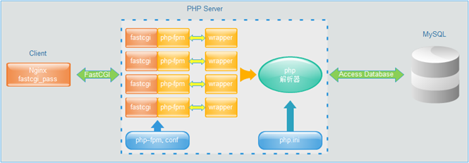
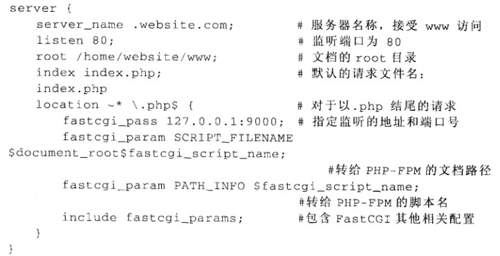

# FastCGI

## 什么是FastCGI

FastCGI 是语言无关的、可伸缩架构的 **[CGI](https://haicoder.net/note/architecture/struct-cgi.html)** 开放扩展，其主要行为是将 CGI 解释器进程保持在内存中并因此获得较高的性能。众所周知，CGI 解释器的反复加载是 CGI 性能低下的主要原因，如果 CGI 解释器保持在内存中并接受 FastCGI 进程管理器调度，则可以提供良好的性能、伸缩性、Fail-Over特性等等。

## 什么是CGI

CGI 全称 “通用网关接口”（Common Gateway Interface），用于 **[HTTP](https://haicoder.net/http/http-tutorial.html)** 服务器与其它机器上的程序服务通信交流的一种工具，CGI 程序须运行在网络服务器上。

传统 CGI 接口方式的主要缺点是性能较差，因为每次 HTTP 服务器遇到动态程序时都需要重启解析器来执行解析，然后结果被返回给 HTTP 服务器。这在处理高并发访问几乎是不可用的，因此就诞生了 FastCGI。另外传统的 CGI 接口方式安全性也很差。

## FastCGI说明

FastCGI 是一个可伸缩地、高速地在 HTTP 服务器和动态脚本语言间通信的接口（FastCGI 接口在 **[Linux](https://haicoder.net/linux/linux-tutorial.html)** 下是 socket（可以是文件 socket，也可以是 ip socket）），主要优点是把动态语言和 HTTP 服务器分离开来。多数流行的 HTTP 服务器都支持 FastCGI，包括 Apache、 **[Nginx](https://haicoder.net/nginx/nginx-tutorial.html)** 和 lightpd。

同时，FastCGI 也被许多脚本语言所支持，比较流行的脚本语言之一为 **[PHP](https://haicoder.net/php/php-tutorial.html)**。FastCGI 接口方式采用 C/S 架构，可以将 HTTP 服务器和脚本解析服务器分开，同时在脚本解析服务器上启动一个或多个脚本解析守护进程。当 HTTP 服务器每次遇到动态程序时，可以将其直接交付给 FastCGI 进程执行，然后将得到的结构返回给浏览器。这种方式可以让 HTTP 服务器专一地处理静态请求或者将动态脚本服务器的结果返回给客户端，这在很大程度上提高了整个应用系统的性能。

## FastCGI特点

1. FastCGI 是 HTTP 服务器和动态脚本语言间通信的接口或者工具。
2. FastCGI 优点是把动态语言解析和 HTTP 服务器分离开来。
3. Nginx、Apache、Lighttpd 以及多数动态语言都支持 FastCGI。
4. FastCGI 接口方式采用 C/S 架构，分为客户端（HTTP服务器）和服务端（动态语言解析服务器）。
5. PHP 动态语言服务端可以启动多个 FastCGI 的守护进程。
6. HTTP 服务器通过 FastCGI 客户端和动态语言 FastCGI 服务端通信。
7. FastCGI 像是一个常驻 (long-live) 型的 CGI，它可以一直执行着，只要激活后，不会每次都要花费时间去 fork 一次 (这是 CGI 最为人诟病的 fork-and-execute 模式)。
8. FastCGI 可在任何平台上使用，Netscape Enterprise 及 IIS 都有 FastCGI 的模块可供使用，阿帕契 (Apache，以及利用 Apache 衍生出做的服务器) 上也有 mod_fastcgi 可用。
9. FastCGI 支持 **[C 语言](https://haicoder.net/c/c-tutorial.html)**、 **[C++](https://haicoder.net/cpp/cpp-tutorial.html)**、 **[Java](https://haicoder.net/java/java-development.html)**、 PHP、 **[Python](https://haicoder.net/python/python-tutorial.html)**、Ruby、Perl，Tcl 等程序语言。
10. FastCGI 的应用程序亦兼容于 CGI。即 FastCGI 的应用程序也可以当成 CGI 来执行。
11. 现有的 CGI 程序要改写成 FastCGI 非常简单，最少可能只需要多加入三行程序代码。
12. FastCGI 的侦错方式与 CGI 大同小异，只要带入程序所需的环境变量及参数，即可在命令列模式执行或侦错。
13. FastCGI 应用程序的写作方式与 CGI 类似，除了几项原则要特别注意外，FastCGI 的写作方式跟 CGI 几乎一样，与学习 Web Server API 比较起来， FastCGI 简单多了。
14. FastCGI 支授分布式运算 (distributed computing)，即 FastCGI 程序可以在网站服务器以外的主机上执行并且接受来自其它网站服务器来的请求。

## FastCGI优点

1. PHP 脚本运行速度更快(3 到 30 倍)。PHP 解释程序被载入内存而不用每次需要时从存储器读取，极大的提升了依靠脚本运行的站点的性能。
2. 需要使用更少的系统资源。由于服务器不用每次需要时都载入 PHP 解释程序，你可以将站点的传输速度提升很高而不必增加 cpu 负担。因为 dll 文件不再每次都载入了，那么数据库的持久连接也将可以起到它设计初的效果。
3. 不需要对现有的代码作任何改变。

## FastCGI工作过程

首先 Fastcgi 会先启动一个 master，解析配置文件，初始化执行环境，然后再启动多个 worker。当请求过来时，master 会传递给一个 worker，然后立即可以接受下一个请求。这样就避免了重复的劳动，效率自然是高。

而且当 worker 不够用时，master 可以根据配置预先启动几个 worker 等着；当然空闲 worker 太多时，也会停掉一些，这样就提高了性能，也节约了资源。这就是 fastcgi 对进程的管理。

## PHP-FPM

php 的解析器是 php-cgi。php-cgi 只是个 CGI 程序，他自己本身只能解析请求，返回结果，不会进程管理，所以就出现里一些能够调度 php-cgi 进程的程序，而 PHP-FPM 就是能够调度 php-cgi 进程的程序中的一种。PHP-FPM 在长时间的发展后，逐渐得到了大家的认可。

PHP-FPM 其实是 PHP 源代码的一个补丁，旨在将 FastCGI 进程管理整合进 PHP 包中。必须将它 patch 你的 PHP 源代码中，在编译安装 PHP 后才可以使用。PHP5.3.3 已经继承 php-fpm 了，不再是第三方的包了。PHP-FPM 提供了更好的 PHP 进程管理方式，可以有效控制内存和进程，可以平滑重载 PHP 配置。

## FastCGI工作原理

Nginx 不支持对外部动态程序的直接调用或者解析，所有的外部程序（包括 PHP）必须通过 FastCGI 接口来调用。FastCGI 接口在 Linux 下是 socket（可以是文件 socket，也可以是 ip socket）。

为了调用 CGI 程序，还需要一个 FastCGI 的 wrapper，这个 wrapper 绑定在某个固定 socket 上，如端口或者文件 socket。当 Nginx 将 CGI 请求发送给这个 socket 的时候，通过 FastCGI 接口，wrapper 接收到请求，然后派生出一个新的线程，这个线程调用解释器或者外部程序处理脚本并读取返回数据；接着，wrapper 再将返回的数据通过 FastCGI 接口，沿着固定的 socket 传递给 Nginx；最后，Nginx 将返回的数据发送给客户端，这就是 Nginx+FastCGI 的整个运作过程。

FastCGI 的主要优点是把动态语言和 HTTP 服务器分离开来，是 Nginx 专一处理静态请求和向后转发动态请求，而 PHP/PHP-FPM 服务器专一解析 PHP 动态请求。具体配置如下：

我们也可以将 FastCGI 的工作过程总结为如下：

1. Web Server 启动时载入 FastCGI 进程管理器（IIS ISAPI 或 Apache Module）。
2. FastCGI 进程管理器自身初始化，启动多个 CGI 解释器进程 (在任务管理器中可见多个 php-cgi.exe)并等待来自 Web Server 的连接。
3. 当客户端请求到达 Web Server 时，FastCGI 进程管理器选择并连接到一个 CGI 解释器。Web server 将 CGI 环境变量和标准输入发送到 FastCGI 子进程 php-cgi.exe。
4. FastCGI 子进程完成处理后将标准输出和错误信息从同一连接返回 Web Server。当 FastCGI 子进程关闭连接时，请求便告处理完成。FastCGI 子进程接着等待并处理来自 FastCGI 进程管理器（运行在 WebServer 中）的下一个连接。 在正常的 CGI 模式中，php-cgi.exe 在此便退出了。

## FastCGI总结

FastCGI 是语言无关的、可伸缩架构的 CGI 开放扩展，其主要行为是将 CGI 解释器进程保持在内存中并因此获得较高的性能。
