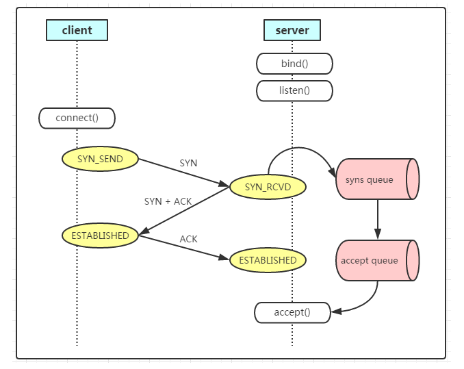
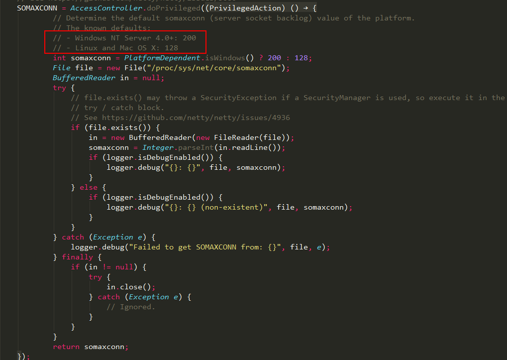
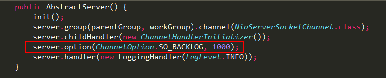

# TCP backlog参数

> GitHub 仓库源文件：[点击打开网页渲染版](https://github.com/ben2023niao/ben-ops-notes/blob/main/doc/md/202304141557-%E5%AE%89%E5%85%A8%E4%B8%8E%E5%A0%A1%E5%9E%92%E6%9C%BA%2B%E9%AB%98%E7%BA%A7%E5%AE%89%E5%85%A8%2BLinux%2BRedis-TCP%20backlog%E5%8F%82%E6%95%B0.md)

backlog 参数主要用于底层方法 int listen(int sockfd, int backlog)， 在解释 backlog 参数之前，我们先了解下 tcp 在内核的请求过程，其实就是 tcp 的三次握手：

1. client 发送 SYN 到 server，将状态修改为 SYN_SEND，如果 server 收到请求，则将状态修改为 SYN_RCVD，并把该请求放到 syns queue 队列中。
2. server 回复 SYN+ACK 给 client，如果 client 收到请求，则将状态修改为 ESTABLISHED，并发送 ACK 给 server。
3. server 收到 ACK，将状态修改为 ESTABLISHED，并把该请求从 syns queue 中放到 accept queue。

在 **Linux** 系统内核中维护了两个队列：syns queue 和 accept queue。

## syns queue

用于保存半连接状态的请求，其大小通过 /proc/sys/net/ipv4/tcp_max_syn_backlog 指定，一般默认值是 512，不过这个设置有效的前提是系统的 syncookies 功能被禁用。

互联网常见的 TCP SYN FLOOD 恶意 DOS 攻击方式就是建立大量的半连接状态的请求，然后丢弃，导致 syns queue 不能保存其它正常的请求。

## accept queue

用于保存全连接状态的请求，其大小通过 /proc/sys/net/core/somaxconn 指定，在使用 listen 函数时，内核会根据传入的 backlog 参数与系统参数 somaxconn，取二者的较小值。

如果 accpet queue 队列满了，server 将发送一个 ECONNREFUSED 错误信息 Connection refused 到 client。

## 应用层

在 **[netty](https://haicoder.net/netty/netty-network.html)** 实现中，backlog 默认通过 NetUtil.SOMAXCONN 指定。

当然也可以通过 option 方法自定义 backlog 的大小。

## 多大的backlog是合适的

前面讲了这么多，应用程序设置多大的 backlog 是合理的呢？答案是 It depends，根据不同过的业务场景，需要做对应的调整。

你如果的接口处理连接的速度要求非常高，或者在做压力测试，很有必要调高这个值。如果业务接口本身性能不好，accept 取走已建连的速度较慢，那么把 backlog 调的再大也没有用，只会增加连接失败的可能性。

可以举个典型的 backlog 值供大家参考，**[Nginx](https://haicoder.net/nginx/nginx-tutorial.html)** 和 **[Redis](https://haicoder.net/redis/redis-birth.html)** 默认的 backlog 值等于 511，Linux 默认的 backlog 为 128，Java 默认的 backlog 等于 50。

## tcp_abort_on_overflow参数

默认情况下，全连接队列满以后，服务端会忽略客户端的 ACK，随后会重传 SYN+ACK，也可以修改这种行为，这个值由 /proc/sys/net/ipv4/tcp_abort_on_overflow 决定。

- tcp_abort_on_overflow 为 0 表示三次握手最后一步全连接队列满以后 server 会丢掉 client 发过来的 ACK，服务端随后会进行重传 SYN+ACK。
- tcp_abort_on_overflow 为 1 表示全连接队列满以后服务端直接发送 RST 给客户端。

但是回给客户端 RST 包会带来另外一个问题，客户端不知道服务端响应的 RST 包到底是因为「该端口没有进程监听」，还是「该端口有进程监听，只是它的队列满了」。

## 总结

半连接队列：服务端收到客户端的 SYN 包，回复 SYN+ACK 但是还没有收到客户端 ACK 情况下，会将连接信息放入半连接队列。半连接队列又被称为 SYN 队列。

全连接队列：服务端完成了三次握手，但是还未被 accept 取走的连接队列。全连接队列又被称为 Accept 队列。

半连接队列的大小与用户 listen 传入的 backlog、net.core.somaxconn、net.core.somaxconn 都有关系。

全连接队列的大小是用户 listen 传入的 backlog 与 net.core.somaxconn 的较小值。
