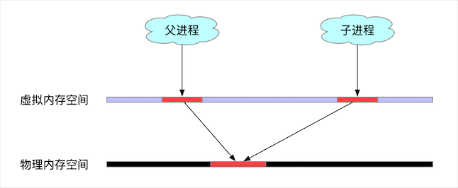
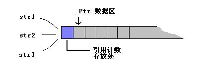

# 写时拷贝

> GitHub 仓库源文件：[点击打开网页渲染版](https://github.com/ben2023niao/ben-ops-notes/blob/main/doc/md/202304141557-%E5%AE%89%E5%85%A8%E4%B8%8E%E5%A0%A1%E5%9E%92%E6%9C%BA%2B%E9%AB%98%E7%BA%A7%E5%AE%89%E5%85%A8%2BLinux%2BRedis-%E5%86%99%E6%97%B6%E6%8B%B7%E8%B4%9D.md)

copy-on-write，写时拷贝，是计算机程序设计领域的一种优化策略，其核心思想是，当有多个调用者都需要请求相同资源时，一开始资源只会有一份，多个调用者共同读取这一份资源，当某个调用者需要修改数据的时候，才会分配一块内存，将数据拷贝过去，供这个调用者使用，而其他调用者依然还是读取最原始的那份数据。每次有调用者需要修改数据时，就会重复一次拷贝流程，供调用者修改使用。

使用 copy-on-write 可以避免或者减少数据的拷贝操作，极大的提高性能，其应用十分广泛，例如 **[Linux](https://haicoder.net/linux/linux-tutorial.html)** 的 fork 调用，Linux 的文件管理系统，一些数据库服务，**[Java](https://haicoder.net/java/java-development.html)** 中的 CopyOnWriteArrayList，C98/C03 中的 std::string 等等。

## Linux中的fork()

Linux 在启动过程中，会初始化内核，而内核初始化的最后一步，是创建一个 PID 为 1 的超级进程，又叫做根进程。系统中所有的其他进程，都是由这个根进程直接或者间接产生的，而产生进程的方式，就是利用 fork 系统调用，fork 是类 Unix 操作系统上创建进程的主要方法。

fork() 的函数原型很简单：

`pid_t fork();`

我们来看一个简单的例子：

```c
#include <unistd.h>
#include <stdio.h>
int main() {
 int pid = fork();
 if (pid == -1) {
 return -1;
 }
 if (pid > 0) {
 printf("Hi, father: %d\n", getpid());
 return 0;
 } else {
 printf("Hi, child: %d\n", getpid());
 return 0;
 }
}
```

通过 gcc 编译之后执行，输出：

`Hi, father: 7562

Hi, child: 7563`

从输出来看，if 和 else 居然都执行了，因为用 fork() 有个神奇的地方，一次调用，两次返回。

调用 fork() 之后，会出现两个进程，一个是子进程，一个是父进程，在子进程中，fork() 返回 0，在父进程中，fork() 返回新创建的子进程的进程 ID，我们可以通过 fork() 函数的返回值来判断当前进程是子进程还是父进程。两个进程都会从调用 fork() 的地方继续执行。

### fork()中的copy-on-write

fork 进程之后，父进程中的数据怎么办？常规思路是，给子进程重新开辟一块物理内存，将父进程的数据拷贝到子进程中，拷贝完之后，父进程和子进程之间的数据段和堆栈是相互独立的。这样做会带来两个问题：

- 拷贝本身会有 CPU 和内存的开销；
- fork 出来的子进程在此后多会执行 exec() 系统调用。

也就是说，绝大部分情况下，fork 一个子进程会耗费 CPU 和内存资源，但是马上又被子进程抛弃不用了，那么资源的开销就显得毫无意义，于是出于效率考虑，Linux 引入了 copy-on-write 技术。

在 fork() 调用之后，只会给子进程分配虚拟内存地址，而父子进程的虚拟内存地址虽然不同，但是映射到物理内存上都是同一块区域，子进程的代码段、数据段、堆栈都是指向父进程的物理空间


并且此时父进程中所有对应的内存页都会被标记为只读，父子进程都可以正常读取内存数据，当其中某个进程需要更新数据时，检测到内存页是 read-only 的，内存管理单元（MMU）便会抛出一个页面异常中断，（page-fault），在处理异常时，内核便会把触发异常的内存页拷贝一份（其他内存页还是共享的一份），让父子进程各自持有一份。

这样做的好处不言而喻，能极大的提高 fork 操作时的效率，但是坏处是，如果 fork 之后，两个进程各自频繁的更新数据，则会导致大量的分页错误，这样就得不偿失了。

## Java中的CopyOnWrite容器

Java 中有两个容器：CopyOnWriteArrayList 和 CopyOnWriteArraySet，从名字就可以看出，其实现思想也是参考了 copy-on-write 技术。

当我们往一个 CopyOnWrite 的容器中添加数据的时候，并不会直接添加到当前容器中，而是会拷贝出一个新的容器，然后往新的容器里添加数据，在添加过程中，所有的读操作都会指向旧的容器，添加操作完成之后，再将原容器的引用指向新的容器。为了避免同时有多个线程更新数据，从而拷贝出多个容器的副本，会在拷贝容器的时候进行加锁。

这样做的好处是对 CopyOnWrite 容器进行读操作的时候并不需要加锁，因为当前容器不会添加任何元素。所以 CopyOnWrite 容器也是一种读写分离的思想，读和写不同的容器。

## C++中的std::string

C98/C03 中的 std::string 使用了 copy-on-write 技术，在 C++11 标准中为了提高并行性取消了这一策略。

C++ 在分配一个 string 对象时，会在数据区的前面多分配一点空间，用于存储 string 的引用计数。


当触发一个 string 的拷贝构造函数或者赋值函数时，便会对这个引用计数加一。需要修改内容时，如果引用计数不为零，表示有人在共享这块内存，那么自己需要先做一份拷贝，然后把引用计数减去一，再把数据拷贝过来。

## Redis中的COW

**[Redis](https://haicoder.net/redis/redis-birth.html)** 中，执行 BGSAVE 命令，来生成 RDB 文件时，本质就是调用了 Linux 的系统调用 fork() 命令，Linux 下 fork() 系统调用，实现了 copy-on-write 写时复制。

## Copy On Write技术实现原理

fork() 之后，kernel 把父进程中所有的内存页的权限都设为 read-only，然后子进程的地址空间指向父进程。当父子进程都只读内存时，相安无事。当其中某个进程写内存时，CPU 硬件检测到内存页是 read-only 的，于是触发页异常中断（page-fault），陷入 kernel 的一个中断例程。中断例程中，kernel 就会把触发的异常的页复制一份，于是父子进程各自持有独立的一份。

## Copy On Write技术好处

COW 技术可减少分配和复制大量资源时带来的瞬间延时。

COW 技术可减少不必要的资源分配。比如 fork 进程时，并不是所有的页面都需要复制，父进程的代码段和只读数据段都不被允许修改，所以无需复制。

## Copy On Write技术缺点

如果在 fork() 之后，父子进程都还需要继续进行写操作，那么会产生大量的分页错误(页异常中断 page-fault)，这样就得不偿失。

## 总结

fork 出的子进程共享父进程的物理空间，当父子进程有内存写入操作时，read-only 内存页发生中断，将触发的异常的内存页复制一份(其余的页还是共享父进程的)。

fork 出的子进程功能实现和父进程是一样的。如果有需要，我们会用 exec() 把当前进程映像替换成新的进程文件，完成自己想要实现的功能。
