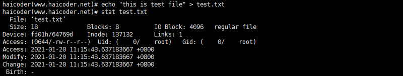
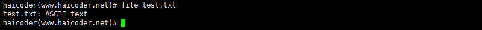
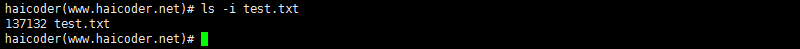
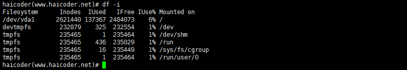

# inode节点

操作系统的文件数据除了实际内容之外，通常含有非常多的属性，例如 **[Linux](https://haicoder.net/linux/linux-tutorial.html)** 操作系统的文件权限与文件属性。文件系统通常会将这两部分内容分别存放在 inode 和 block 中。

## inode和block概述

文件是存储在硬盘上的，硬盘的最小存储单位叫做扇区 sector，每个扇区存储 512 字节。操作系统读取硬盘的时候，不会一个个扇区地读取，这样效率太低，而是一次性连续读取多个扇区，即一次性读取一个块 block。这种由多个扇区组成的块，是文件存取的最小单位。块的大小，最常见的是 4KB，即连续八个 sector 组成一个 block。

文件数据存储在块中，那么还必须找到一个地方存储文件的元信息，比如文件的创建者、文件的创建日期、文件的大小等等。这种存储文件元信息的区域就叫做 inode，中文译名为索引节点，也叫 i 节点。因此，一个文件必须占用一个 inode，但至少占用一个 lock。

- 元信息 → inode
- 数据 → block

## inode内容

inode 包含很多的文件元信息，但不包含文件名，例如：字节数、属主 UserID、属组 GroupID、读写执行权限、时间戳等。

而文件名存放在目录当中，但 Linux 系统内部不使用文件名，而是使用 inode 号码识别文件。对于系统来说文件名只是 inode 号码便于识别的别称。

### stat

要查看 inode 信息，我们可以使用 stat 命令。我们首先在终端上使用 echo 命令，创建一个文件，并写入内容：

`echo "this is test file" > test.txt`

接着，我们使用 stat 命令，查看文件的 inode 信息，具体命令如下：

`stat test.txt`

执行完毕后，如下图所示：


三个主要的时间属性：

- ctime：change time 是最后一次改变文件或目录（属性）的时间，例如执行 chmod，chown 等命令。
- atime：access time 是最后一次访问文件或目录的时间。
- mtime：modify time 是最后一次修改文件或目录（内容）的时间。

### file

使用 file 命令，查看文件的类型：

`file test.txt`

执行完毕后，如下图所示：


### inode号码

表面上，用户通过文件名打开文件，实际上，系统内部将这个过程分为三步：

1. 系统找到这个文件名对应的 inode 号码；
2. 通过 inode 号码，获取 inode 信息；
3. 根据 inode 信息，找到文件数据所在的 block，并读出数据。

其实系统还要根据 inode 信息，看用户是否具有访问的权限，有就指向对应的数据 block，没有就返回权限拒绝。

### ls -i

直接查看文件 i 节点号，也可以通过 stat 查看文件 inode 信息查看 i 节点号。

`ls -i test.txt`

执行完毕后，如下图所示：


### inode大小

inode 也会消耗硬盘空间，所以格式化的时候，操作系统自动将硬盘分成两个区域。一个是数据区，存放文件数据；另一个是 inode 区，存放 inode 所包含的信息。每个 inode 的大小，一般是 128 字节或 256 字节。通常情况下不需要关注单个 inode 的大小，而是需要重点关注 inode 总数。inode 总数在格式化的时候就确定了。

### df -i

查看硬盘分区的 inode 总数和已使用情况

`df -i`

执行完毕后，如下图所示：


### 特有现象

由于 inode 号码与文件名分离，导致一些 Unix/Linux 系统具备以下几种特有的现象。

1. 文件名包含特殊字符，可能无法正常删除。这时直接删除 inode，能够起到删除文件的作用：

`find ./* -inum 节点号 -delete`
2. 移动文件或重命名文件，只是改变文件名，不影响 inode 号码；
3. 打开一个文件以后，系统就以 inode 号码来识别这个文件，不再考虑文件名。

这种情况使得软件更新变得简单，可以在不关闭软件的情况下进行更新，不需要重启。因为系统通过 inode 号码，识别运行中的文件，不通过文件名。

更新的时候，新版文件以同样的文件名，生成一个新的 inode，不会影响到运行中的文件。等到下一次运行这个软件的时候，文件名就自动指向新版文件，旧版文件的 inode 则被回收。

### inode耗尽故障

由于硬盘分区的 inode 总数在格式化后就已经固定，而每个文件必须有一个 inode，因此就有可能发生 inode 节点用光，但硬盘空间还剩不少，却无法创建新文件。同时这也是一种攻击的方式，所以一些公用的文件系统就要做磁盘限额，以防止影响到系统的正常运行。

至于修复，很简单，只要找出哪些大量占用i节点的文件删除就可以了。

demo:

```bash
先准备一个比较小的硬盘分区 /dev/sdb1，并格式化挂载，这里挂载到了 /data 目录下。

[root@localhost ~]# df -hT /data/
Filesystem Type Size Used Avail Use% Mounted on
/dev/sdb1 xfs 29M 1.8M 27M 6% /data
先测试可以正常创建文件。

[root@localhost ~]# touch /data/test{1..5}.txt
[root@localhost ~]# ls /data/
test1.txt test2.txt test3.txt test4.txt test5.txt
查看 i 节点的使用情况。

[root@localhost ~]# df -i /data/
Filesystem Inodes IUsed IFree IUse% Mounted on
/dev/sdb1 16384 8 16376 1% /data
编写一个测试程序，创建大量空文件，用于耗尽此分区中的 i 节点数。

[root@localhost ~]# vim killinode.sh
#!/bin/bash
i=1
while [ $i -le 16376 ]
do
touch /data/file$i
let i++
done
运行测试程序，结束后查看 i 节点占用情况，磁盘分区空间使用情况。

[root@localhost ~]# sh killinode.sh
[root@localhost ~]# df -i /data/
Filesystem Inodes IUsed IFree IUse% Mounted on
/dev/sdb1 16384 16384 0 100% /data
[root@localhost ~]# df -hT /data/
Filesystem Type Size Used Avail Use% Mounted on
/dev/sdb1 xfs 29M 11M 19M 36% /data
虽然还有很多剩余空间，但是 i 节点耗尽了，也无法创建创建新文件，这就是 i 节点耗尽故障。

[root@localhost ~]# touch /data/newfile.txt
touch: cannot touch ‘/data/newfile.txt’: No space left on device
```

## 硬链接与软链接

### 硬链接

通过文件系统的 inode 链接来产生的新的文件名，而不是产生新的文件，称为硬链接。

一般情况下，每个 inode 号码对应一个文件名，但是 Linux 允许多个文件名指向同一个 inode 号码。意味着可以使用不同的文件名访问相同的内容。

`ln 源文件 目标`

运行该命令以后，源文件与目标文件的 inode 号码相同，都指向同一个 inode。inode 信息中的链接数这时就会增加 1。

当一个文件拥有多个硬链接时，对文件内容修改，会影响到所有文件名；但是删除一个文件名，不影响另一个文件名的访问。删除一个文件名，只会使得 inode 中的链接数减 1。

需要注意的是不能对目录做硬链接。

通过 mkdir 命令创建一个新目录，其硬链接数应该有 2 个，因为常见的目录本身为 1 个硬链接，而目录下面的隐藏目录.（点号）是该目录的又一个硬链接，也算是 1 个连接数。

### 软链接

类似于 Windows 的快捷方式功能的文件，可以快速连接到目标文件或目录，称为软链接。

`ln -s 源文件或目录 目标文件或目录`

软链接就是再创建一个独立的文件，而这个文件会让数据的读取指向它连接的那个文件的文件名。例如，文件 A 和文件B的 inode 号码虽然不一样，但是文件 A 的内容是文件B的路径。读取文件 A 时，系统会自动将访问者导向文件 B。这时，文件 A 就称为文件B的软链接 soft link 或者符号链接 symbolic link。

这意味着，文件 A 依赖于文件 B 而存在，如果删除了文件 B，打开文件 A 就会报错。这是软链接与硬链接最大的不同：文件 A 指向文件 B 的文件名，而不是文件 B 的 inode 号码，文件 B 的 inode 链接数不会因此发生变化。
