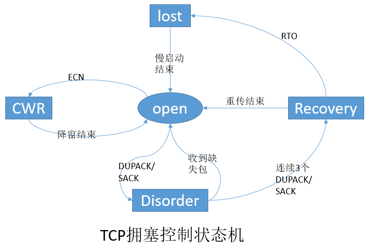
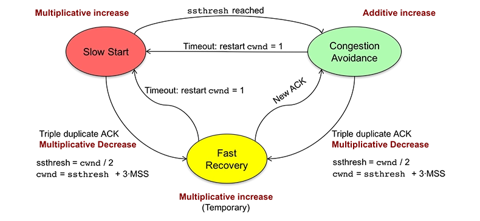
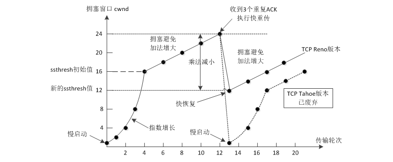
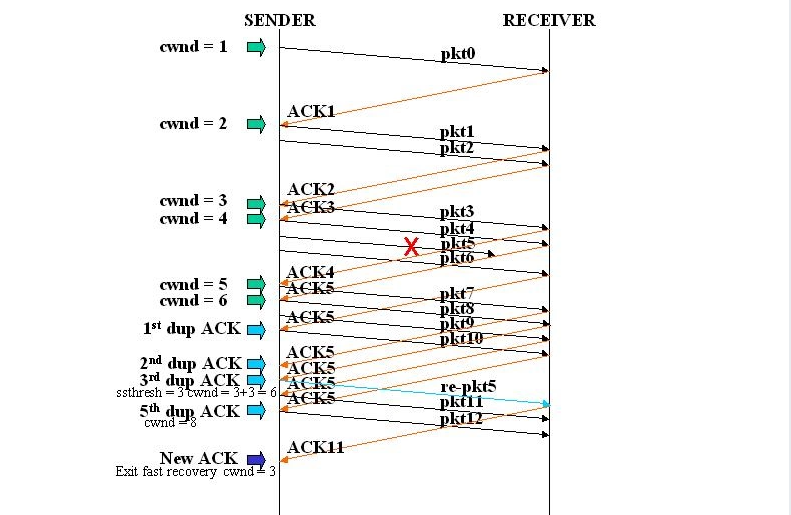

# TCP拥塞控制

> GitHub 仓库源文件：[点击打开网页渲染版](https://github.com/ben2023niao/ben-ops-notes/blob/main/doc/md/202304141557-%E5%AE%89%E5%85%A8%E4%B8%8E%E5%A0%A1%E5%9E%92%E6%9C%BA%2B%E9%AB%98%E7%BA%A7%E5%AE%89%E5%85%A8%2BLinux%2B%E5%A4%87%E4%BB%BD%E6%81%A2%E5%A4%8D-TCP%E6%8B%A5%E5%A1%9E%E6%8E%A7%E5%88%B6.md)

## 什么是拥塞

我们都知道计算机网络中的资源是有限的。某段时间内网络中对资源的需求超过了网络中的可用部分，而导致网络性能下降的情况就是拥塞。通俗点说就是发送的数据包太多网络中的设备处理不过来，而导致网络性能下降的情况。

## TCP为什么要进行拥塞控制

网络中的路由器会有一个数据包处理队列，当路由器接收到的数据包太多而一下子处理不过来时，就会导致数据包处理队列过长。此时，路由器就会无条件的丢弃新接收到的数据封包。

这就会导致上层的 TCP 协议以为数据包在网络中丢失，进而重传这些数据包，而路由器又会丢弃这些重传的数据包，如此以往，就会导致网络性能急剧下降，引起网络瘫痪。

因此，TCP 需要控制数据包发送的数量来避免网络性能的下降。

## 拥塞控制与流量控制的区别

拥塞控制就是防止过多的数据注入到网络中，这样可以防止网络中的路由器或链路不致过载。拥塞控制所要做的都有一个前提，就是网络能够承受现有的网络负荷。拥塞控制是一个全局性的过程，涉及到所有的主机、所有的路由器，以及与降低网络传输性能有关的所有因素。

流量控制往往指点对点通信量的控制，是个端到端的问题。流量控制所要做的就是抑制发送端发送数据的速率，以便使接收端来得及接收。

## TCP拥塞控制算法

TCP 协议有两个比较重要的控制算法，一个是流量控制，另一个就是阻塞控制。

TCP 协议通过滑动窗口来进行流量控制，它是控制发送方的发送速度从而使接受者来得及接收并处理。而拥塞控制是作用于网络，它是防止过多的包被发送到网络中，避免出现网络负载过大，网络拥塞的情况。

拥塞算法需要掌握其状态机和四种算法。拥塞控制状态机的状态有五种，分别是 Open，Disorder，CWR，Recovery 和 Loss 状态。四个算法为慢启动，拥塞避免，拥塞发生时算法和快速恢复。

### Congestion Control State Machine

和 TCP 一样，拥塞控制算法也有其状态机。当发送方收到一个 Ack 时，Linux TCP 通过状态机(state)来决定其接下来的行为，是应该降低拥塞窗口 cwnd 大小，或者保持 cwnd 不变，还是继续增加 cwnd。如果处理不当，可能会导致丢包或者超时。

#### Open状态

Open 状态是拥塞控制状态机的默认状态。这种状态下，当 ACK 到达时，发送方根据拥塞窗口 cwnd(Congestion Window)是小于还是大于慢启动阈值 ssthresh(slow start threshold)，来按照慢启动或者拥塞避免算法来调整拥塞窗口。

#### Disorder状态

当发送方检测到 DACK(重复确认)或者 SACK(选择性确认)时，状态机将转变为 Disorder 状态。在此状态下，发送方遵循飞行(in-flight)包守恒原则，即一个新包只有在一个老包离开网络后才发送，也就是发送方收到老包的 ACK 后，才会再发送一个新包。

#### CWR状态

发送方接收到一个拥塞通知时，并不会立刻减少拥塞窗口 cwnd，而是每收到两个 ACK 就减少一个段，直到窗口的大小减半为止。当 cwnd 正在减小并且网络中有没有重传包时，这个状态就叫 CWR(Congestion Window Reduced，拥塞窗口减少)状态。CWR 状态可以转变成 Recovery 或者 Loss 状态。

#### Recovery状态

当发送方接收到足够(推荐为三个)的 DACK(重复确认)后，进入该状态。在该状态下，拥塞窗口 cnwd 每收到两个 ACK 就减少一个段(segment)，直到 cwnd 等于慢启动阈值 ssthresh，也就是刚进入 Recover 状态时 cwnd 的一半大小。
发送方保持 Recovery 状态直到所有进入 Recovery 状态时正在发送的数据段都成功地被确认，然后发送方恢复成 Open 状态，重传超时有可能中断 Recovery 状态，进入 Loss 状态。

#### Loss状态

当一个 RTO(重传超时时间)到期后，发送方进入 Loss 状态。所有正在发送的数据标记为丢失，拥塞窗口 cwnd 设置为一个段(segment)，发送方再次以慢启动算法增大拥塞窗口 cwnd。

Loss 和 Recovery 状态的区别是:Loss 状态下，拥塞窗口在发送方设置为一个段后增大，而 Recovery 状态下，拥塞窗口只能被减小。Loss 状态不能被其他的状态中断，因此，发送方只有在所有 Loss 开始时正在传输的数据都得到成功确认后，才能退到 Open 状态。

## 四大算法

拥塞控制主要是四个算法：1）慢启动，2）拥塞避免，3）拥塞发生，4）快速恢复。这四个算法不是一天都搞出来的，这个四算法的发展经历了很多时间，到今天都还在优化中。

### 慢热启动算法 – Slow Start

所谓慢启动，也就是TCP连接刚建立，一点一点地提速，试探一下网络的承受能力，以免直接扰乱了网络通道的秩序。

慢启动算法：

1. 连接建好的开始先初始化拥塞窗口 cwnd 大小为 1，表明可以传一个 MSS 大小的数据。
2. 每当收到一个 ACK，cwnd 大小加一，呈线性上升。
3. 每当过了一个往返延迟时间 RTT(Round-Trip Time)，cwnd 大小直接翻倍，乘以 2，呈指数让升。
4. 还有一个 ssthresh（slow start threshold），是一个上限，当 cwnd >= ssthresh 时，就会进入 “拥塞避免算法”（后面会说这个算法）

### 拥塞避免算法 – Congestion Avoidance

如同前边说的，当拥塞窗口大小 cwnd 大于等于慢启动阈值 ssthresh 后，就进入拥塞避免算法。算法如下：

1. 收到一个ACK，则 cwnd = cwnd + 1 / cwnd
2. 每当过了一个往返延迟时间 RTT，cwnd 大小加一。

过了慢启动阈值后，拥塞避免算法可以避免窗口增长过快导致窗口拥塞，而是缓慢的增加调整到网络的最佳值。

### 拥塞状态时的算法

一般来说，TCP 拥塞控制默认认为网络丢包是由于网络拥塞导致的，所以一般的 TCP 拥塞控制算法以丢包为网络进入拥塞状态的信号。对于丢包有两种判定方式，一种是超时重传 RTO[Retransmission Timeout] 超时，另一个是收到三个重复确认 ACK。

超时重传是 TCP 协议保证数据可靠性的一个重要机制，其原理是在发送一个数据以后就开启一个计时器，在一定时间内如果没有得到发送数据报的 ACK 报文，那么就重新发送数据，直到发送成功为止。

但是如果发送端接收到 3 个以上的重复 ACK，TCP 就意识到数据发生丢失，需要重传。这个机制不需要等到重传定时器超时，所以叫做快速重传，而快速重传后没有使用慢启动算法，而是拥塞避免算法，所以这又叫做快速恢复算法。

超时重传 RTO[Retransmission Timeout] 超时，TCP 会重传数据包。TCP 认为这种情况比较糟糕，反应也比较强烈：

1. 由于发生丢包，将慢启动阈值 ssthresh 设置为当前 cwnd 的一半，即 ssthresh = cwnd / 2
2. cwnd 重置为 1
3. 进入慢启动过程

最为早期的 TCP Tahoe 算法就只使用上述处理办法，但是由于一丢包就一切重来，导致 cwnd 又重置为 1，十分不利于网络数据的稳定传递。所以，TCP Reno 算法进行了优化。当收到三个重复确认 ACK 时，TCP 开启快速重传 Fast Retransmit 算法，而不用等到 RTO 超时再进行重传：

1. cwnd 大小缩小为当前的一半
2. ssthresh 设置为缩小后的 cwnd 大小
3. 然后进入快速恢复算法 Fast Recovery

### 快速恢复算法 – Fast Recovery

TCP Tahoe 是早期的算法，所以没有快速恢复算法，而 Reno 算法有。在进入快速恢复之前，cwnd 和 ssthresh 已经被更改为原有 cwnd 的一半。快速恢复算法的逻辑如下：

	1. cwnd = cwnd + 3 MSS，加 3 MSS 的原因是因为收到 3 个重复的 ACK。
	2. 重传 DACKs 指定的数据包。
	3. 如果再收到 DACKs，那么 cwnd 大小增加一。
	4. 如果收到新的 ACK，表明重传的包成功了，那么退出快速恢复算法。将 cwnd 设置为 ssthresh，然后进入拥塞避免算法。
	
	如图所示，第五个包发生了丢失，所以导致接收方接收到三次重复 ACK，也就是 ACK5。所以将 ssthresh 设置为当时 cwnd 的一半，也就是 6/2 = 3，cwnd 设置为 3 + 3 = 6。然后重传第五个包。当收到新的 ACK 时，也就是 ACK11，则退出快速恢复阶段，将 cwnd 重新设置为当前的 ssthresh，也就是 3，然后进入拥塞避免算法阶段。
