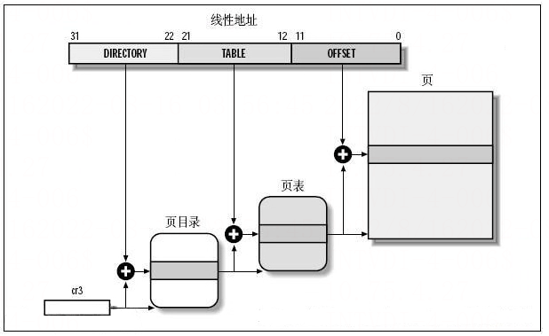

# 操作系统页表

> GitHub 仓库源文件：[点击打开网页渲染版](https://github.com/ben2023niao/ben-ops-notes/blob/main/doc/md/202304141557-%E5%AE%89%E5%85%A8%E4%B8%8E%E5%A0%A1%E5%9E%92%E6%9C%BA%2B%E9%AB%98%E7%BA%A7%E5%AE%89%E5%85%A8%2BLinux%2B%E6%9D%83%E9%99%90%E7%AE%A1%E7%90%86-%E6%93%8D%E4%BD%9C%E7%B3%BB%E7%BB%9F%E9%A1%B5%E8%A1%A8.md)

## 什么是页表

页表是内存管理系统中的数据结构，用于向每个进程提供一致的虚拟地址空间，每个页表项保存的是虚拟地址到物理地址的映射以及一些管理标志。应用进程只能访问虚拟地址，内核必须借助页表和硬件把虚拟地址翻译为对物理地址的访问。

## 页表作用

在使用虚拟地址空间的 **[Linux](https://haicoder.net/linux/linux-tutorial.html)** 操作系统上，每一个进程都工作在一个 4G 的地址空间上，其中 0~3G 是应用进程可以访问的 user 地址空间，是这个进程独有的，其他进程看不到也无法操作这个地址空间；3G~4G 是 kernel 地址空间，所有进程共享这部分地址空间。

由于每个进程都有 3G 的私有进程空间，所以系统的物理内存无法对这些地址空间进行一一映射，因此 kernel 需要一种机制，把进程地址空间映射到物理内存上。当一个进程请求访问内存时，操作系统通过存储在 kernel 中的进程页表把这个虚拟地址映射到物理地址，如果还没有为这个地址建立页表项，那么操作系统就为这个访问的地址建立页表项。最基本的映射单位是 page，对应的是页表项 PTE。

页表项和物理地址是多对一的关系，即多个页表项可以对应一个物理页面，因而支持共享内存的实现（几个进程同时共享物理内存）。

## 页表的实现

实现虚拟地址到物理地址转换最容易想到的方法是使用数组，对虚拟地址空间的每一个页，都分配一个数组项。但是有一个问题，考虑 IA32 体系结构下，页面大小为 4KB，整个虚拟地址空间为 4GB，则需要包含 1M 个页表项，这还只是一个进程，因为每个进程都有自己独立的页表。因此，系统所有的内存都来存放页表项恐怕都不够。

相像一下进程的虚拟地址空间，实际上大部分是空闲的，真正映射的区域几乎是汪洋大海中的小岛，因次我们可以考虑使用多级页表，可以减少页表内存使用量。实际上多级页表也是各种体系结构支持的，没有硬件支持，我们是没有办法实现页表转换的。

为了减少页表的大小并忽略未做实际映射的区域，计算机体系结构的设计都会靠虑将虚拟地址划分为多个部分。具体的体系结构划分方式不同，比如 ARM7 和 IA32 就有不同的划分，在这里我们不讨论这部分内容。

Linux 操作系统使用 4 级页表：

图中 CR3 保存着进程页目录 PGD 的地址，不同的进程有不同的页目录地址。进程切换时，操作系统负责把页目录地址装入 CR3 寄存器。

### 地址翻译过程如下

1. 对于给定的线性地址，根据线性地址的 bit22 ~ bit31 作为页目录项索引值，在 CR3 所指向的页目录中找到一个页目录项。
2. 找到的页目录项对应着页表，根据线性地址的 bit12 ~ bit21 作为页表项索引值，在页表中找到一个页表项。
3. 找到的页表项中包含着一个页面的地址，线性地址的 bit0 ~ bit11 作为页内偏移值和找到的页确定线性地址对应的物理地址。

这个地址翻译过程完全是由硬件完成的。

### 页表转化失败

在地址转换过程中，有两种情况会导致失败发生。

1. 要访问的地址不存在，这通常意味着由于编程错误访问了无效的虚拟地址，操作系统必须采取某种措施来处理这种情况，对于现代操作系统，发送一个段错误给程序；或者要访问的页面还没有被映射进来，此时操作系统要为这个线性地址分配相应的物理页面，并更新页表。
2. 要查找的页不在物理内存中，比如页已经交换出物理内存。在这种情况下需要把页从磁盘交换回物理内存。

### TLB

CPU 的 Memory management unit(MMU) cache 了最近使用的页面映射。我们称之为 translation lookaside buffer(TLB)。TLB 是一个组相连的 cache。当一个虚拟地址需要转换成物理地址时，首先搜索 TLB。如果发现了匹配（TLB命中），那么直接返回物理地址并访问。然而，如果没有匹配项（TLB miss），那么就要从页表中查找匹配项，如果存在也要把结果写回 TLB。

## 页表格式

页目录项和页表项大小都是 32bit(4 bytes)，由于 4KB 地址对齐的原因，页目录项和页表项只有 bit12 ~ bit31 用于地址，剩余的低 12bits 则用来描述页有关的附加信息。尽管这些位是特定于 CPU 的，下列位在 Linux 内核支持的大部分 CPU 都能找到：

### Present

页目录项和页表项都包含这个位。

虚拟地址对应的物理页面不在内存中，比如页被交换出去，此时页表项的其他部分通常会代表不同的含义，因为不需要描述页在物理内存中的地址，相反，需要信息来找到换出的页。

如果页目录或者页表项的 Present 位为 0， 那么 CPU 分页单元把虚拟地址存储到 CR2 中，然后生成一个异常 14：page fault 异常。

### Accessed

每次分页单元访问页面时，都会自动设置 Accessed 位，内核会定期检查该位，以便确定页的活跃程度，内核会选择不活跃的页面 swapout 到交换空间。注意分页单元只负责置位，清除位操作要内核自己执行。

### Dirty

仅仅存在于页表项，每当向页帧写入数据分页单元都会设置 dirty 标志，swap 进程可以通过这个位来决定是否选择这个页面进行交换。记住，分页单元不会清除这个标记，所以必须由操作系统来清除这个标记。

### Read/Write

包含了页面的读写权限，如果设置为 0，那么只有读权限；设置为 1，则有读写权限。

### User/Supervisor

User 允许用户空间代码访问该页；Supervisor 只有内核才可以访问。

### Exec

在较新的 64 bit 处理器上，分页单元支持 No eXec 位，因此 2.6.11 内核开始加入了这个标志。

## 页表项的创建和操作

所有体系结构都要实现下面的页表项创建，释放和操作函数，以便于内存管理代码创建和销毁页表：

| 函数 | 描述 |

| --- | --- |

| mk_pte | 创建一个页表项，必须将page实列和所需的访问权限作为参数传入 |

| pte_page | 获得页表项描述的页对应的page实列地址 |

| pgd_alloc | 分配并初始化可容纳一个完整目录表的内存（不是一个表项） |

| pud_alloc |  |

| pmd_alloc |  |

| pte_alloc |  |

| pgd_free | 释放目录表占用的内存 |

| pud_free |  |

| pmd_free |  |

| pte_free |  |

| set_pgd | 设置页目录项中某项的值 |

| set_pud |  |

| set_pmd |  |

| set_pte |
