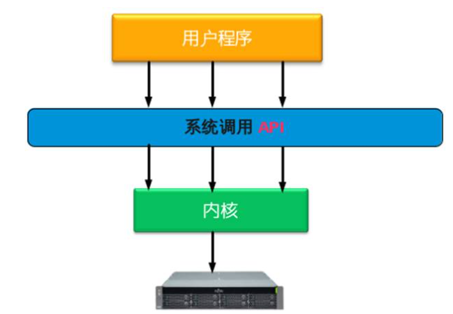
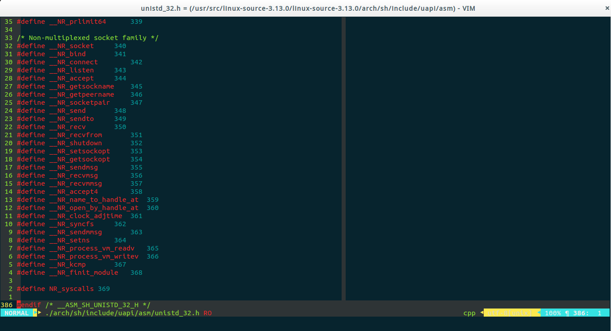
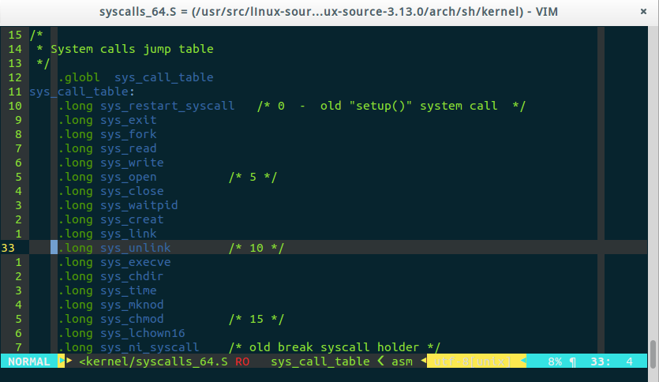
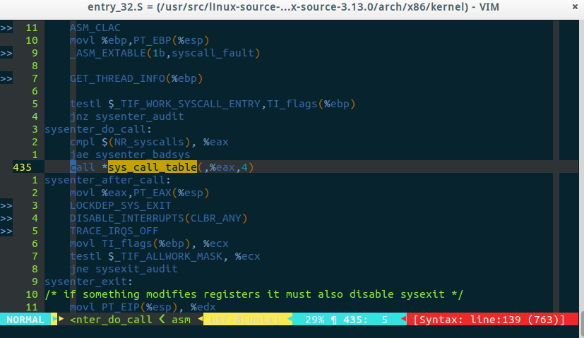

# 系统调用

## 系统调用概述

计算机系统的各种硬件资源是有限的，在现代多任务操作系统上同时运行的多个进程都需要访问这些资源，为了更好的管理这些资源进程是不允许直接操作的，所有对这些资源的访问都必须有操作系统控制。也就是说操作系统是使用这些资源的唯一入口，而这个入口就是操作系统提供的系统调用（System Call）。在 **[Linux](https://haicoder.net/linux/linux-tutorial.html)** 中系统调用是用户空间访问内核的唯一手段，除异常和陷入外，他们是内核唯一的合法入口。

一般情况下应用程序通过应用编程接口 API，而不是直接通过系统调用来编程。在 Unix 世界，最流行的 API 是基于 POSIX 标准的。

操作系统一般是通过中断从用户态切换到内核态。中断就是一个硬件或软件请求，要求 CPU 暂停当前的工作，去处理更重要的事情。比如，在 x86 机器上可以通过 int 指令进行软件中断，而在磁盘完成读写操作后会向 CPU 发起硬件中断。

中断有两个重要的属性，中断号和中断处理程序。中断号用来标识不同的中断，不同的中断具有不同的中断处理程序。在操作系统内核中维护着一个中断向量表（Interrupt Vector Table），这个数组存储了所有中断处理程序的地址，而中断号就是相应中断在中断向量表中的偏移量。

一般地，系统调用都是通过软件中断实现的，x86 系统上的软件中断由 int $0x80 指令产生，而 128 号异常处理程序就是系统调用处理程序 system_call()，它与硬件体系有关，在 entry.S 中用汇编写。接下来就来看一下 Linux 下系统调用具体的实现过程。

系统调用图如下图所示：

## 为什么需要系统调用

Linux 内核中设置了一组用于实现系统功能的子程序，称为系统调用。系统调用和普通库函数调用非常相似，只是系统调用由操作系统核心提供，运行于内核态，而普通的函数调用由函数库或用户自己提供，运行于用户态。

一般的，进程是不能访问内核的。它不能访问内核所占内存空间也不能调用内核函数。CPU 硬件决定了这些（这就是为什么它被称作 “保护模式” ）。

为了和用户空间上运行的进程进行交互，内核提供了一组接口。透过该接口，应用程序可以访问硬件设备和其他操作系统资源。这组接口在应用程序和内核之间扮演了使者的角色，应用程序发送各种请求，而内核负责满足这些请求(或者让应用程序暂时搁置)。实际上提供这组接口主要是为了保证系统稳定可靠，避免应用程序肆意妄行，惹出大麻烦。

系统调用在用户空间进程和硬件设备之间添加了一个中间层。该层主要作用有三个：

1. 它为用户空间提供了一种统一的硬件的抽象接口。比如当需要读些文件的时候，应用程序就可以不去管磁盘类型和介质，甚至不用去管文件所在的文件系统到底是哪种类型。
2. 系统调用保证了系统的稳定和安全。作为硬件设备和应用程序之间的中间人，内核可以基于权限和其他一些规则对需要进行的访问进行裁决。举例来说，这样可以避免应用程序不正确地使用硬件设备，窃取其他进程的资源，或做出其他什么危害系统的事情。
3. 每个进程都运行在虚拟系统中，而在用户空间和系统的其余部分提供这样一层公共接口，也是出于这种考虑。如果应用程序可以随意访问硬件而内核又对此一无所知的话，几乎就没法实现多任务和虚拟内存，当然也不可能实现良好的稳定性和安全性。在 Linux 中，系统调用是用户空间访问内核的惟一手段；除异常和中断外，它们是内核惟一的合法入口。

## API/POSIX/C库的区别与联系

一般情况下，应用程序通过应用编程接口(API)而不是直接通过系统调用来编程。这点很重要，因为应用程序使用的这种编程接口实际上并不需要和内核提供的系统调用一一对应。

在 Unix 世界中，最流行的应用编程接口是基于 POSIX 标准的，其目标是提供一套大体上基于 Unix 的可移植操作系统标准。POSIX 是说明 API 和系统调用之间关系的一个极好例子。在大多数 Unix 系统上，根据 POSIX 而定义的 API 函数和系统调用之间有着直接关系。

Linux 的系统调用像大多数 Unix 系统一样，作为 C 库的一部分提供如下图所示。C 库实现了 Unix 系统的主要 API，包括标准 C 库函数和系统调用。所有的 C 程序都可以使用 C 库，而由于 **[C 语言](https://haicoder.net/c/c-tutorial.html)** 本身的特点，其他语言也可以很方便地把它们封装起来使用。

从程序员的角度看，系统调用无关紧要，他们只需要跟API打交道就可以了。相反，内核只跟系统调用打交道；库函数及应用程序是怎么使用系统调用不是内核所关心的。

关于 Unix 的界面设计有一句通用的格言 “提供机制而不是策略”。换句话说，Unix 的系统调用抽象出了用于完成某种确定目的的函数。至干这些函数怎么用完全不需要内核去关心。区别对待机制(mechanism)和策略(policy)是 Unix 设计中的一大亮点。大部分的编程问题都可以被切割成两个部分:“需要提供什么功能”(机制)和“怎样实现这些功能”(策略)。

### 区别

api 是函数的定义，规定了这个函数的功能，跟内核无直接关系。而系统调用是通过中断向内核发请求，实现内核提供的某些服务。

### 联系

一个 api 可能会需要一个或多个系统调用来完成特定功能。通俗点说就是如果这个 api 需要跟内核打交道就需要系统调用，否则不需要。程序员调用的是 API（API 函数），然后通过与系统调用共同完成函数的功能。因此，API 是一个提供给应用程序的接口，一组函数，是与程序员进行直接交互的。

系统调用则不与程序员进行交互的，它根据 API 函数，通过一个软中断机制向内核提交请求，以获取内核服务的接口。并不是所有的 API 函数都一一对应一个系统调用，有时，一个 API 函数会需要几个系统调用来共同完成函数的功能，甚至还有一些 API 函数不需要调用相应的系统调用（因此它所完成的不是内核提供的服务）。

## 系统调用的实现原理

### 基本机制

前文已经提到了 Linux 下的系统调用是通过 0x80 实现的，但是我们知道操作系统会有多个系统调用（Linux 下有 319 个系统调用），而对于同一个中断号是如何处理多个不同的系统调用的？最简单的方式是对于不同的系统调用采用不同的中断号，但是中断号明显是一种稀缺资源，Linux 显然不会这么做；还有一个问题就是系统调用是需要提供参数，并且具有返回值的，这些参数又是怎么传递的？也就是说，对于系统调用我们要搞清楚两点：

1. 系统调用的函数名称转换。
2. 系统调用的参数传递。

首先看第一个问题。实际上，Linux 中每个系统调用都有相应的系统调用号作为唯一的标识，内核维护一张系统调用表，sys_call_table，表中的元素是系统调用函数的起始地址，而系统调用号就是系统调用在调用表的偏移量。在 x86 上，系统调用号是通过 eax 寄存器传递给内核的。比如 fork() 的实现。

用户空间的程序无法直接执行内核代码。它们不能直接调用内核空间中的函数，因为内核驻留在受保护的地址空间上。如果进程可以直接在内核的地址空间上读写的话，系统安全就会失去控制。所以，应用程序应该以某种方式通知系统，告诉内核自己需要执行一个系统调用，希望系统切换到内核态，这样内核就可以代表应用程序来执行该系统调用了。

通知内核的机制是靠软件中断实现的。首先，用户程序为系统调用设置参数。其中一个参数是系统调用编号。参数设置完成后，程序执行“系统调用”指令。x86系统上的软中断由int产生。这个指令会导致一个异常：产生一个事件，这个事件会致使处理器切换到内核态并跳转到一个新的地址，并开始执行那里的异常处理程序。此时的异常处理程序实际上就是系统调用处理程序。它与硬件体系结构紧密相关。

新地址的指令会保存程序的状态，计算出应该调用哪个系统调用，调用内核中实现那个系统调用的函数，恢复用户程序状态，然后将控制权返还给用户程序。系统调用是设备驱动程序中定义的函数最终被调用的一种方式。

从系统分析的角度，linux的系统调用涉及 4 个方面的问题。

### 响应函数sys_xxx

响应函数名以 “sys_” 开头，后跟该系统调用的名字。例如系统调用 fork() 的响应函数是 sys_fork()，exit() 的响应函数是 sys_exit()。

### 系统调用表与系统调用号-=>数组与下标

文件 include/asm/unisted.h 为每个系统调用规定了唯一的编号。

假设用 name 表示系统调用的名称，那么系统调用号与系统调用响应函数的关系是：以系统调用号 `_NR_name` 作为下标，可找出系统调用表 sys_call_table 中对应表项的内容，它正好是该系统调用的响应函数 sys_name 的入口地址。

系统调用表 sys_call_table 记录了各 sys_name 函数在表中的位置，共 190 项。有了这张表，就很容易根据特定系统调用

在表中的偏移量，找到对应的系统调用响应函数的入口地址。系统调用表共 256 项，余下的项是可供用户自己添加的系统调用空间。

在 Linux 中，每个系统调用被赋予一个系统调用号。这样，通过这个独一无二的号就可以关联系统调用。当用户空间的进程执行一个系统调用的时候，这个系统调用号就被用来指明到底是要执行哪个系统调用。进程不会提及系统调用的名称。

系统调用号相当关键，一旦分配就不能再有任何变更，否则编译好的应用程序就会崩溃。Linux 有一个 “未实现” 系统调用 sys_ni_syscall()，它除了返回一 ENOSYS 外不做任何其他工作，这个错误号就是专门针对无效的系统调用而设的。

因为所有的系统调用陷入内核的方式都一样，所以仅仅是陷入内核空间是不够的。因此必须把系统调用号一并传给内核。在 x86 上，系统调用号是通过 eax 寄存器传递给内核的。在陷人内核之前，用户空间就把相应系统调用所对应的号放入 eax 中了。这样系统调用处理程序一旦运行，就可以从 eax 中得到数据。其他体系结构上的实现也都类似。

内核记录了系统调用表中的所有已注册过的系统调用的列表，存储在 sys_call_table 中。它与体系结构有关，一般在 entry.s 中定义。这个表中为每一个有效的系统调用指定了惟一的系统调用号。sys_call_table 是一张由指向实现各种系统调用的内核函数的函数指针组成的表：

system_call() 函数通过将给定的系统调用号与 NR_syscalls 做比较来检查其有效性。如果它大于或者等于 NR syscalls,该函数就返回一 ENOSYS。否则，就执行相应的系统调用。

### 进程的系统调用命令转换为INT 0x80中断的过程

宏定义 `_syscallN()` 见 (include/asm/unisted.h) 用于系统调用的格式转换和参数的传递。N 取 0~5 之间的整数。参数个数为 N 的系统调用由 `_syscallN()` 负责格式转换和参数传递。系统调用号放入 EAX 寄存器，启动 INT 0x80 后，规定返回值送 EAX 寄存器。
