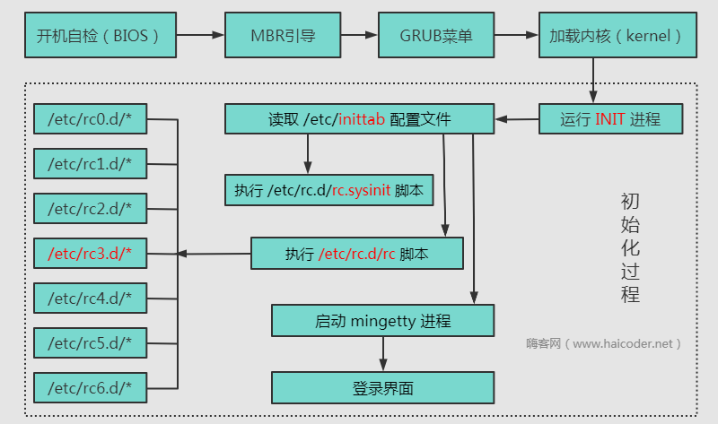

# Linux启动过程

## Linux启动过程详解

第一步：开机自检，加载 BIOS

第二步：读取 MBR

第三步：Boot Loader　grub 引导菜单

第四步：加载 kernel 内核

第五步：init 进程依据 inittab 文件夹来设定运行级别

第六步：init 进程执行 rc.sysinit

第七步：启动内核模块

第八步：执行不同运行级别的脚本程序

第九步：执行 /etc/rc.d/rc.local

第十步：执行 /bin/login 程序，启动 mingetty，进入登录状态

### Linux启动过程图解

### 剖析启动过程

**第一步：开机自检，加载 BIOS**

当我们打开计算机电源的时候，随后会听到滴的一声，自检开始，这个过程中主要是检测我们的计算机硬件设备比如：CPU，内存，主板，显卡，CMOS 等设备是否有故障存在。

**第二步：读取MBR**

BIOS 自检，首先会在一个 Boot Sequence 程序中搜索可以让系统启动的引导设备（比如我们有时在 BIOS 中设置为从硬盘启动，或者从 CD-ROM 启动等等）。

这时如果 BIOS 找不到可以引导的设备及相关程序后，便会启动失败，如果顺序的找到了相关设备硬盘，那么 BIOS 将把控制权交给启动设备中的 MBR（Master Boot Record）主引导记录。

MBR 在大小为 512 字节，存放预启动信息、分区表等信息。

**第三步：Boot Loader　grub引导菜单**

在 MBR 程序中找到其前 446 字节的 Boot　Loader。

Boot Loader 就是在操作系统内核运行之前运行的一段小程序。通过这段小程序，我们可以初始化硬件设备、建立内存空间的映射图，从而将系统的软硬件环境带到一个合适的状态，以便为最终调用操作系统内核做好一切准备。

Boot Loader 有若干种，其中 Grub、Lilo 和 spfdisk 是常见的 Loader。

系统读取内存中的 grub 配置信息（一般为 menu.lst 或 grub.lst），并依照此配置信息来启动不同的操作系统。

**第四步：加载kernel内核**

根据 grub 设定的内核映像所在路径，系统读取内存映像，并进行解压缩操作。此时，屏幕一般会输出 “Uncompressing Linux” 的提示。当解压缩内核完成后，屏幕输出 “OK, booting the kernel”。

系统将解压后的内核放置在内存之中，并调用 start_kernel() 函数来启动一系列的初始化函数并初始化各种设备，完成 Linux 核心环境的建立。至此，Linux 内核已经建立起来了，基于 Linux 的程序应该可以正常运行了。

**第五步：init进程依据inittab文件夹来设定运行级别**

内核被加载后，第一个运行的程序便是 /sbin/init，该文件会读取 /etc/inittab 文件，并依据此文件来进行初始化工作。

其实 /etc/inittab 文件最主要的作用就是设定 Linux 的运行等级，其设定形式是 “：id:5:initdefault:”，这就表明 Linux 需要运行在等级 5 上。Linux 的运行等级设定如下：

| 启动级别 | 说明 |

| --- | --- |

| 0 | halt，关机 |

| 1 | single user mode，单用户模式 |

| 2 | Multi-user,without NFS 无网络支持的多用户模式，类似于下面的 run level3 |

| 3 | Full multi-user mode，有网络支持的多用户模式 |

| 4 | unused 保留，未使用 |

| 5 | X11 ，有网络支持有 X-Window 支持的多用户模式 |

| 6 | reboot，重新引导系统，即重启 |

通过命令

`cat /etc/inittab`

可以查看 /etc/inittab 相关设定。

**第六步：init进程执行rc.sysinit**

在设定了运行等级后，Linux 系统执行的第一个用户层文件就是 /etc/rc.d/rc.sysinit 脚本程序，它做的工作非常多，包括设定 PATH、设定网络配置（/etc/sysconfig/network）、启动 swap 分区、设定 /proc 等等。如果你有兴趣，可以到 /etc/rc.d 中查看一下 rc.sysinit 文件，里面的脚本够你看几天的。

**第七步：启动内核模块**

具体是依据 /etc/modules.conf 文件或 /etc/modules.d 目录下的文件来装载内核模块。

**第八步：执行不同运行级别的脚本程序**

根据运行级别的不同，系统会运行 rc0.d 到 rc6.d 中的相应的脚本程序，来完成相应的初始化工作和启动相应的服务。

**第九步：执行/etc/rc.d/rc.local**

你如果打开了此文件，里面有一句话，读过之后，你就会对此命令的作用一目了然：

`# This script will be executed *after* all the other init scripts.

## You can put your own initialization stuff in here if you don’t

## want to do the full Sys V style init stuff.`

rc.local 就是在一切初始化工作后，Linux 留给用户进行个性化的地方。你可以把你想设置和启动的东西放到这里。

**第十步：执行/bin/login程序，启动mingetty,进入登录状态**

### 简述开机系统启动过程

1. 开机 BIOS 自检
2. MBR 引导，硬盘 0 柱面 0 磁道 1 扇区的前 446byte
3. grub 引导菜单

`cat /etc/grub.conf`

1. 加载内核 kernel
2. 启动 init 进程

`[root@dingjian rc.d]# ps -ef|grep init
root 1 0 0 Oct23 ? 00:00:02 init [3]`

1. 读取 inittab 文件，执行 rc.sysinit.rc 等脚本

`/etc/inittab
/etc/rc.d/rc.sysinit
/etc/rc.d/rc3.d/ <==文本模式`

1. 启动 mingetty，进入系统登陆界面。
