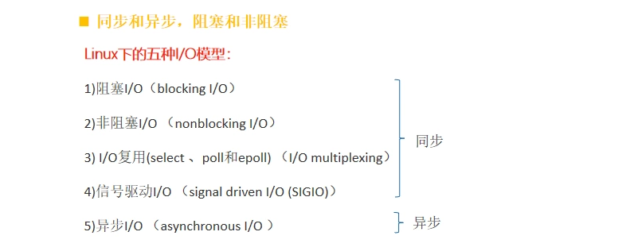
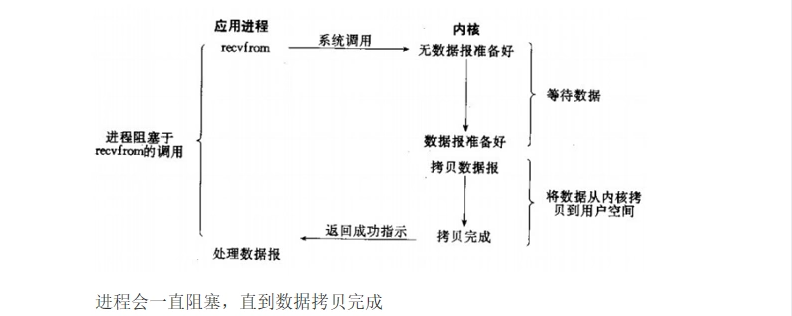
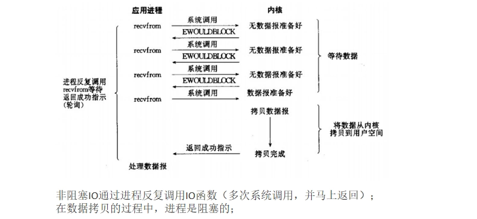
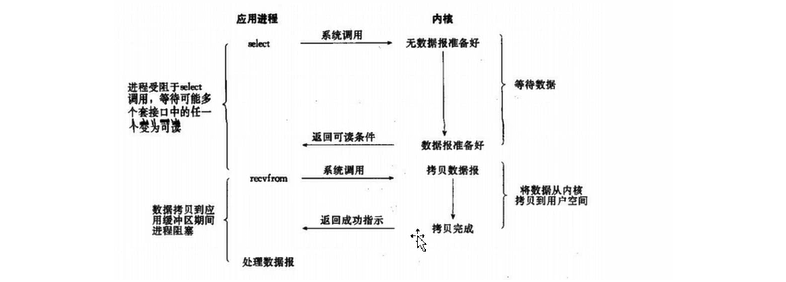
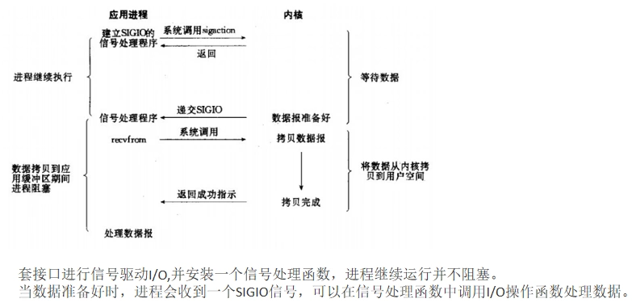
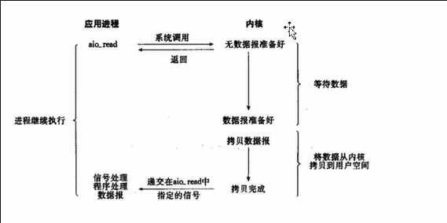
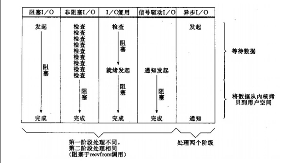

# Linux网络IO模型

**[Linux](https://haicoder.net/linux/linux-tutorial.html)** 的五种 IO 模型，分别是：阻塞 IO、非阻塞 IO、多路复用 IO、信号驱动 IO 以及异步 IO。其中阻塞 IO、非阻塞 IO、多路复用 IO、信号驱动 IO 都属于同步 IO。

## 同步IO和异步IO

同步 IO：应用程序主动向内核查询是否有可用数据，如果有自己负责把数据从内核 copy 到用户空间。

异步 IO：应用程序向内核发起读数据请求需要：（1）告诉内核数据存放位置（2）注册回调函数，当内核完成数据 copy 后调用回调通知应用程序取数据。

同步IO/异步IO最大区别：同步 IO 数据从内核空间到用户空间的 copy 动作是由应用程序自己完成。而异步 IO 则是注册回调函数并告知内核用户空间缓冲区存放地址，数据 copy 由内核完成。

## Linux五种网络IO模型

### 阻塞IO模型

1. 当应用程序发起网络 IO 的请求时会调用操作系统 recvfrom 函数。
2. 等待系统内核准备数据报(获取网络数据:网卡把数据拷贝到内核)。
3. 数据报准备好后将数据从内核拷贝到用户空间，即应用程序空间。

### 非阻塞IO模型

一般很少用这个非阻塞模型，因为反复调用消耗 CPU。

### IO复用模型

IO 复用模型是 Linux 下用的最多的，也就是 JDK 中的 NIO。

特点：

1. 对于某一个应用进程而言，或者说在某一次网络通信,它还是阻塞的,但是可以同时服务于多个网络通信。
2. 多个 select 函数即多个 socket 请求，会挂在内核中,操作系统会轮询检查数据报是否准备好再返回可读条件即就绪，应用程序再发起 recefrom 函数拷贝内核中的数据。

select 和 epoll，对一个 socket 两次调用，两次返回，比阻塞 IO 并没有什么优越性，关键是能实现同时对多个 socket 进行处理。

### 信号驱动IO—(相对少用)

### 异步IO模型

当一个异步过程调用发出后，系统直接返回,调用者不能立刻得到结果。实际处理这个调用的部件在完成后，通过状态、通知和回调来通知调用者的输入输出操作。

## 五种IO模型的比较

除异步 IO 模型，前面四种 IO 模型第二阶段都是相同的，阻塞于 recefrom 调用。

## 总结

五种 IO 的模型：阻塞 IO、非阻塞 IO、多路复用 IO、信号驱动 IO 和异步 IO；前四种都是同步 IO，在内核数据 copy 到用户空间时都是阻塞的。

阻塞 IO 和非阻塞 IO 的区别在于第一步，发起 IO 请求是否会被阻塞，如果会那就是传统的阻塞 IO，如果不会那就是非阻塞 IO。

同步 IO 和异步 IO 的区别就在于第二个步骤是否阻塞，如果实际的 IO 读写阻塞请求进程，那么就是同步 IO；如果不阻塞，而是操作系统帮你做完 IO 操作再将结果返回给你，那么就是异步 IO。
