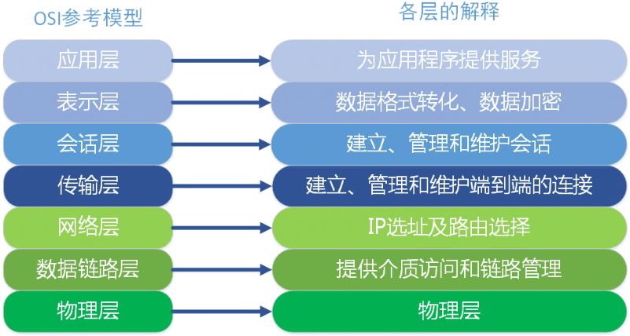
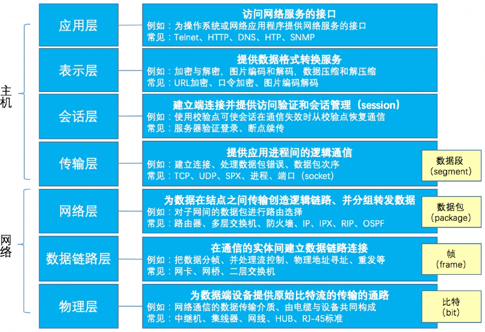
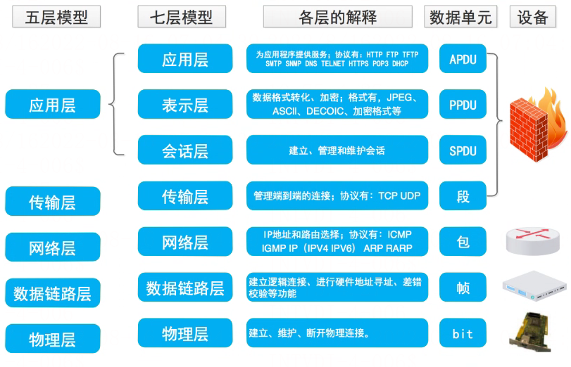
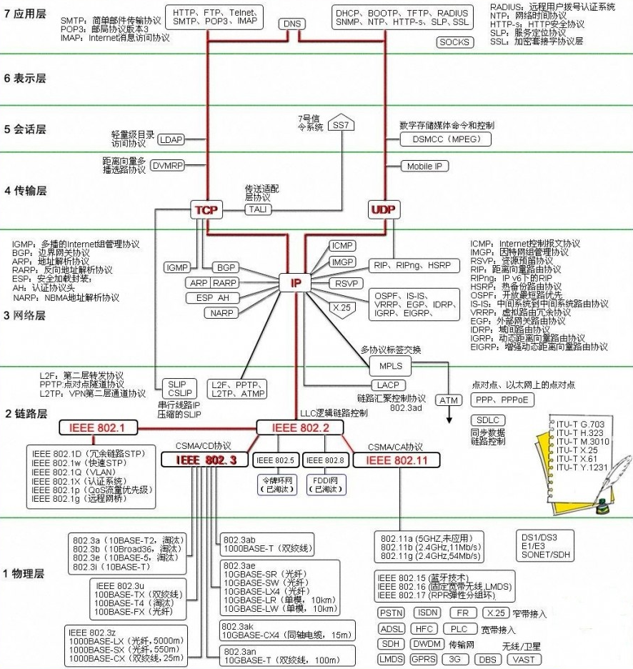
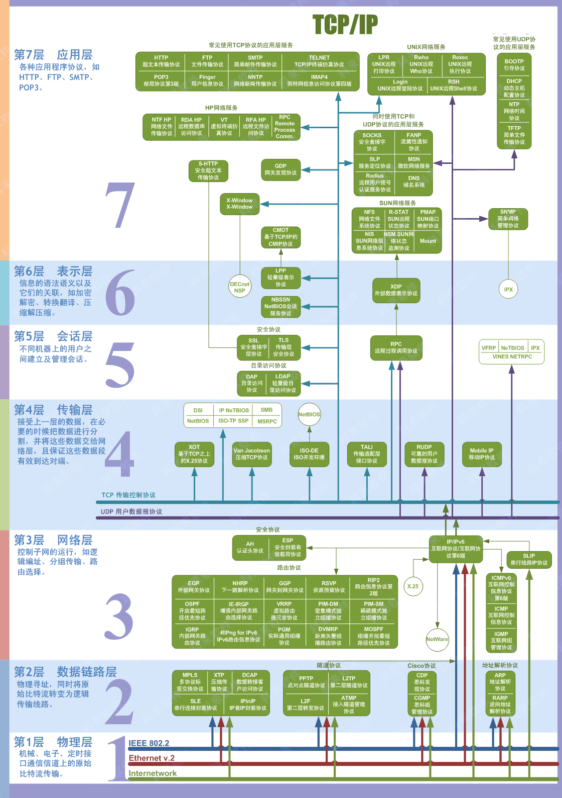
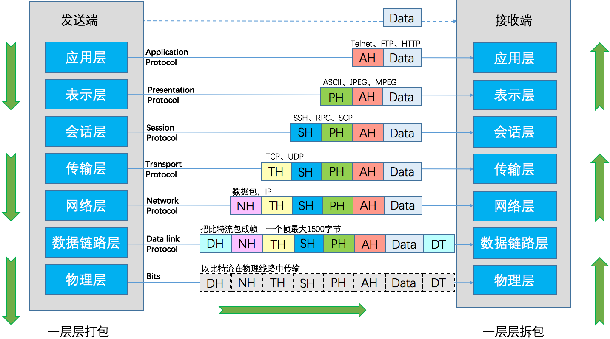

# OSI七层模型

> GitHub 仓库源文件：[点击打开网页渲染版](https://github.com/ben2023niao/ben-ops-notes/blob/main/doc/md/202304141557-%E5%AE%89%E5%85%A8%E4%B8%8E%E5%A0%A1%E5%9E%92%E6%9C%BA%2B%E9%AB%98%E7%BA%A7%E5%AE%89%E5%85%A8%2BLinux%2B%E7%9F%A5%E8%AF%86%E7%AC%94%E8%AE%B0-OSI%E4%B8%83%E5%B1%82%E6%A8%A1%E5%9E%8B.md)

## 什么是OSI

OSI（Open System Interconnect），即开放式系统互联。 一般都叫 OSI 参考模型，是 ISO（国际标准化组织）组织在 1985 年研究的网络互连模型。

ISO 为了更好的使网络应用更为普及，推出了 OSI 参考模型。其含义就是推荐所有公司使用这个规范来控制网络。这样所有公司都有相同的规范，就能互联了。

## OSI七层模型的划分

OSI 定义了网络互连的七层框架（物理层、数据链路层、网络层、传输层、会话层、表示层、应用层），即 ISO 开放互连系统参考模型。如下图：

每一层实现各自的功能和协议，并完成与相邻层的接口通信。OSI 的服务定义详细说明了各层所提供的服务。某一层的服务就是该层及其下各层的一种能力，它通过接口提供给更高一层。各层所提供的服务与这些服务是怎么实现的无关。

## OSI七层各层功能

### 物理层

主要定义物理设备标准，如网线的接口类型、光纤的接口类型、各种传输介质的传输速率等。它的主要作用是传输比特流（就是由 1、0 转化为电流强弱来进行传输,到达目的地后在转化为 1、0，也就是我们常说的数模转换与模数转换），这一层的数据叫做比特。

### 数据链路层

定义了如何让格式化数据以进行传输，以及如何让控制对物理介质的访问，这一层通常还提供错误检测和纠正，以确保数据的可靠传输。

### 网络层

在位于不同地理位置的网络中的两个主机系统之间提供连接和路径选择，Internet 的发展使得从世界各站点访问信息的用户数大大增加，而网络层正是管理这种连接的层。

### 传输层

定义了一些传输数据的协议和端口号（WWW 端口 80 等），如：**[TCP](https://haicoder.net/tcp/tcpip-tutorial.html)**（传输控制协议，传输效率低，可靠性强，用于传输可靠性要求高，数据量大的数据），UDP（用户数据报协议，与 TCP 特性恰恰相反，用于传输可靠性要求不高，数据量小的数据，如 QQ 聊天数据就是通过这种方式传输的）， 主要是将从下层接收的数据进行分段和传输，到达目的地址后再进行重组，常常把这一层数据叫做段。

### 会话层

通过传输层（端口号：传输端口与接收端口）建立数据传输的通路，主要在你的系统之间发起会话或者接受会话请求（设备之间需要互相认识可以是 IP 也可以是 MAC 或者是主机名）。

### 表示层

可确保一个系统的应用层所发送的信息可以被另一个系统的应用层读取。例如，PC 程序与另一台计算机进行通信，其中一台计算机使用扩展二一十进制交换码（EBCDIC），而另一台则使用美国信息交换标准码（ASCII）来表示相同的字符。如有必要，表示层会通过使用一种通格式来实现多种数据格式之间的转换。

### 应用层

是最靠近用户的 OSI 层，这一层为用户的应用程序（例如电子邮件、文件传输和终端仿真）提供网络服务。

### 图解

## OSI七层模型详解

| 分层 | 作用 | PDU(协议数据单元) | 设备 | 备注 |

| --- | --- | --- | --- | --- |

| 物理层 | 定义一些电器，机械，过程和规范，如集线器 | bit/比特 | 集线器HUB | 没有寻址的概念 |

| 数据链路层 | 定义如何格式化数据，支持错误检测 | 帧 | frame（帧）设备：以太网交换机 | 交换机通过 MAC 地址转发数据，逻辑链路控制 |

| 网络层 | 定义一个逻辑的寻址，选择最佳路径传输，路由数据包 | packet/数据包 | 路由器 | 实现寻址 |

| 传输层 | 提供可靠和尽力而为的传输 | fragment 段 | 无典型设备 | 负责网络传输和会话建立 |

| 会话层 | 控制会话，建立管理终止应用程序会话 | 无 | 无典型设备 | 负责会话建立 |

| 表示层 | 格式化数据 | 无 | 无典型设备 | 可以提供加密服务 |

| 应用层 | 控制应用程序 | 应用层数据 | 无典型设备 | 为应用程序提供网络服务 |

图解如下：

## 七层模型优点

1. 把复杂的网络划分成为更容易管理的层（将整个庞大而复杂的问题划分为若干个容易处理的小问题）。
2. 没有一个厂家能完整的提供整套解决方案和所有的设备，协议。
3. 独立完成各自该做的任务，互不影响，分工明确，上层不关心下层具体细节，分层同样有益于网络排错。

## OSI七层模型图解

OSI 七层模型各层典型协议图解如下：

各层作用即协议图解如下：

## 七层模型传输数据过程

OSI 七层模型数据传输过程如下：

## 七层模型传输说明

这个模型推出的最开始，是因为美国人有两台机器之间进行通信的需求。

### 需求1

科学家要解决的第一个问题是，两个硬件之间怎么通信。具体就是一台发些比特流，然后另一台能收到。于是，科学家发明了物理层：
主要定义物理设备标准，如网线的接口类型、光纤的接口类型、各种传输介质的传输速率等。它的主要作用是传输比特流(就是由 1、0 转化为电流强弱来进行传输，到达目的地后在转化为 1、0，也就是我们常说的数模转换与模数转换)。这一层的数据叫做比特。

### 需求2

现在通过电线我能发数据流了，但是，我还希望通过无线电波，通过其它介质来传输。然后我还要保证传输过去的比特流是正确的，要有纠错功能。于是，发明了数据链路层：
通过各种控制协议，将有差错的物理信道变为无差错的、能可靠传输数据帧的数据链路。

### 需求3

现在我可以在两台计算机之间发送数据了，那么如果我要在多台计算机之间发送数据呢？怎么找到我要发的那台？或者，A 要给 F 发信息，中间要经过 B，C，D，E，但是中间还有好多节点如 K.J.Z.Y。我怎么选择最佳路径？这就是路由要做的事。于是，发明了网络层。

通过路由算法，为报文或分组通过通信子网选择最适当的路径。该层控制数据链路层与物理层之间的信息转发，建立、维持与终止网络的连接。具体的说，数据链路层的数据在这一层被转换为数据包，然后通过路径选择、分段组合、顺序、进/出路由等控制，将信息从一个网络设备传送到另一个网络设备。一般的，数据链路层是解决统一网络内节点之间的通信，而网络层主要解决不同子网之间的通信。例如路由选择问题。

### 需求4

现在我能发正确的发比特流数据到另一台计算机了，但是当我发大量数据时候，可能需要好长时间，例如一个视频格式的，网络会中断好多次（事实上，即使有了物理层和数据链路层，网络还是经常中断，只是中断的时间是毫秒级别的）。那么，我还须要保证传输大量文件时的准确性。于是，我要对发出去的数据进行封装。就像发快递一样，一个个地发。于是，先发明了传输层。

向用户提供可靠的、端到端的差错和流量控制，保证报文的正确传输。提供建立、连接和拆除传输连接的功能。传输层在网络层基础上，提供 “面向连接” 和 “面向无连接” 两种服务。例如 TCP，是用于发大量数据的，我发了 1 万个包出去，另一台电脑就要告诉我是否接受到了 1 万个包，如果缺了 3 个包，就告诉我是第 1001，234，8888 个包丢了，那我再发一次。这样，就能保证对方把这个视频完整接收了。

例如 UDP，是用于发送少量数据的。我发 20 个包出去，一般不会丢包，所以，我不管你收到多少个。在多人互动游戏，也经常用 UDP 协议，因为一般都是简单的信息，而且有广播的需求。如果用 TCP，效率就很低，因为它会不停地告诉主机我收到了 20 个包，或者我收到了 18 个包，再发我两个！如果同时有 1 万台计算机都这样做，那么用 TCP 反而会降低效率，还不如用 UDP，主机发出去就算了，丢几个包你就卡一下，算了，下次再发包你再更新。

### 需求5

现在我们已经保证给正确的计算机，发送正确的封装过后的信息了。但是用户级别的体验好不好？难道我每次都要调用 TCP 去打包，然后调用 IP 协议去找路由，自己去发？当然不行，所以我们要建立一个自动收发包，自动寻址的功能。于是，发明了会话层。

会话层的作用就是建立和管理应用程序之间的通信。允许用户在两个实体设备之间建立、维持和终止会话，并支持它们之间的数据交换。例如提供单方向会话或双向同时会话，并管理会话中的发送顺序，以及会话所占用时间的长短。

### 需求6

现在我能保证应用程序自动收发包和寻址了。但是我要用 **[Linux](https://haicoder.net/linux/linux-tutorial.html)** 给 window 发包，两个系统语法不一致，就像安装包一样，exe 是不能在 linux 下用的，**[shell](https://haicoder.net/shell/shell-tutorial.html)** 在 window 下也是不能直接运行的。于是需要表示层，帮我们解决不同系统之间的通信语法问题。

### 需求7

OK，现在所有必要条件都准备好了，我们可以写个 android 程序，web 程序去实现需求吧。

## OSI七层模型总结

OSI 定义了网络互连的七层框架（物理层、数据链路层、网络层、传输层、会话层、表示层、应用层），即 ISO 开放互连系统参考模型。
