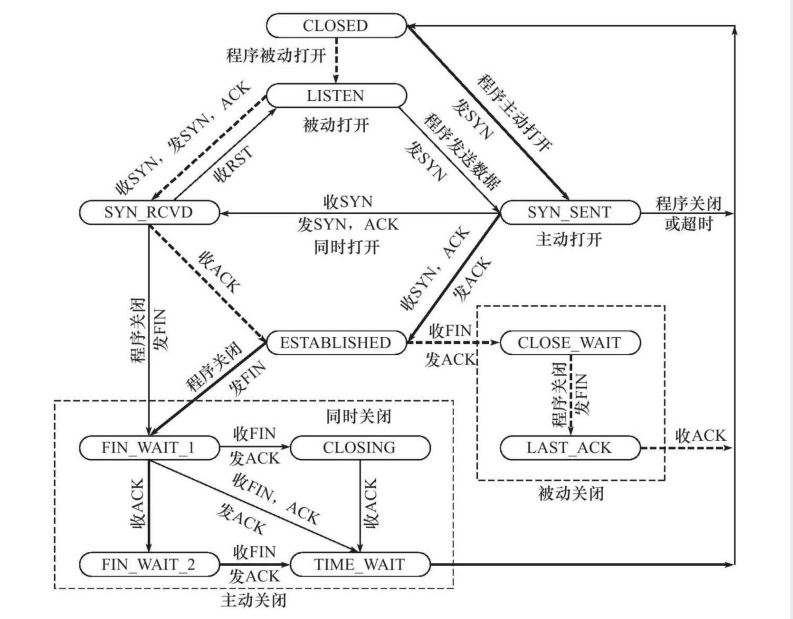
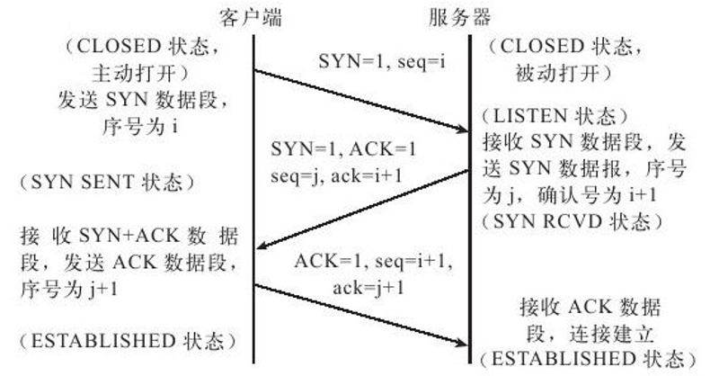
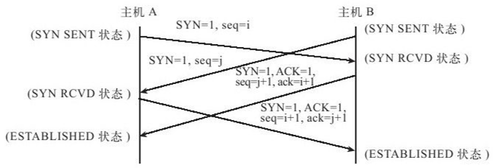
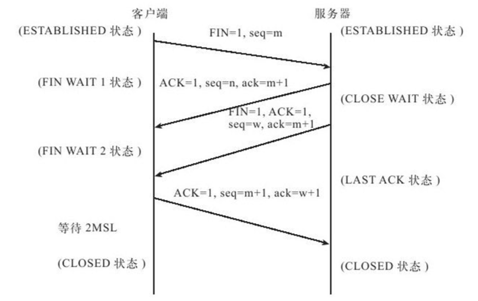
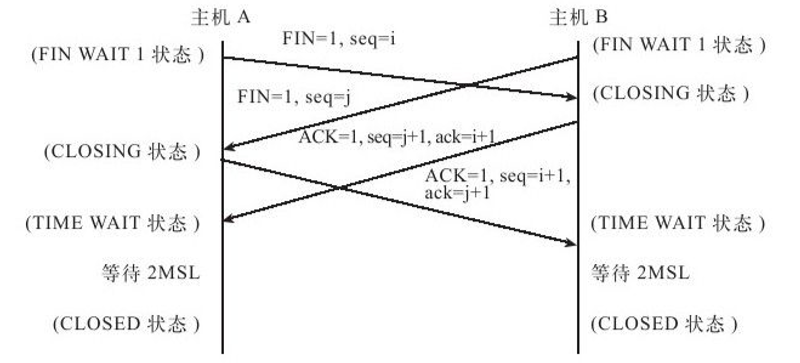

# TCP状态转移

> GitHub 仓库源文件：[点击打开网页渲染版](https://github.com/ben2023niao/ben-ops-notes/blob/main/doc/md/202304141557-%E5%AE%89%E5%85%A8%E4%B8%8E%E5%A0%A1%E5%9E%92%E6%9C%BA%2B%E9%AB%98%E7%BA%A7%E5%AE%89%E5%85%A8%2BLinux%2B%E7%9F%A5%E8%AF%86%E7%AC%94%E8%AE%B0-TCP%E7%8A%B6%E6%80%81%E8%BD%AC%E7%A7%BB.md)

TCP 是一个面向连接的传输层协议，因此不论哪一方需要传输数据，都需要在双方之间建立一条传输连接。

用 TCP 的三次握手与四次挥手来解释 TCP 的各个状态之间的会比较清晰。

## TCP三次握手

### 单方主动发起连接

1. 服务器端应用层的应用程序创建了一个 socket，使服务端被动打开，从 CLOSED 状态切换至 LISTEN 状态；
2. 此时客户端向服务端发送了一个 SYN=1，seq=i 的数据段，主动打开，并将状态从 CLOSED 切换至 SYN_SENT（此为 TCP 三次握手中的第一次握手）；
3. 服务端收到客户端的发来的同步请求后，给客户端回应一个 SYN=1，ACK=1，seq=j，ack=i+1 的数据段，并将状态从 LISTEN 切换至 SYN_RCVD，等待客户端的最后的 ACK（此为 TCP 三次握手中的第二次握手）；
4. 客户端收到服务端发来的 ACK 与 SYN 请求后，回应服务端 ACK=1，seq=i+1，ack=j+1 数据段，并将状态从 SYN_SENT 转换至 ESTABLISHED（此为 TCP 三次握手中的第三次握手）；
5. 服务端收到客户端发来的 ACK 确认后，将状态从 SYN_RCVD 转换至 ESTABLISHED。

### 双方同时发起连接请求

此种状态并不存在一方为服务器，一方为客户端的情况，主机 A 与主机 B 既是客户端又是服务端。

1. 主机 A 与主机 B 同时向对方发起同步请求；并将状态从 CLOSED 转换到 SYN_SENT

A：SYN=1 seq=i —–> B（在收到对方的 SYN 请求后，状态从 SYN_SENT 转换到 SYN_RCVD）

B：SYN=1 seq=j —–> A（在收到对方的 SYN 请求后，状态从 SYN_SENT 转换到 SYN_RCVD）
2. 主机 A 与主机 B 再同时确认对方的同步请求；

A：SYN=1 ACK=1 seq=i+1 ack=j+1 —–> B（在收到对方的 ACK 确认后，状态从 SYN_RCVD 转换到 ESTABLISHED）

B：SYN=1 ACK=1 seq=j+1 ack=i+1 —–> A（在收到对方的 ACK 确认后，状态从 SYN_RCVD 转换到 ESTABLISHED）

## TCP的四次挥手

### 单方主动发起断开请求

1. 假设由客户端主动发起断开请求，客户端向服务器端发送 FIN=1，seq=m 的数据段，请求断开连接，并将状态从 ESTABLISHED 转换至 FIN_WAIT 1 等待服务器确认；（此为四次挥手中的第一次挥手）
2. 服务器端接收到客户端发来的 FIN 请求后，会回应给客户端一个 ACK=1
seq=n，ack=m+1 的数据段，并将状态从 ESTABLISHED 转换至 CLOSE_WAIT；此时如果服务器端还由未发送完成的数据，则会继续发送；（此为四次挥手中的第二次挥手）
3. 客户端收到来自服务器端发来的 ACK 数据段后，关闭客户端至服务器方向 TCP 连接，此时整个 TCP 连接处于半关闭状态（half-close）；客户端状态从 FIN_WAIT 1 切换至 FIN_WAIT 2 ；等待服务器端发送FIN确认可以断开连接；注：此时客户端仍然可以接收来自服务器端发送的数据
4. 当服务器端数据传输完成，向客户端发送 FIN=1 ACK=1 seq=w ack=m+1 的数据段（此时服务器 ack 确认的数据段为客户端关闭 TCP 连接的最后一个数据段的序号），并将状态从 CLOSE_WAIT 转换至 LAST_ACK，等待客户端的 ACK 确认（此为 TCP 四次挥手的第 3 次挥手）
5. 客户端收到来自服务器端发送的 FIN 数据段后，向服务器段发送 ACK 确认数据段，并将状态从 FIN_WAIT 2 转换至 TIMED_WAIT；等待 2MSL(最大报文段生存时间)，如果没有收到来自服务器端的回应，关闭 TCP 连接，从 TIMED_WAIT 状态转换至 CLOSED 状态（此为 TCP 四次挥手的第四次挥手）
6. 服务器端在收到客户端发送的 ACK 后，将状态转换为 LISTEN；如果在一定时间内收不到客户端的 ACK，会重新向客户端发送 FIN 数据段

### 双方同时发起FIN请求

1. 双方同时向对方发送 FIN 请求；并将状态从 ESTABLISHED 转换至 FIN_WAIT 1
2. 双方都收到来自对方发送的 FIN 请求时，将状态从 FIN_WAIT1 转换至 CLOSING；给对方发送 ACK 确认数据段后，又将状态从 CLOSING 转换至 TIMED_WAIT；双方在等待 2MSL 时长后，没有收到来自对方的回应后，超时进入 CLOSED 状态

如果在客户端向服务端发起 SYN 请求后，服务器段不愿意进行连接，此时服务器端会向客户端发送一个 FIN 请求，并将状态从 SYN_RCVD 切换到 FIN_WAIT1；客户端收到 FIN 后，会回应服务器端一个 ACK 数据段，表示双方同时尝试关闭连接；并将状态从 SYN_SENT 切换至 CLOSING；服务器端在收到客户端发来的 ACK 数据段后，切换状态至 TIMED_WAIT；在超时后双方即关闭连接。

## 各状态解释

### CLOSED

初始状态，表示 TCP 连接是 “关闭着的” 或 “未打开的”。

### LISTEN

表示服务器端的某个 SOCKET 处于监听状态，可以接受客户端的连接。

### SYN-SEN

这个状态与 SYN_RCVD 状态相呼应，当客户端 SOCKET 执行 connect() 进行连接时，它首先发送 SYN 报文，然后随即进入到 SYN_SENT 状态，并等待服务端的发送三次握手中的第 2 个报文。SYN_SENT 状态表示客户端已发送 SYN 报文。

### SYN-RCVD

表示接收到了 SYN 报文。在正常情况下，这个状态是服务器端的 SOCKET 在建立 TCP 连接时的三次握手会话过程中的一个中间状态，很短暂，基本上用 netstat 很难看到这种状态（除非故意写一个监测程序，将三次 TCP 握手过程中最后一个 ACK 报文不予发送）。

当 TCP 连接处于此状态时，再收到客户端的 ACK 报文，它就会进入到 ESTABLISHED 状态。

### ESTABLISHED

表示 TCP 连接已经成功建立，数据可以传送给用户。

### FIN-WAIT-1

这个状态得好好解释一下，其实 FIN_WAIT_1 和 FIN_WAIT_2 两种状态的真正含义都是表示等待对方的 FIN 报文。而这两种状态的区别是：FIN_WAIT_1 状态实际上是当 SOCKET 在 ESTABLISHED 状态时，它想主动关闭连接，向对方发送了 FIN 报文，此时该 SOCKET 进入到 FIN_WAIT_1 状态。

而当对方回应 ACK 报文后，则进入到 FIN_WAIT_2 状态。当然在实际的正常情况下，无论对方处于任何种情况下，都应该马上回应 ACK 报文，所以 FIN_WAIT_1 状态一般是比较难见到的，而 FIN_WAIT_2 状态有时仍可以用 netstat 看到。

### FIN-WAIT-2

上面已经解释了这种状态的由来，实际上 FIN_WAIT_2 状态下的 SOCKET 表示半连接，即有一方调用 close() 主动要求关闭连接。

注意：FIN_WAIT_2 是没有超时的（不像 TIME_WAIT 状态），这种状态下如果对方不关闭（不配合完成 4 次挥手过程），那这个 FIN_WAIT_2 状态将一直保持到系统重启，越来越多的 FIN_WAIT_2 状态会导致内核崩溃。

### CLOSE-WAIT

表示正在等待关闭。怎么理解呢？当对方 close() 一个 SOCKET 后发送 FIN 报文给自己，你的系统毫无疑问地将会回应一个 ACK 报文给对方，此时 TCP 连接则进入到 CLOSE_WAIT 状态。

接下来呢，你需要检查自己是否还有数据要发送给对方，如果没有的话，那你也就可以 close() 这个 SOCKET 并发送 FIN 报文给对方，即关闭自己到对方这个方向的连接。

有数据的话则看程序的策略，继续发送或丢弃。简单地说，当你处于 CLOSE_WAIT 状态下，需要完成的事情是等待你去关闭连接。

### CLOSING

这种状态在实际情况中应该很少见，属于一种比较罕见的例外状态。正常情况下，当一方发送 FIN 报文后，按理来说是应该先收到（或同时收到）对方的 ACK 报文，再收到对方的 FIN 报文。

但是 CLOSING 状态表示一方发送 FIN 报文后，并没有收到对方的 ACK 报文，反而却也收到了对方的 FIN 报文。什么情况下会出现此种情况呢？那就是当双方几乎在同时 close() 一个 SOCKET 的话，就出现了双方同时发送 FIN 报文的情况，这时就会出现 CLOSING 状态，表示双方都正在关闭 SOCKET 连接。

### LAST-ACK

当被动关闭的一方在发送 FIN 报文后，等待对方的 ACK 报文的时候，就处于 LAST_ACK 状态。当收到对方的 ACK 报文后，也就可以进入到 CLOSED 可用状态了。

### TIME-WAIT

等待足够的时间以确保远程 TCP 接收到连接中断请求的确认； 表示收到了对方的 FIN 报文，并发送出了 ACK 报文。TIME_WAIT 状态下的 TCP 连接会等待 2*MSL（Max Segment Lifetime，最大分段生存期，指一个 TCP 报文在 Internet 上的最长生存时间。

每个具体的 TCP 协议实现都必须选择一个确定的 MSL 值，RFC 1122 建议是 2 分钟，但 BSD 传统实现采用了 30 秒，Linux 可以 cat /proc/sys/net/ipv4/tcp_fin_timeout 看到本机的这个值），然后即可回到 CLOSED 可用状态了。

如果 FIN_WAIT_1 状态下，收到了对方同时带 FIN 标志和 ACK 标志的报文时，可以直接进入到 TIME_WAIT 状态，而无须经过 FIN_WAIT_2 状态。
