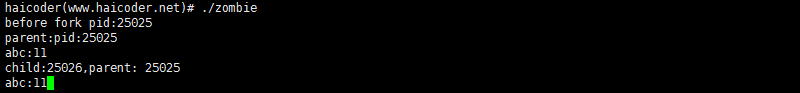
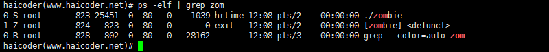

# 僵尸进程

## 僵尸进程教程

如果我们了解过 **[Linux](https://haicoder.net/linux/linux-tutorial.html)** 进程状态及转换关系，我们应该知道进程这么多状态中有一种状态是僵死状态，就是进程终止后进入僵死状态（zombie）等待告知父进程自己终止后才能完全消失。

但是如果一个进程已经终止了，但是其父进程还没有获取其状态，那么这个进程就称之为僵尸进程。

僵尸进程还会消耗一定的系统资源，并且还保留一些概要信息供父进程查询子进程的状态可以提供父进程想要的信息，一旦父进程得到想要的信息，僵尸进程就会结束。

## 案例

### 创建僵尸进程

我们在 Linux 下使用 vim 新建一个 zombie.c 的文件，编写如下**[C 语言](https://haicoder.net/c/c-tutorial.html)**代码如下：

```c
#include <sys/types.h>
#include <unistd.h>
#include <stdlib.h>
#include <stdio.h>
#include <string.h>
#include <signal.h>
#include <errno.h>
int main(void)
{
 pid_t pid ;
 //signal(SIGCHLD,SIG_IGN);
 printf("before fork pid:%d\n",getpid());
 int abc = 10;
 pid = fork();
 if(pid == -1)
 {
 perror("tile");
 return -1;
 }
 if(pid > 0)
 {
 abc++;
 printf("parent:pid:%d \n",getpid());
 printf("abc:%d \n",abc);
 sleep(20);
 }
 else if(pid == 0)
 {
 abc++;
 printf("child:%d,parent: %d\n",getpid(),getppid());
 printf("abc:%d",abc);
 exit(0);
 }
 printf("fork after...\n");
}
```

我们使用 gcc 编译上述程序，具体命令如下：

`gcc zombie.c -ozombie`

编译完成后，会在当前目录生成一个 zombie 的二进制可执行文件

此时，我们直接运行该二进制文件，输入以下命令：

`./zombie`

运行成功后，控制台输出如下：


此时，我们在另一终端，使用 ps 命令，查看当前进程的状态，具体命令如下：

`ps -elf | grep zombie`

此时，运行后，控制台输出如下：


此时，我们可以看到，zombie 进程后面的状态为 defunct，即此时的 zombie 进程即为僵尸进程。

## 怎么避免僵尸进程

看程序被注释的那句 signal(SIGCHLD,SIG_IGN)，加上就不会出现僵尸进程了。

这是 signal() **[函数](https://haicoder.net/c/c-function.html)** 的声明 sighandler_t signal(int signum, sighandler_t handler)，我们可以得出 signal 函数的第一个函数是 Linux 支持的信号，第二个参数是对信号的操作 ，是系统默认还是忽略或捕获。

我们这是就可以知道 signal(SIGCHLD,SIG_IGN) 是选择对子程序终止信号选择忽略，这是僵尸进程就是交个内核自己处理，并不会产生僵尸进程。
