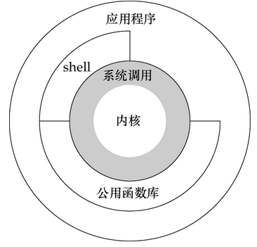

# 内核态与用户态

## 概念

**[Linux](https://haicoder.net/linux/linux-tutorial.html)** 的设计哲学之一就是：对不同的操作赋予不同的执行等级，就是所谓特权的概念，即与系统相关的一些特别关键的操作必须由最高特权的程序来完成。

Intel 的 X86 架构的 CPU 提供了 0 到 3 四个特权级，数字越小，特权越高，Linux 操作系统中主要采用了 0 和 3 两个特权级，分别对应的就是内核态(Kernel Mode)与用户态(User Mode)。

- **内核态：** CPU 可以访问内存所有数据,包括外围设备（硬盘、网卡），CPU 也可以将自己从一个程序切换到另一个程序；
- **用户态：** 只能受限的访问内存，且不允许访问外围设备，占用 CPU 的能力被剥夺，CPU 资源可以被其他程序获取；

Linux 中任何一个用户进程被创建时都包含 2 个栈：内核栈，用户栈，并且是进程私有的，从用户态开始运行。内核态和用户态分别对应内核空间与用户空间，内核空间中存放的是内核代码和数据，而进程的用户空间中存放的是用户程序的代码和数据。不管是内核空间还是用户空间，它们都处于虚拟空间中。

## 内核空间相关

- 内核空间：存放的是内核代码和数据，处于虚拟空间；
- 内核态：当进程执行系统调用而进入内核代码中执行时，称进程处于内核态，此时CPU处于特权级最高的0级内核代码中执行，当进程处于内核态时，执行的内核代码会使用当前进程的内核栈，每个进程都有自己的内核栈；
- CPU 堆栈指针寄存器指向：内核栈地址；
- 内核栈：进程处于内核态时使用的栈，存在于内核空间；
- 处于内核态进程的权利：处于内核态的进程，当它占有 CPU 的时候，可以访问内存所有数据和所有外设，比如硬盘，网卡等等；

## 用户空间相关

- 用户空间：存放的是用户程序的代码和数据，处于虚拟空间；
- 用户态：当进程在执行用户自己的代码（非系统调用之类的函数）时，则称其处于用户态，CPU 在特权级最低的3级用户代码中运行，当正在执行用户程序而突然被中断程序中断时，此时用户程序也可以象征性地称为处于进程的内核态，因为中断处理程序将使用当前进程的内核栈；
- CPU 堆栈指针寄存器指向：用户堆栈地址；
- 用户堆栈：进程处于用户态时使用的堆栈，存在于用户空间；
- 处于用户态进程的权利：处于用户态的进程，当它占有 CPU 的时候，只可以访问有限的内存，而且不允许访问外设，这里说的有限的内存其实就是用户空间，使用的是用户堆栈；

## 内核态和用户态的切换

### 系统调用

所有用户程序都是运行在用户态的，但是有时候程序确实需要做一些内核态的事情，例如从硬盘读取数据等。而唯一可以做这些事情的就是操作系统，所以此时程序就需要先操作系统请求以程序的名义来执行这些操作。这时需要一个这样的机制：用户态程序切换到内核态，但是不能控制在内核态中执行的指令。

这种机制叫系统调用，在 CPU 中的实现称之为陷阱指令(Trap Instruction)。

### 异常事件

当 CPU 正在执行运行在用户态的程序时，突然发生某些预先不可知的异常事件，这个时候就会触发从当前用户态执行的进程转向内核态执行相关的异常事件，典型的如缺页异常。

### 外围设备的中断

当外围设备完成用户的请求操作后，会向 CPU 发出中断信号，此时，CPU 就会暂停执行下一条即将要执行的指令，转而去执行中断信号对应的处理程序，如果先前执行的指令是在用户态下，则自然就发生从用户态到内核态的转换。

注意：系统调用的本质其实也是中断，相对于外围设备的硬中断，这种中断称为软中断，这是操作系统为用户特别开放的一种中断，如 Linux int 80h 中断。所以从触发方式和效果上来看，这三种切换方式是完全一样的，都相当于是执行了一个中断响应的过程。但是从触发的对象来看，系统调用是进程主动请求切换的，而异常和硬中断则是被动的。

## 用户态到内核态具体的切换步骤

1. 从当前进程的描述符中提取其内核栈的 ss0 及 esp0 信息。
2. 使用 ss0 和 esp0 指向的内核栈将当前进程的 cs, eip, eflags, ss, esp 信息保存起来，这个过程也完成了由用户栈到内核栈的切换过程，同时保存了被暂停执行的程序的下一条指令。
3. 将先前由中断向量检索得到的中断处理程序的 cs, eip 信息装入相应的寄存器，开始执行中断处理程序，这时就转到了内核态的程序执行了。
