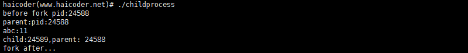
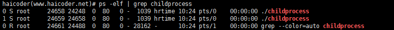
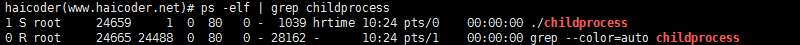

# 孤儿进程

> GitHub 仓库源文件：[点击打开网页渲染版](https://github.com/ben2023niao/ben-ops-notes/blob/main/doc/md/202304141557-%E5%AE%89%E5%85%A8%E4%B8%8E%E5%A0%A1%E5%9E%92%E6%9C%BA%2B%E9%AB%98%E7%BA%A7%E5%AE%89%E5%85%A8%2BLinux%2B%E7%9F%A5%E8%AF%86%E7%AC%94%E8%AE%B0-%E5%AD%A4%E5%84%BF%E8%BF%9B%E7%A8%8B.md)

## 孤儿进程教程

如果父进程先退出，子进程还没退出那么子进程将被托孤给 init 进程，这时子进程的父进程就是 init 进程（1 号进程）。

## 案例

### 创建孤儿进程

我们在**[Linux](https://haicoder.net/linux/linux-tutorial.html)**下使用 vim 新建一个 childprocess.c 的文件，编写如下**[C 语言](https://haicoder.net/c/c-tutorial.html)**代码如下：

```c
#include <sys/types.h>
#include <unistd.h>
#include <stdlib.h>
#include <stdio.h>
#include <string.h>
#include <signal.h>
#include <errno.h>
#include <signal.h>
int main(void)
{
 pid_t pid ;
 signal(SIGCHLD,SIG_IGN);
 printf("before fork pid:%d\n",getpid());
 int abc = 10;
 pid = fork();
 if(pid == -1)
 {
 perror("tile");
 return -1;
 }
 if(pid > 0) //父进程先退出
 {
 abc++;
 printf("parent:pid:%d \n",getpid());
 printf("abc:%d \n",abc);
 sleep(5);
 }
 else if(pid == 0) //值进程后退出,被托付给init进程
 {
 abc++;
 printf("child:%d,parent: %d\n",getpid(),getppid());
 printf("abc:%d",abc);
 sleep(100);
 }
 printf("fork after...\n");
}
```

我们使用 gcc 编译上述程序，具体命令如下：

`gcc childprocess.c -ochildprocess`

编译完成后，会在当前目录生成一个 childprocess 的二进制可执行文件

此时，我们直接运行该二进制文件，输入以下命令：

`./childprocess`

运行成功后，控制台输出如下：


此时，我们在另一终端，使用 ps 命令，查看当前进程的状态，具体命令如下：

`ps -elf | grep childprocess`

此时，运行后，控制台输出如下：


此时，我们可以看到，有两个 childprocess 进程在运行，稍等一会，我们再次使用 ps 命令查看当前进程状态，此时，运行后，控制台输出如下：

此时，我们可以看到，只有一个 childprocess 进程在运行了，而且此时的 childprocess 进程的父进程变成了 1，也就是我们说的 init 进程。
