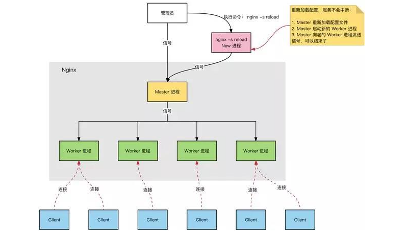
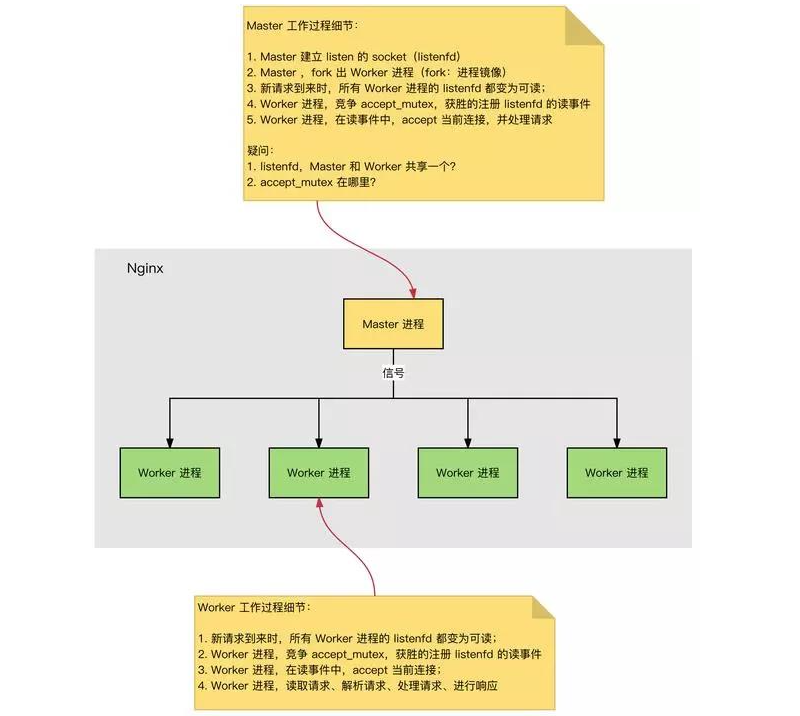

# Nginx是如何实现高并发的

> GitHub 仓库源文件：[点击打开网页渲染版](https://github.com/ben2023niao/ben-ops-notes/blob/main/doc/md/202304141557-%E5%AE%89%E5%85%A8%E4%B8%8E%E5%A0%A1%E5%9E%92%E6%9C%BA%2B%E9%AB%98%E7%BA%A7%E5%AE%89%E5%85%A8%2BNginx%2BApache-Nginx%E6%98%AF%E5%A6%82%E4%BD%95%E5%AE%9E%E7%8E%B0%E9%AB%98%E5%B9%B6%E5%8F%91%E7%9A%84.md)

如果一个 server 采用一个进程(或者线程)负责一个 request 的方式，那么进程数就是并发数。那么显而易见的，就是会有很多进程在等待中。等什么？最多的应该是等待网络传输。其缺点胖友应该也感觉到了，此处不述。

而 **[Nginx](https://haicoder.net/nginx/nginx-tutorial.html)** 的异步非阻塞工作方式正是利用了这点等待的时间。在需要等待的时候，这些进程就空闲出来待命了。因此表现为少数几个进程就解决了大量的并发问题。

Nginx 是如何利用的呢，简单来说：同样的 4 个进程，如果采用一个进程负责一个 request 的方式，那么，同时进来 4 个 request 之后，每个进程就负责其中一个，直至会话关闭。期间，如果有第 5 个 request 进来了。就无法及时反应了，因为 4 个进程都没干完活呢，因此，一般有个调度进程，每当新进来了一个 request ，就新开个进程来处理。

Nginx 服务器，正常运行过程中是多进程的：

一个 Master 进程

`- Master 进程：管理 Worker 进程。对外接口：接收外部的操作（信号）；对内转发：根据外部的操作的不同，通过信号管理 Worker；监控：监控 Worker 进程的运行状态，Worker 进程异常终止后，自动重启 Worker 进程。`

多个 Worker 进程

`- Worker 进程：所有 Worker 进程都是平等的。实际处理：网络请求，由 Worker 进程处理。Worker 进程数量：在 nginx.conf 中配置，一般设置为核心数，充分利用 CPU 资源，同时，避免进程数量过多，避免进程竞争 CPU 资源，增加上下文切换的损耗。
`

每进来一个 request ，会有一个 worker 进程去处理。但不是全程的处理，处理到什么程度呢？处理到可能发生阻塞的地方，比如向上游（后端）服务器转发 request ，并等待请求返回。那么，这个处理的 worker 不会这么傻等着，他会在发送完请求后，注册一个事件：“如果 upstream 返回了，告诉我一声，我再接着干”。于是他就休息去了。此时，如果再有 request 进来，他就可以很快再按这种方式处理。而一旦上游服务器返回了，就会触发这个事件，worker 才会来接手，这个 request 才会接着往下走。

这就是为什么说，Nginx 基于事件模型。

由于 web server 的工作性质决定了每个 request 的大部份生命都是在网络传输中，实际上花费在 server 机器上的时间片不多。这是几个进程就解决高并发的秘密所在。即：webserver 刚好属于网络 IO 密集型应用，不算是计算密集型。

异步，非阻塞，使用 epoll ，和大量细节处的优化。也正是 Nginx 之所以然的技术基石。

## Nginx如何处理HTTP请求

- 首先，Nginx 在启动时，会解析配置文件，得到需要监听的端口与 IP 地址，然后在 Nginx 的 Master 进程里面先初始化好这个监控的 Socket(创建 Socket，设置 addr、reuse 等选项，绑定到指定的 ip 地址端口，再 listen 监听)。
- 然后，再 fork(一个现有进程可以调用 fork 函数创建一个新进程。由 fork 创建的新进程被称为子进程 )出多个子进程出来。
- 之后，子进程会竞争 accept 新的连接。此时，客户端就可以向 nginx 发起连接了。当客户端与 nginx 进行三次握手，与 nginx 建立好一个连接后。此时，某一个子进程会 accept 成功，得到这个建立好的连接的 Socket ，然后创建 nginx 对连接的封装，即 ngx_connection_t 结构体。
- 接着，设置读写事件处理函数，并添加读写事件来与客户端进行数据的交换。

## 为什么Nginx不使用多线程

Apache: 创建多个进程或线程，而每个进程或线程都会为其分配 cpu 和内存（线程要比进程小的多，所以 worker 支持比 perfork 高的并发），并发过大会榨干服务器资源。

Nginx: 采用单线程来异步非阻塞处理请求（管理员可以配置 Nginx 主进程的工作进程的数量）(epoll)，不会为每个请求分配 cpu 和内存资源，节省了大量资源，同时也减少了大量的 CPU 的上下文切换。所以才使得 Nginx 支持更高的并发。
