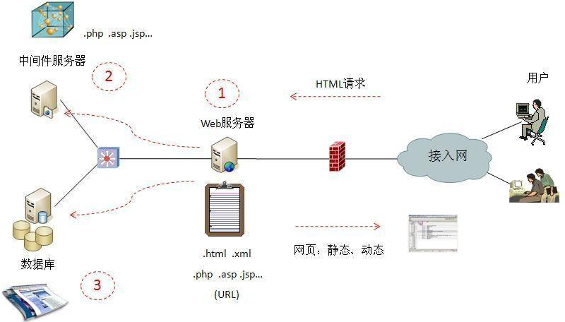
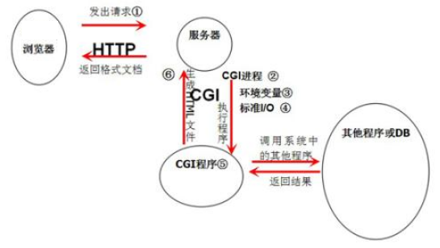
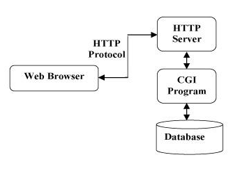
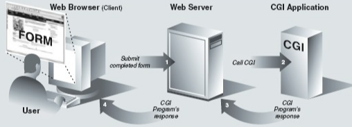
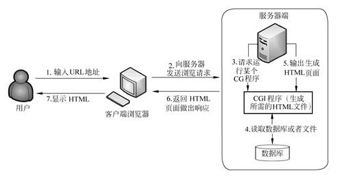
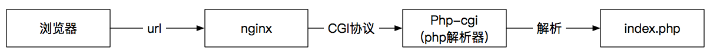

# CGI

> GitHub 仓库源文件：[点击打开网页渲染版](https://github.com/ben2023niao/ben-ops-notes/blob/main/doc/md/202304141557-%E5%AE%89%E5%85%A8%E4%B8%8E%E5%A0%A1%E5%9E%92%E6%9C%BA%2B%E9%AB%98%E7%BA%A7%E5%AE%89%E5%85%A8%2BNginx%2BApache-%E9%AB%98%E7%BA%A7%E5%AE%89%E5%85%A8%E8%AF%B4%E6%98%8E-CGI.md)

## 什么是CGI

CGI 是通用网关接口(Common Gateway Interface)的缩写。它主要用于服务器端动态输出客户端的请求(如 HTML 页面/二进制文件)，也就是说客户端请求参数不同, 服务器端会给出不同的应答结果。

CGI 标准将这个接口定义的非常简单 (即: WEB 服务器收到客户端的请求后通过环境变量和标准输入(stdin)将数据传递给 CGI 程序, CGI 程序通过标准输出(stdout) 将数据返回给客户端)， 所以只要能操作标准输入/输出的程序语言都可以 CGI 程序, 比如： **[C 语言](https://haicoder.net/c/c-tutorial.html)**、 **[C++](https://haicoder.net/cpp/cpp-tutorial.html)**、 **[Java](https://haicoder.net/java/java-development.html)** 和 **[Python](https://haicoder.net/python/python-tutorial.html)** 等。

## CGI产生

早期的 Web 服务器，只能响应浏览器发来的 **[HTTP](https://haicoder.net/http/http-tutorial.html)** 静态资源的请求，并将存储在服务器中的静态资源返回给浏览器。随着 Web 技术的发展，逐渐出现了动态技术，但是 Web 服务器并不能够直接运行动态脚本，为了解决 Web 服务器与外部应用程序（CGI 程序）之间数据互通，于是出现了 CGI（Common Gateway Interface）通用网关接口。简单理解，可以认为 CGI 是 Web 服务器和运行其上的应用程序进行 “交流” 的一种约定。

CGI 是 Web 服务器和一个独立的进程之间的协议，它会把 HTTP 请求 Request 的 Header 头设置成进程的环境变量，HTTP 请求的 Body 正文设置成进程的标准输入，进程的标准输出设置为 HTTP 响应 Response，包含 Header 头和 Body 正文。

## CGI程序

CGI 只是一个接口规范或协议，它的实现则与具体的编程语言相关。在 2000 年以前，CGI 通用网关接口盛行，那个时候，Perl 是编写 CGI 的主流语言，以至于一般的 CGI 程序都是 Perl 程序。

通过 CGI 接口，Web 服务器就能够获取客户端传递的数据，并转交给服务器端的 CGI 程序处理，然后返回结果给客户端。简单来说，CGI 实际上是一个接口标准。而通常所说的 CGI 指代其实是 CGI 程序，也就是实现了 CGI 接口标准的程序，只要编程语言具有标准输入、标准输出和环境变量，就可以用来编写 CGI 程序。

CGI 程序通过标准输入（STDIN）和标准输出（STDOUT）进行数据的输入输出，此外 CGI 程序还通过环境变量来得到输入，操作系统提供了许多环境变量，它们定义了程序的执行环境，应用程序可以存取它们。Web 服务器和 CGI 接口又另外设置了一些环境变量，用来向 CGI 程序传递一些重要的参数。CGI 的 GET 方法还通过环境变量 QUERY_STRING 向 CGI 程序传递 Form 表单中的数据。

对于一个 CGI 程序，主要的工作是从环境变量和标准输入中读取数据，然后处理数据，最后向标准输出中输出数据。

- 环境变量

环境变量中存储的叫做 Request Meta-Variables，也就是诸如 QUERY_STRING、PATH_INFO 之类的，这些都是由 Web 服务器通过环境变量传递给 CGI 程序的，CGI 程序也是从环境变量中读取的。
- 标准输出

中存放的往往是用户通过 PUTS 或 POST 提交的数据，这些数据也是由 Web 服务器传递过来的。

为了处理动态请求，Web 服务器会根据请求的内容，Fork 创建一个新进程来运行外部 C 程序或 Perl 脚本等，这个进程会把处理完的数据返回给 Web 服务器，然后 Web 服务器把内容发送给用户，Fork 创建出来的进程也会随之退出。如果下次用户请求为动态脚本，那么 Web 服务器会再次 Fork 创建一个新进程，如此周而复始的运行。

以 **[Nginx](https://haicoder.net/nginx/nginx-tutorial.html)** 接收 HTTP 请求为例，Nginx 接收一个 HTTP 请求后 Fork 创建出一个进程，将 HTTP 请求带来的参数作为输入，执行完程序处理后输出，最终会摧毁这个 Fork 出来的进程，并将输出返回给客户端。这种方式虽然简单，但是需要不断地 Fork 进程和销毁进程。

## CGI程序工作原理

Web 服务器一般只用来处理静态文件请求，一旦碰到动态脚本请求，Web 服务器主进程就会 Fork 创建出一个新的进程来启动 CGI 程序，也就是将动态脚本交给 CGI 程序来处理。启动 CGI 程序需要一个过程，如读取配置文件、加载扩展等。当 CGI 程序启动后会去解析动态脚本，然后将结果返回给 Web 服务器，最后由 Web 服务器将结果返回给客户端，之前 Fork 出来的进程也随之关闭。这样，每次用户请求动态脚本，Web 服务器都要重新 Fork 创建一个新进程去启动 CGI 程序，由 CGI 程序来处理动态脚本，处理完成后进程随之关闭，其效率是非常低下的。

> 原始图片使用本机 `file:///F:/.../11_CGI.png` 路径，GitBook/私有归档未包含该文件，因此公开版不保留失效的本地路径。

## FastCGI

FastCGI 是 Web 服务器与处理程序之间通信的一种协议，是 CGI 的改进版本。由于 CGI 程序反复加载 CGI 而造成性能低下，如果 CGI 程序保持在内存中并接收 FastCGI 进程管理器调度，则可以提供良好的性能、伸缩性、Fail-Over 特性等。

FastCGI 就是常驻型的 CGI，可以一直运行。在请求到达时不会耗费时间去 Fork 创建一个进程来处理。FastCGI 是语言无关的、可伸缩架构的 CGI 开放扩展，它将 CGI 解释器进程保持在内存中，因此获得较高的性能。

FastCGI的工作流程

1. Web 服务器启动时载入 FastCGI 进程管理，如 IIS 的 ISAPI、Apache 的 Module…
2. FastCGI 进程管理器自身初始化，并启动多个 CGI 解释器进程 php-cgi 并等待 Web 服务器的连接。
3. 当客户端请求到达 Web 服务器时，FastCGI 进程管理器选择并连接一个 CGI 解释器，Web 服务器将 CGI 环境变量和标准输入发送到 FastCGI 子进程 PHP-CGI。
4. FastCGI 子进程完成处理后将标准输出和错误信息，从同一连接返回给 Web 服务器。当 FastCGI 子进程关闭连接时请求便处理完毕。FastCGI 子进程接着等待并处理来自 FastCGI 进程管理器（运行在 Web 服务器中）的下一个连接。在 CGI 模式中，PHP-CGI 在此便退出了。

## CGI的处理步骤

1. 通过 Internet 把用户请求送到 web 服务器。
2. web 服务器接收用户请求并交给 CGI 程序处理。
3. CGI 程序把处理结果传送给 web 服务器。
4. web 服务器把结果送回到用户。

## CGI总结

CGI 不是一门编程语言。它是网页的表单和你写的程序之间通信的一种协议。可以用任何语言写一个 CGI 脚本，这些语言只要能接收输入输出信息，读取环境变量。所以，几乎所有的编程语言都能写一个 CGI 脚本，例如：python，C，甚至是 shell 脚本。
