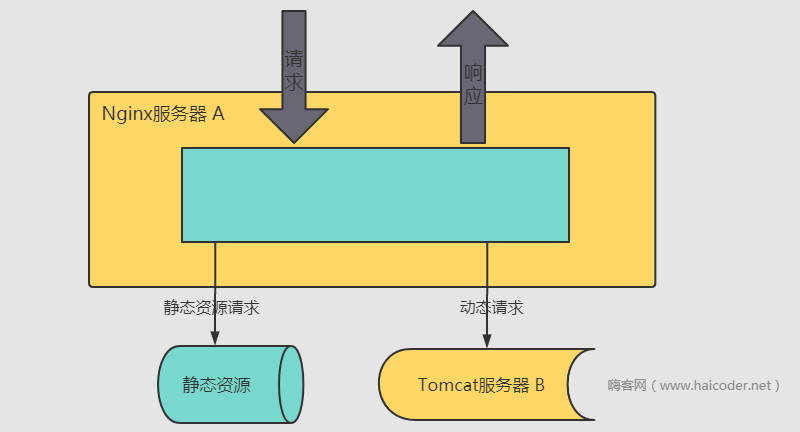

# Nginx动静分离

## 动静分离

动静分离是让动态网站里的动态网页根据一定规则把不变的资源和经常变的资源区分开来，动静资源做好了拆分以后，我们就可以根据静态资源的特点将其做缓存操作，这就是网站静态化处理的核心思路，实际上，何谓动？何谓静呢？拿我们 **[Java](https://haicoder.net/java/java-development.html)** 来说 jsp、servlet 等就是动，因为他们离开我们的 web 服务器的支持就会无法正常工作。而 js、css 等文件就是静了。因为离开 web 服务器他一样能正常的工作。

动静分离简单的概括是：动态文件与静态文件的分离。

## 为什么要做动静分离

在我们的软件开发中，有些请求是需要后台处理的（如：.jsp, .do等等），有些请求是不需要经过后台处理的（如：css、html、jpg、js 等等文件），这些不需要经过后台处理的文件称为静态文件，否则动态文件。

因此我们后台处理忽略静态文件。这会有人又说那我后台忽略静态文件不就完了吗。当然这是可以的，但是这样后台的请求次数就明显增多了。在我们对资源的响应速度有要求的时候，我们应该使用这种动静分离的策略去解决。

动静分离将网站静态资源（HTML，JavaScript，CSS，img 等文件）与后台应用分开部署，提高用户访问静态代码的速度，降低对后台应用访问。这里我们将静态资源放到 Nginx 中，动态资源转发到 tomcat 服务器中。

## Nginx如何做动静分离

Nginx 根据客户端请求的 url 来判断请求的是否是静态资源，如果请求的 url 包含 jpg、png，则由 Nginx 处理。如果请求的 url 是 .php 或者 .jsp 等等，这个时候这个请求是动态的，将转发给 tomcat 处理。

总结来说，Nginx 是通过 url 来区分请求的类型，并转发给不同的服务端。

## Nginx动静分离的好处

- api 接口服务化：动静分离之后，后端应用更为服务化，只需要通过提供 api 接口即可，可以为多个功能模块甚至是多个平台的功能使用，可以有效的节省后端人力，更便于功能维护。
- 前后端开发并行：前后端只需要关心接口协议即可，各自的开发相互不干扰，并行开发，并行自测，可以有效的提高开发时间，也可以有些的减少联调时间
- 减轻后端服务器压力，提高静态资源访问速度：后端不用再将模板渲染为 html 返回给用户端，且静态服务器可以采用更为专业的技术提高静态资源的访问速度。
