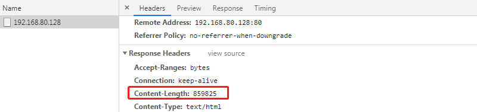
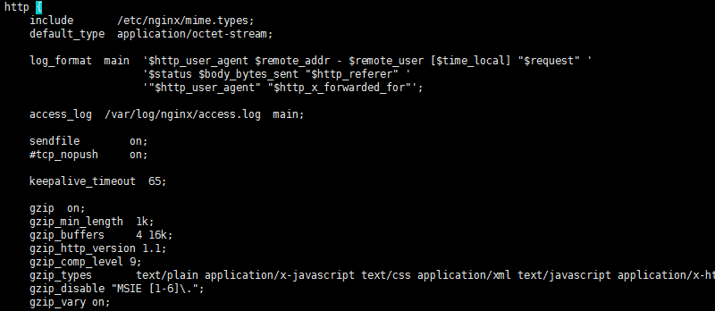
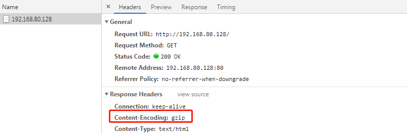

# Nginx开启gzip压缩

> GitHub 仓库源文件：[点击打开网页渲染版](https://github.com/ben2023niao/ben-ops-notes/blob/main/doc/md/202304141557-%E5%AE%89%E5%85%A8%E4%B8%8E%E5%A0%A1%E5%9E%92%E6%9C%BA%2B%E9%AB%98%E7%BA%A7%E5%AE%89%E5%85%A8%2BNginx%2BPHP-Nginx%E5%BC%80%E5%90%AFgzip%E5%8E%8B%E7%BC%A9.md)

## Nginx gzip配置教程

**[Nginx](https://haicoder.net/nginx/nginx-tutorial.html)** 开启 Gzip 压缩功能， 可以使网站的 css、js 、xml、html 文件在传输时进行压缩，提高访问速度, 进而优化 Nginx 性能。

网站加载的速度取决于浏览器必须下载的所有文件的大小。减少要传输的文件的大小可以使网站不仅加载更快，而且对于那些宽带是按量计费的人来说也更友好。

gzip 是一种流行的数据压缩程序。您可以使用 gzip 压缩 Nginx 实时文件。这些文件在检索时由支持它的浏览器解压缩，好处是 web 服务器和浏览器之间传输的数据量更小，速度更快。

gzip 不一定适用于所有文件的压缩。例如，文本文件压缩得非常好，通常会缩小两倍以上。另一方面，诸如 JPEG或 PNG 文件之类的图像已经按其性质进行压缩，使用 gzip 压缩很难有好的压缩效果或者甚至没有效果。压缩文件会占用服务器资源，因此最好只压缩那些压缩效果好的文件。

## Nginx gzip配置作用

Nginx 开启 Gzip 压缩功能， 可以使网站的 css、js 、xml、html 文件在传输时进行压缩，提高访问速度, 进而优化 Nginx 性能! Web 网站上的图片，视频等其它多媒体文件以及大文件，因为压缩效果不好，所以对于图片没有必要支压缩，如果想要优化，可以图片的生命周期设置长一点，让客户端来缓存。

开启 Gzip 功能后，Nginx 服务器会根据配置的策略对发送的内容, 如 css、js、xml、html 等静态资源进行压缩, 使得这些内容大小减少，在用户接收到返回内容之前对其进行处理，以压缩后的数据展现给客户。这样不仅可以节约大量的出口带宽，提高传输效率，还能提升用户快的感知体验, 一举两得; 尽管会消耗一定的 cpu 资源，但是为了给用户更好的体验还是值得的。

经过 Gzip 压缩后页面大小可以变为原来的 30% 甚至更小，这样，用户浏览页面的时候速度会快得多。Gzip 的压缩页面需要浏览器和服务器双方都支持，实际上就是服务器端压缩，传到浏览器后浏览器解压并解析。浏览器那里不需要我们担心，因为目前的巨大多数浏览器 都支持解析 Gzip 过的页面。

## Nginx gzip配置参数

### 参数

| 参数 | 描述 |

| --- | --- |

| gzip on | 决定是否开启 gzip 模块，on 表示开启，off 表示关闭 |

| gzip_min_length 1k | 设置允许压缩的页面最小字节(从 header 头的 Content-Length 中获取) ，当返回内容大于此值时才会使用 gzip 进行压缩,以 K 为单位,当值为 0 时，所有页面都进行压缩。建议大于 1k |

| gzip_buffers 4 16k | 设置 gzip 申请内存的大小，其作用是按块大小的倍数申请内存空间,param2:int(k) 后面单位是 k。这里设置以 16k 为单位,按照原始数据大小以 16k 为单位的 4 倍申请内存 |

| gzip_http_version 1.1 | 识别 http 协议的版本,早起浏览器可能不支持 gzip 自解压,用户会看到乱码 |

| gzip_comp_level 2 | 设置 gzip 压缩等级，等级越底压缩速度越快文件压缩比越小，反之速度越慢文件压缩比越大；等级1-9，最小的压缩最快 但是消耗 cpu |

| gzip_types text/plain | 设置需要压缩的 MIME 类型,非设置值不进行压缩，即匹配压缩类型 |

| gzip_vary on | 启用应答头"Vary: Accept-Encoding" |

| gzip_proxied off | nginx 做为反向代理时启用 |

| gzip_disable msie6 | IE5.5 和 IE6 SP1 使用 msie6 参数来禁止 gzip 压缩 )指定哪些不需要 gzip 压缩的浏览器(将和User-Agents进行匹配),依赖于 PCRE 库 |

### 配置

#### gzip on

`打开或关闭gzip
默认 off 关闭
代码块 http, server, location, if in location`

#### gzip_buffers

设置用于处理请求压缩的缓冲区数量和大小。比如 32 4K 表示按照内存页（one memory page）大小以 4K 为单位（即一个系统中内存页为 4K），申请 32 倍的内存空间。建议此项不设置，使用默认值。

`Syntax: gzip_buffers number size;
Default:
gzip_buffers 32 4k|16 8k;
Context: http, server, location`

#### gzip_comp_level

设置 gzip 压缩级别，级别越底压缩速度越快文件压缩比越小，反之速度越慢文件压缩比越大

`Syntax: gzip_comp_level level;
Default:
gzip_comp_level 1;
Context: http, server, location`

不是压缩级别越高越好，其实 gzip_comp_level 1 的压缩能力已经够用了，后面级别越高，压缩的比例其实增长不大，反而很吃处理性能。
另一方面，压缩一定要和静态资源缓存相结合，缓存压缩后的版本，否则每次都压缩高负载下服务器肯定吃不住。

#### gzip_disable

通过表达式，表明哪些 UA 头不使用 gzip 压缩

`Syntax: gzip_disable regex ...;
Default: —
Context: http, server, location
This directive appeared in version 0.6.23.`

#### gzip_min_length

当返回内容大于此值时才会使用gzip进行压缩,以 K 为单位,当值为 0 时，所有页面都进行压缩。

`Syntax: gzip_min_length length;
Default:
gzip_min_length 20;
Context: http, server, location`

#### gzip_http_version

用于识别 http 协议的版本，早期的浏览器不支持 gzip 压缩，用户会看到乱码，所以为了支持前期版本加了此选项。默认在 http/1.0 的协议下不开启 gzip 压缩。

`Syntax: gzip_http_version 1.0 | 1.1;
Default:
gzip_http_version 1.1;
Context: http, server, location`

在应用服务器前，如果还有一层 Nginx 的集群作为负载均衡，在这一层上，若果没有开启 gzip。

如果我们使用了proxy_pass 进行反向代理，那么 nginx 和后端的 upstream server 之间默认是用 HTTP/1.0 协议通信的。

如果我们的 Cache Server 也是 nginx，而前端的 nginx 没有开启 gzip。同时，我们后端的 nginx 上没有设置gzip_http_version 为 1.0，那么 Cache 的 url 将不会进行 gzip 压缩。

#### gzip_proxied

Nginx 做为反向代理的时候启用：

`1. off – 关闭所有的代理结果数据压缩
2. expired – 如果header中包含”Expires”头信息，启用压缩
3. no-cache – 如果header中包含”Cache-Control:no-cache”头信息，启用压缩
4. no-store – 如果header中包含”Cache-Control:no-store”头信息，启用压缩
5. private – 如果header中包含”Cache-Control:private”头信息，启用压缩
6. no_last_modified – 启用压缩，如果header中包含”Last_Modified”头信息，启用压缩
7. no_etag – 启用压缩，如果header中包含“ETag”头信息，启用压缩
8. auth – 启用压缩，如果header中包含“Authorization”头信息，启用压缩
9. any – 无条件压缩所有结果数据
Syntax: gzip_proxied off | expired | no-cache | no-store | private | no_last_modified | no_etag | auth | any ...;
Default:
gzip_proxied off;
Context: http, server, location`

#### gzip_types

设置需要压缩的 MIME 类型,如果不在设置类型范围内的请求不进行压缩

`Syntax: gzip_types mime-type ...;
Default:
gzip_types text/html;
Context: http, server, location`

#### gzip_vary

增加响应头”Vary: Accept-Encoding”，告诉接收方发送的数据经过了压缩处理，开启后的效果是在响应头部添加了Accept-Encoding:gzip，这对于本身不支持 gzip 压缩的客户端浏览器有用。

`Syntax: gzip_vary on | off;
Default:
gzip_vary off;
Context: http, server, location`

## 案例

我们首先，使用 **[vim](https://haicoder.net/vim/vim-tutorial.html)** 打开 nginx 的默认配置路径，具体命令如下：

`vim /etc/nginx/conf.d/default.conf`

我们执行如上命令，打开配置文件，此时配置文件如下：


现在，我们在 nginx 的根路径下新建一个 index.html，并写入内容，并使用浏览器访问，此时，浏览器输出如下：


现在，我们打开 nginx.conf 配置文件，如下图所示：

在 nginx 的 http 模块的配置里面，开启 gzip 配置，具体配置如下：

```
gzip on;
gzip_min_length 1k;
gzip_buffers 4 16k;
gzip_http_version 1.1;
gzip_comp_level 9;
gzip_types text/plain application/x-javascript text/css application/xml text/javascript application/x-httpd-php application/javascript application/json;
gzip_disable "MSIE [1-6]\.";
gzip_vary on;
```

配置完成后，如下图所示：



现在，我们使用 reload 重新加载配置，具体命令如下：

`nginx -s reload`

执行完毕后，我们再次使用浏览器访问，此时输出如下：

我们看到，此时输出了 gzip，并且浏览器的内容如下：


我们看到，浏览器的内容也正常输出了。

## Nginx gzip配置总结

Nginx 开启 Gzip 压缩功能， 可以使网站的 css、js 、xml、html 文件在传输时进行压缩，提高访问速度, 进而优化 Nginx 性能。
