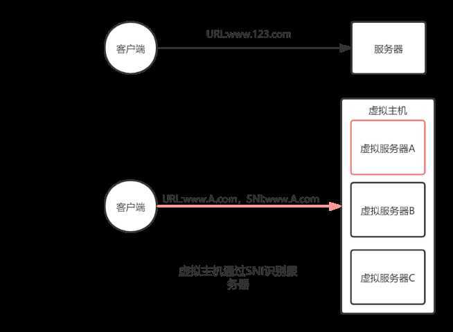
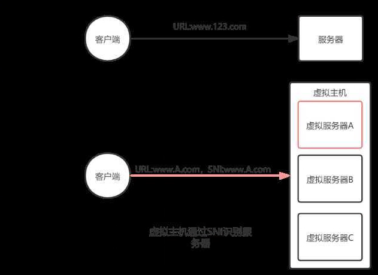
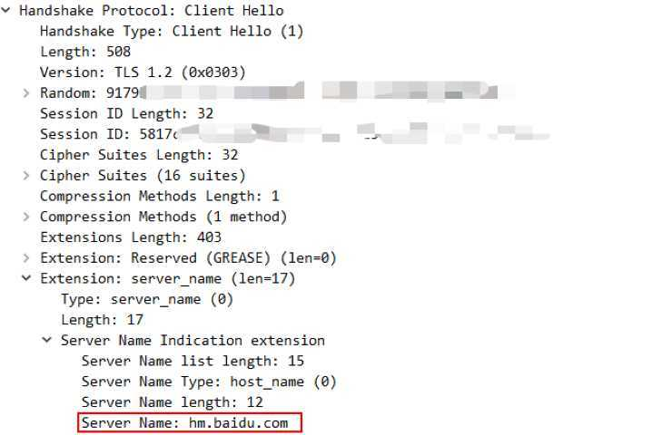
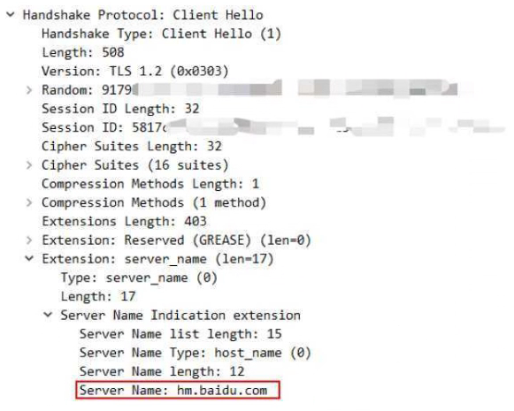
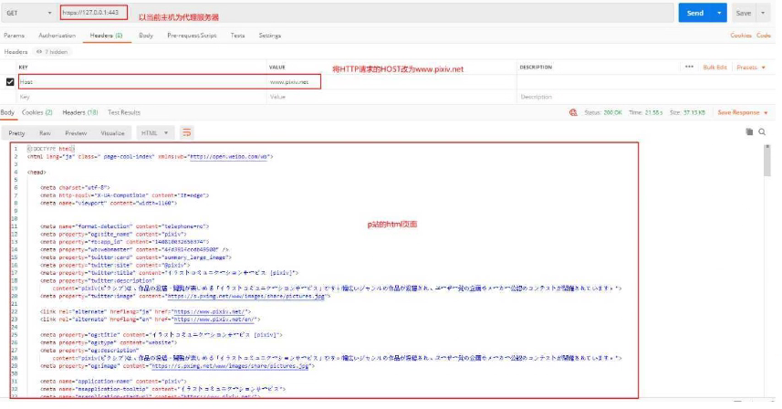
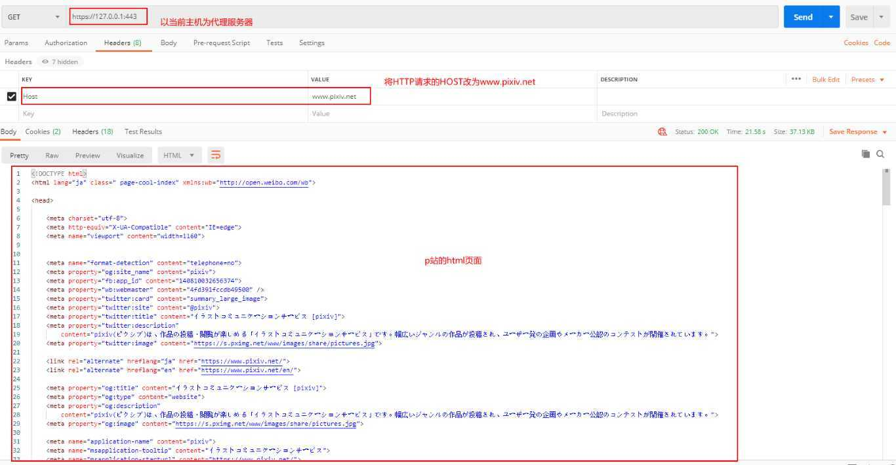
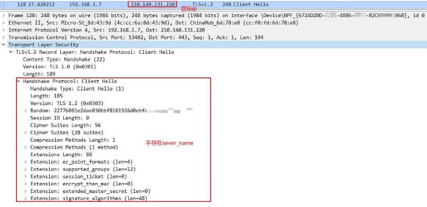
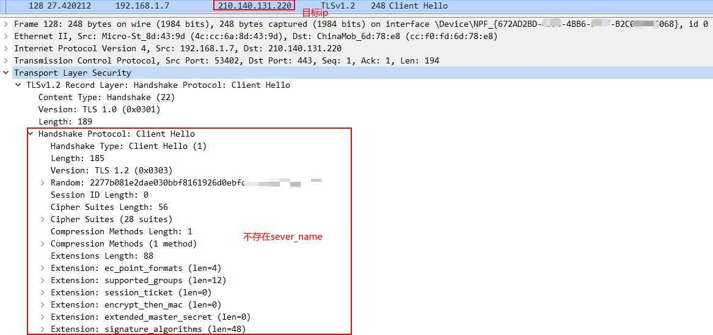

# 绕过SNI审查

> GitHub 仓库源文件：[点击打开网页渲染版](https://github.com/ben2023niao/ben-ops-notes/blob/main/doc/md/202304141557-%E5%AE%89%E5%85%A8%E4%B8%8E%E5%A0%A1%E5%9E%92%E6%9C%BA%2B%E9%AB%98%E7%BA%A7%E5%AE%89%E5%85%A8%2BNginx%2B%E5%A4%87%E4%BB%BD%E6%81%A2%E5%A4%8D-%E7%BB%95%E8%BF%87SNI%E5%AE%A1%E6%9F%A5.md)

此文章仅为学习SNI相关知识留作记录

## SNI（Server Name Indication）

### SNI作用

在SSL初期一个服务器只对应一个域名（如下图），一个服务器也只有一个数字证书。但随着虚拟主机的出现，一个物理服务器上可能会管理多个域名，所以一个物理服务器会同时管理多个证书（如下图）。为了让物理服务器区分客户端究竟是要访问它所管理的哪一个虚拟服务器，需要一个域标明客户端所访问的域名，这就是**SNI（Server Name Indication）**。



### SNI抓包验证

- 以访问百度为例，抓取Client Hello包可以查看到其中的SNI信息，即 `[hm.baidu.com](http://hm.baidu.com)`，这表示客户端要访问的域名。



## SNI审查及如何绕过SNI审查

### SNI审查

所谓SNI审查即使用上述的SNI信息过滤以限制某部分的网站的访问，是防火墙措施的一种。

由于是以域名作为过滤关键字，其好处是一次可以过滤一系列网站，相较于ip过滤有着更高的效率。目前使用SNI审查的网站有P站，steam社区等。使用SNI审查的网站有一个特征，使用`ping`命令访问其ip地址发现是连通的，但是却无法访问。

### 绕过SNI审查

绕过思路：绕过的方法很简单，只要伪造错误的SNI，或者直接隐藏SNI，这里采用第二种方法。

我们这里使用nginx，利用其反向代理的功能绕过SNI审查来上P站，使用nginx的原因是当nginx反向代理时会默认隐藏SNI的值。

#### 操作步骤

- 首先在nginx上配置一个服务器，打开nginx目录下conf/nginx.conf文件，添加如下配置

```nginx
server {
 listen 443 ssl;
 server_name www.pixiv.net;
 #这里需要自签一个数字证书,下面为其公钥和私钥
 ssl_certificate cert.pem;
 ssl_certificate_key cert.key;
 location / {
 proxy_pass https://203.0.113.1:443;
 proxy_set_header Host $http_host;
 }
```

上述代码完成了反向代理P站的配置。意为将一个host为`[www.pixiv.net](http://www.pixiv.net)`的网站代理到`203.0.113.1`（其中`203.0.113.1`为P站可访问的ip地址）。

- 使用POSTMAN验证反向代理成果



成功获取到P站的html页面。

- 抓包验证是否成功隐藏SNI信息



从上图我们可以看见当我们连接`203.0.113.1`时成功隐藏了我们的SNI信息，这样就绕过了SNI审核。

参考资料：
[1] [SNI(Server Name Indication)_浴血重生-学习空间-CSDN博客_sni](https://blog.csdn.net/makenothing/article/details/53292335)
[2] [PIXIV网页版及客户端访问恢复指南 | 樱花庄的白猫](https://2heng.xin/2017/09/19/pixiv/)!

[绕过SNI审查](http://www.bubuko.com/infodetail-3630653.html "绕过SNI审查,bubuko.com")

原文：<https://www.cnblogs.com/greapi/p/13281770.html>
