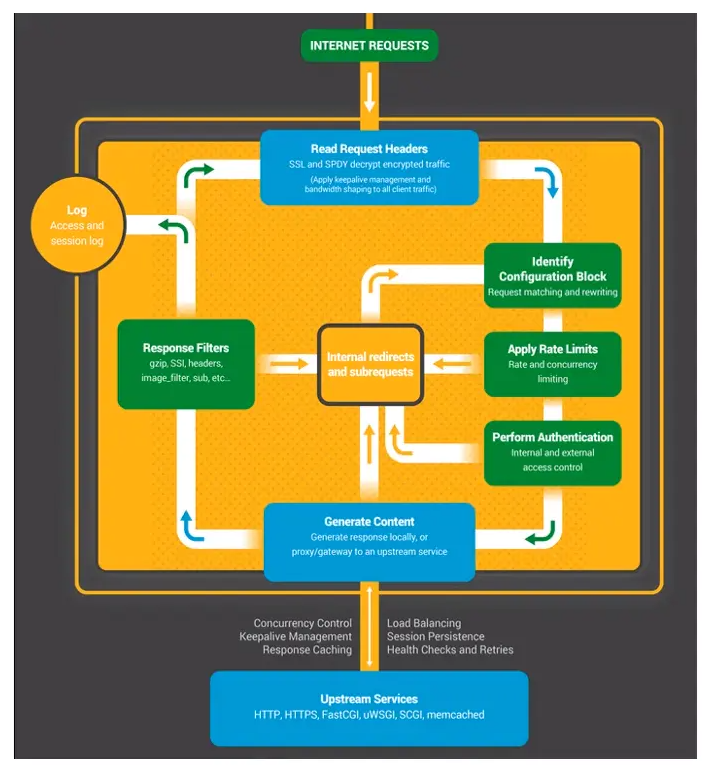
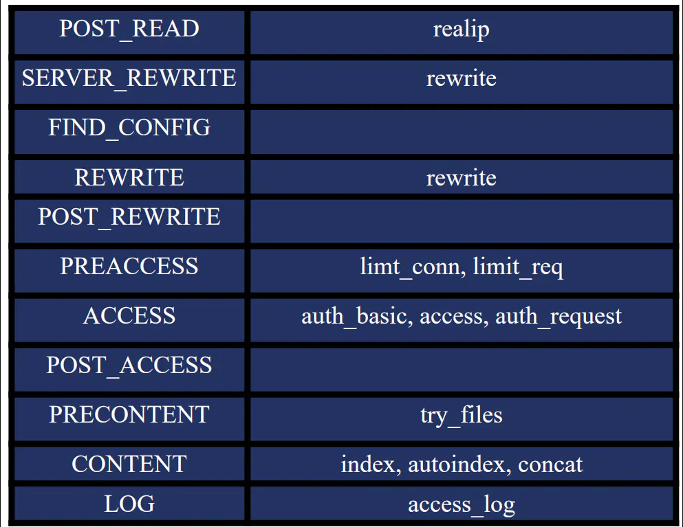
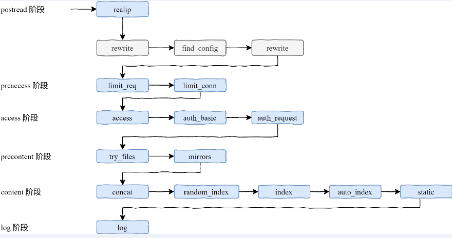

# Nginx处理HTTP请求过程

> GitHub 仓库源文件：[点击打开网页渲染版](https://github.com/ben2023niao/ben-ops-notes/blob/main/doc/md/202304141557-%E5%AE%89%E5%85%A8%E4%B8%8E%E5%A0%A1%E5%9E%92%E6%9C%BA%2B%E9%AB%98%E7%BA%A7%E5%AE%89%E5%85%A8%2BNginx%2B%E6%9D%83%E9%99%90%E7%AE%A1%E7%90%86-Nginx%E5%A4%84%E7%90%86HTTP%E8%AF%B7%E6%B1%82%E8%BF%87%E7%A8%8B.md)

**[Nginx](https://haicoder.net/nginx/nginx-tutorial.html)** 处理 **[HTTP](https://haicoder.net/http/http-tutorial.html)** 请求的过程大概可以分为 11 个阶段，如下：

1. Read Request Headers：解析请求头。
2. Identify Configuration Block：识别由哪一个 location 进行处理，匹配 URL。
3. Apply Rate Limits：判断是否限速。例如可能这个请求并发的连接数太多超过了限制，或者 QPS 太高。
4. Perform Authentication：连接控制，验证请求。例如可能根据 Referrer 头部做一些防盗链的设置，或者验证用户的权限。
5. Generate Content：生成返回给用户的响应。为了生成这个响应，做反向代理的时候可能会和上游服务（Upstream Services）进行通信，然后这个过程中还可能会有些子请求或者重定向，那么还会走一下这个过程（Internal redirects and subrequests）。
6. Response Filters：过滤返回给用户的响应。比如压缩响应，或者对图片进行处理。
7. Log：记录日志。



以上这七个步骤从整体上介绍了一下处理流程，下面还会再说一下实际的处理过程。

## Nginx处理HTTP请求的11个阶段

下面介绍一下详细的 11 个阶段，每个阶段都可能对应着一个甚至多个 HTTP 模块，通过这样一个模块对比，我们也能够很好的理解这些模块具体是怎么样发挥作用的。


	1. POST_READ：在 read 完请求的头部之后，在没有对头部做任何处理之前，想要获取到一些原始的值，就应该在这个阶段进行处理。这里面会涉及到一个 realip 模块。
	2. SERVER_REWRITE：和下面的 REWRITE 阶段一样，都只有一个模块叫 rewrite 模块，一般没有第三方模块会处理这个阶段。
	3. FIND_CONFIG：做 location 的匹配，暂时没有模块会用到。
	4. REWRITE：对 URL 做一些处理。
	5. POST_WRITE：处于 REWRITE 之后，也是暂时没有模块会在这个阶段出现。接下来是确认用户访问权限的三个模块：

	1. PREACCESS：是在 ACCESS 之前要做一些工作，例如并发连接和 QPS 需要进行限制，涉及到两个模块：limt_conn 和 limit_req
	2. ACCESS：核心要解决的是用户能不能访问的问题，例如 auth_basic 是用户名和密码，access 是用户访问 IP，auth_request 根据第三方服务返回是否可以去访问。
	3. POST_ACCESS：是在 ACCESS 之后会做一些事情，同样暂时没有模块会用到。最后的三个阶段处理响应和日志：

	1. PRECONTENT：在处理 CONTENT 之前会做一些事情，例如会把子请求发送给第三方的服务去处理，try_files 模块也是在这个阶段中。
	2. CONTENT：这个阶段涉及到的模块就非常多了，例如 index, autoindex, concat 等都是在这个阶段生效的。
	3. LOG：记录日志 access_log 模块。以上的这些阶段都是严格按照顺序进行处理的，当然，每个阶段中各个 HTTP 模块的处理顺序也很重要，如果某个模块不把请求向下传递，后面的模块是接收不到请求的。

而且每个阶段中的模块也不一定所有都要执行一遍，下面就接着讲一下各个阶段模块之间的请求顺序。

## 11个阶段的顺序处理

如下图所示，每一个模块处理之间是有序的，那么这个顺序怎么才能得到呢？其实非常简单，在源码 ngx_module.c 中，有一个数组 ngx_module_name，其中包含了在编译 Nginx 的时候的 with 指令所包含的所有模块，它们之间的顺序非常关键，在数组中顺序是相反的。

```
char *ngx_module_names[] = {
 … …
 "ngx_http_static_module",
 "ngx_http_autoindex_module",
 "ngx_http_index_module",
 "ngx_http_random_index_module",
 "ngx_http_mirror_module",
 "ngx_http_try_files_module",
 "ngx_http_auth_request_module",
 "ngx_http_auth_basic_module",
 "ngx_http_access_module",
 "ngx_http_limit_conn_module",
 "ngx_http_limit_req_module",
 "ngx_http_realip_module",
 "ngx_http_referer_module",
 "ngx_http_rewrite_module",
 "ngx_http_concat_module",
 … …
}
```

灰色部分的模块是 Nginx 的框架部分去执行处理的，第三方模块没有机会在这里得到处理。

在依次向下执行的过程中，也可能不按照这样的顺序。例如，在 access 阶段中，有一个指令叫 satisfy，它可以指示当有一个满足的时候就直接跳到下一个阶段进行处理，例如当 access 满足了，就直接跳到 try_files 模块进行处理，而不会再执行 auth_basic、auth_request 模块。

在 content 阶段中，当 index 模块执行了，就不会再执行 auto_index 模块，而是直接跳到 log 模块。整个 11 个阶段所涉及到的模块和先后顺序如下图所示：


