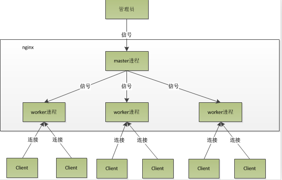

# Nginx master与worker进程

> GitHub 仓库源文件：[点击打开网页渲染版](https://github.com/ben2023niao/ben-ops-notes/blob/main/doc/md/202304141557-%E5%AE%89%E5%85%A8%E4%B8%8E%E5%A0%A1%E5%9E%92%E6%9C%BA%2B%E9%AB%98%E7%BA%A7%E5%AE%89%E5%85%A8%2BNginx%2B%E7%9B%91%E6%8E%A7%E5%91%8A%E8%AD%A6-Nginx%20master%E4%B8%8Eworker%E8%BF%9B%E7%A8%8B.md)

## 工作模式

1. **[Nginx](https://haicoder.net/nginx/nginx-tutorial.html)** 启动后，会产生一个 master 主进程，主进程执行一系列的工作后会产生一个或者多个工作进程 worker。
2. 在客户端请求动态站点的过程中，Nginx 服务器还涉及和后端服务器的通信。Nginx 将接收到的 Web 请求通过代理转发到后端服务器，由后端服务器进行数据处理和组织。
3. Nginx 为了提高对请求的响应效率，降低网络压力，采用了缓存机制，将历史应答数据缓存到本地。保障对缓存文件的快速访问。

## 进程模型

nginx 的进程模型，可以由下图来表示：

## master进程

主要用来管理 worker 进程，master 进程会接收来自外界发来的信号，再根据信号做不同的事情。所以我们要控制 nginx，只需要通过 kill 向 master 进程发送信号就行了。

具体包括以下主要功能：

1. 接收来自外界的信号
2. 向各 worker 进程发送信号
3. 监控 worker 进程的运行状态，当 worker 进程退出后 (异常情况下)，会自动重新启动新的 worker 进程

### 重启说明

比如 kill -HUP pid，则是告诉 nginx，重启 nginx，早期版本可以用这个信号来重启 nginx，因为是从容地重启，因此服务是不中断的。（现在一般使用 nginx -s reload）

master 进程在接收到 HUP 信号后，会先重新加载配置文件，然后再启动新的 worker 进程，并向所有老的 worker 进程发送信号，告诉他们可以光荣退休了。新的 worker 在启动后，就开始接收新的请求，而老的 worker 在收到来自 master 的信号后，就不再接收新的请求，并且在当前进程中的所有未处理完的请求处理完成后，再退出。

## worker进程

主要任务是完成具体的任务逻辑。其主要关注点是与客户端或后端真实服务器 (此时 worker 作为中间代理) 之间的数据可读 / 可写等 I/O 交互事件。具体包括以下主要功能:

1. 接收客户端请求；
2. 将请求一次送入各个功能模块进行过滤处理；
3. 与后端服务器通信，接收后端服务器处理结果；
4. 数据缓存 proxy_cache 模块；
5. 响应客户端请求。

（一个请求，完全由 worker 进程来处理，而且只在一个 worker 进程中处理。）

### worker进程是如何处理请求的

首先，worker 进程之间是平等的，每个 worker 进程都是从 master 进程 fork 过来，在 master 进程里面，先建立好需要 listen 的 socket（listenfd）之后，然后再 fork 出多个 worker 进程。每个 worker 进程，处理请求的机会也是一样的。当一个连接请求过来，每个进程都有可能处理这个连接，怎么做的呢？

所有 worker 进程的 listenfd 会在新连接到来时变得可读，为保证只有一个进程处理该连接，所有 worker 进程在注册 listenfd 读事件前抢 accept_mutex，抢到互斥锁的那个 worker 进程注册 listenfd 读事件，在读事件里调用 accept 接受该连接。

当一个 worker 进程在 accept 这个连接之后，就开始读取请求，解析请求，处理请求，产生数据后，再返回给客户端，最后断开连接，这样就是一个完整的请求就是这样的了。

我们可以了解到一个请求，完全由 worker 进程来处理，且只在一个 worker 进程中处理。

## 总结

Master 进程：master 进程负责管理 worker 进程，并负责读取配置文件和判断文件语法的工作；是主进程，且只有一个。

Worker 进程：worker 进程有多个，它负责处理请求；worker 的进程数量由管理员自己定义。
