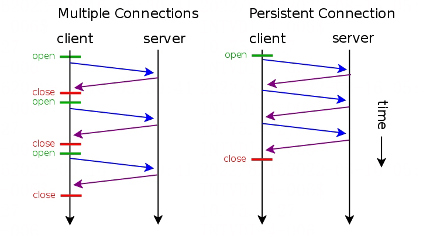

# Http中的Keep-Alive

## Http中的Keep-Alive

**[HTTP](https://haicoder.net/http/http-tutorial.html)** 持久连接（HTTP persistent connection，也称作 HTTP keep-alive 或 HTTP connection reuse，翻译过来可以是保持连接或者连接复用）是使用同一个 TCP 连接来发送和接收多个 HTTP 请求/应答，而不是为每一个新的请求/应答打开新的连接的方式。

HTTP 协议采用 “请求-应答” 模式，当使用普通模式，即非 KeepAlive 模式时，每个请求/应答客户和服务器都要新建一个连接，完成之后立即断开连接（HTTP 协议为无连接的协议），每次请求都会经过三次握手四次挥手过程，效率较低；当使用 Keep-Alive 模式时，客户端到服务器端的连接不会断开，当出现对服务器的后继请求时，客户端就会复用已建立的连接。

下图是每次新建连接和连接复用在通信模型上的区别：

在 Http 1.0 中，Keep-Alive 是没有官方支持的，但是也有一些 Server 端支持，这个年代比较久远就不用考虑了。

Http1.1 以后，Keep-Alive 已经默认支持并开启。客户端（包括但不限于浏览器）发送请求时会在 Header 中增加一个请求头 Connection: Keep-Alive，当服务器收到附带有 Connection: Keep-Alive 的请求时，也会在响应头中添加 Keep-Alive。这样一来，客户端和服务器之间的 HTTP 连接就会被保持，不会断开（断开方式下面介绍），当客户端发送另外一个请求时，就可以复用已建立的连接。

现在的 Http 协议基本都是 Http 1.1 版本了，不太需要考虑 1.0 的兼容问题。

## 为什么要Keep-Alive

通常一个网页可能会有很多组成部分，除了文本内容，还会有诸如：js、css、图片等静态资源，有时还会异步发起 AJAX 请求。只有所有的资源都加载完毕后，我们看到网页完整的内容。然而，一个网页中，可能引入了几十个 js、css 文件，上百张图片，如果每请求一个资源，就创建一个连接，然后关闭，代价实在太大了。

基于此背景，我们希望连接能够在短时间内得到复用，在加载同一个网页中的内容时，尽量的复用连接，这就是 HTTP 协议中 keep-alive 属性的作用。

- HTTP 1.0 中默认是关闭的，需要在 http 头加入 “Connection: Keep-Alive”，才能启用 Keep-Alive；
- http 1.1 中默认启用 Keep-Alive，如果加入 "Connection: close "，才关闭。

## HTTP Keep-Alive优缺点

### 优点

1. 节省了服务端 CPU 和内存适用量
2. 降低拥塞控制 （TCP 连接减少）
3. 减少了后续请求的延迟（无需再进行握手）

### 缺点

对于某些低频访问的资源/服务，比如一个冷门的图片服务器，一年下不了几次，每下一次连接还保持就比较浪费了（这个场景举的不是很恰当）。Keep-Alive 可能会非常影响性能，因为它在文件被请求之后还保持了不必要的连接很长时间，额外占用了服务端的连接数。

## 连接复用后会有什么问题

在没有连接复用时，Http 接收端（注意这里是接收端，并没有特指 Client/Server，因为 Client/Server 都同是发送端和接收端）只需要读取 Socket 中所有的数据就可以了，解决 “拆包” 问题即可；但是连接复用后，无法区分单次 Http 报文的边界，所以还需要额外处理报文边界问题。当然这个通过 Http中Header 的长度字段，按需读取即可解决。

## Http连接复用后包边界问题处理

由于 Http 中 Header 的存在，通过定义一些报文长度的首部字段，可以很方便的处理包边界问题。在 Http 中，有两种方式处理包边界问题：

### Content-Length处理包边界

这个是最通常的处理方式，接收端处理报文时首先读取完整首部（Header），然后通过 Header 中的 Content-Length 来确认报文大小，读取报文时按此长度读取即可，超出长度的报文（“粘包”）不读取，不够长度的报文缓存等待继续读取（“拆包”）。

### Chunked处理包边界

对于无法确认总报文大小的情况，可以使用 Chunked 的方式来对报文进行分块传输，每一块内标示报文大小。比如 **[Nginx](https://haicoder.net/nginx/nginx-tutorial.html)**，开启 Gzip 压缩后，就会开启 Chunked 的传输方式。

当服务端返回 Transfer-Encoding: chunked header 时，报文会通过 chunked 的形式进行编码。

## 断开连接

通过 Keep-Alive 已经做到连接复用了，但复用之后什么时候断开连接呢，不然一直保持连接，造成资源的浪费。Http 协议规定了两种关闭复用连接的方式：

### 通过Keep-Alive Timeout标识

如果服务端 Response Header 设置了 Keep-Alive:timeout={timeout}，客户端会就会保持此连接 timeout（单位秒）时间，超时之后关闭连接。现在在服务端设置响应 Header:

`Keep-Alive:timeout=15`

### 通过Connection close标识

还有一种方式是接收端通在 Response Header 中增加 Connection close 标识，来主动告诉发送端，连接已经断开了，不能再复用了；客户端接收到此标示后，会销毁连接，再次请求时会重新建立连接。

注意：配置 close 配置后，并不是说每次都新建连接，而是约定此连接可以用几次，达到这个最大次数时，接收端就会返回 close 标识。

## Nginx中设置Keep-Alive

### Keep-Alive timeout配置

`Syntax: keepalive_timeout timeout [header_timeout];

Default: keepalive_timeout 75s;

Context: http, server, location`

第一个参数设置一个超时，在此期间保持活动的客户机连接将在服务器端保持打开状态。如果为0则禁用保 Keep-Alive。第二个可选参数在 “Keep-Alive: timeout=time” 响应头字段中设置一个值。

“Keep-Alive: timeout=time” 报头字段被 Mozilla 和 Konqueror 识别。MSIE 在大约 60 秒内自动关闭保持连接。

### Keep-Alive requests（连接可用次数）配置

`Syntax: keepalive_requests number;

Default: keepalive_requests 100;

Context: http, server, location`

设置通过一个保持活动连接可以服务的请求的最大数量。在发出最大数量的请求之后，连接关闭。

## TCP中的Keep-Alive

TCP 中的 KeepAlive 和 Http 的 Keep-Alive 可不是一回事，HTTP 中是做连接复用的，而 TCP 中的 KeepAlive 是 “心跳监测”，定时发送一个空的 TCP Segment，来监测连接是否存活。
