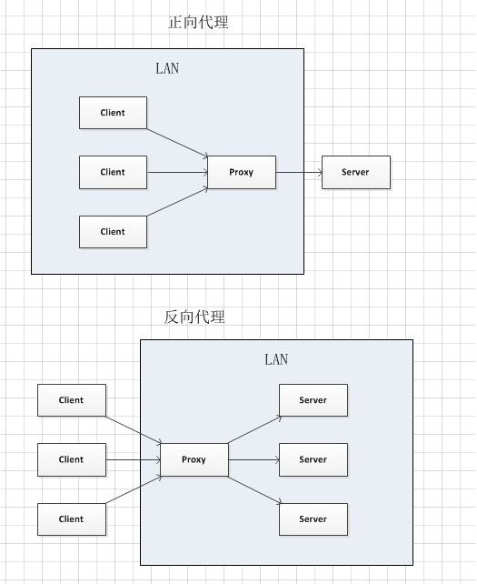
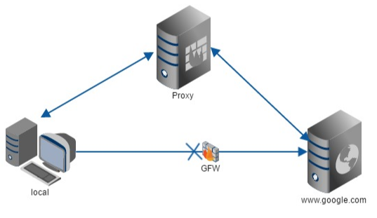
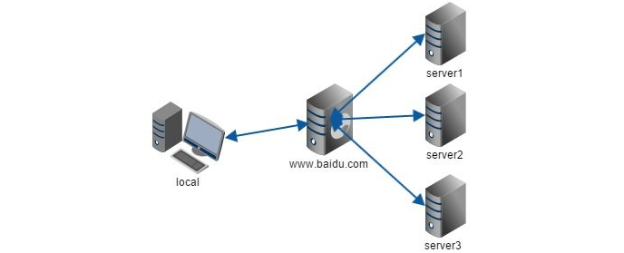

# Nginx 正向代理与反向代理

## 什么是代理

代理其实就是一个中介，A 和 B 本来可以直连，中间插入一个 C，C 就是中介。刚开始的时候，代理多数是帮助内网 client 访问外网 server 用的。

后来出现了反向代理，“反向” 这个词在这儿的意思其实是指方向相反，即代理将来自外网客户端的请求转发到内网服务器，从外到内。

### 正向代理详解

#### 概念

正向代理类似一个跳板机，代理访问外部资源。

比如我们国内访问谷歌，直接访问访问不到，我们可以通过一个正向代理服务器，请求发到代理服，代理服务器能够访问谷歌，这样由代理去谷歌取到返回数据，再返回给我们，这样我们就能访问谷歌了。

#### 用途

1. 访问原来无法访问的资源，如 google。
2. 可以做缓存，加速访问资源。
3. 对客户端访问授权，上网进行认证。
4. 代理可以记录用户访问记录（上网行为管理），对外隐藏用户信息。

### 反向代理详解

#### 概念

反向代理（Reverse Proxy）实际运行方式是指以代理服务器来接受 internet 上的连接请求，然后将请求转发给内部网络上的服务器，并将从服务器上得到的结果返回给 internet 上请求连接的客户端，此时代理服务器对外就表现为一个服务器。

#### 作用

1. 保证内网的安全，阻止 web 攻击，大型网站，通常将反向代理作为公网访问地址，Web 服务器是内网。
2. 用户请求过多，服务器会有一个处理的极限。所以使用反向代理服务器接受请求，再用均衡负载将请求分布给多个真实的服务器。既能提高效率还有一定的安全性。

### 正向代理与反向代理区别

#### 代理对象不同

正向代理即是客户端代理, 代理客户端, 服务端不知道实际发起请求的客户端，反向代理即是服务端代理, 代理服务端, 客户端不知道实际提供服务的服务端。

正向代理中，proxy 和 client 同属一个 LAN，对 server 透明。反向代理中，proxy 和 server 同属一个 LAN，对 client 透明。
实际上 proxy 在两种代理中做的事都是代为收发请求和响应，不过从结构上来看正好左右互换了下，所以把后出现的那种代理方式叫成了反向代理。

#### 案例说明

我们常说的代理也就是只正向代理，正向代理的过程，它隐藏了真实的请求客户端，服务端不知道真实的客户端是谁，客户端请求的服务都被代理服务器代替来请求，某些科学上网工具扮演的就是典型的正向代理角色。用浏览器访问 `[www.google.com](http://www.google.com)` 时，被残忍的 block，于是你可以在国外搭建一台代理服务器，让代理帮我去请求`[google.com](http://google.com)`，代理把请求返回的相应结构再返回给我。

反向代理隐藏了真实的服务端，当我们请求 `[www.baidu.com](http://www.baidu.com)` 时，就像拨打 10086 一样，背后可能有成千上万台服务器为我们服务，但具体是哪一台，你不知道，也不需要知道，你只需要知道反向代理服务器是谁就好了，`[ww.baidu.com](http://ww.baidu.com)` 就是我们的反向代理服务器，反向代理服务器会帮我们把请求转发到真实的服务器那里去。Nginx就是性能非常好的反向代理服务器，用来做负载均衡。

## 反向代理好处

1. 保护了真实的 web 服务器，web 服务器对外不可见，外网只能看到反向代理服务器，而反向代理服务器上并没有真实数据，因此，保证了 web 服务器的资源安全。
2. 反向代理为基础产生了动静资源分离以及负载均衡的方式，减轻 web 服务器的负担，加速了对网站访问速度。
3. 节约了有限的 IP 地址资源，企业内所有的网站共享一个在 internet 中注册的IP地址，这些服务器分配私有地址，采用虚拟主机的方式对外提供服务。

### 正向代理与反向代理总结

正向代理即是客户端代理, 代理客户端, 服务端不知道实际发起请求的客户端，反向代理即是服务端代理, 代理服务端, 客户端不知道实际提供服务的服务端。
