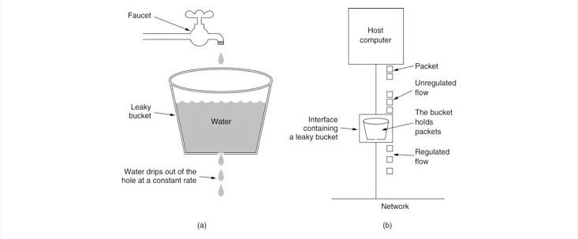
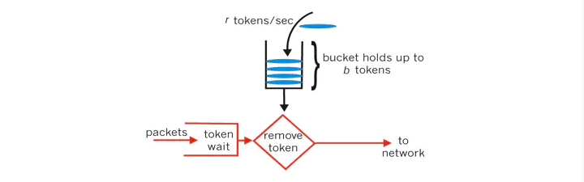
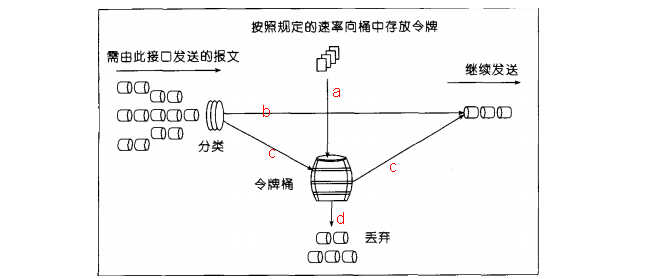

# Nginx漏桶算法和令牌桶算法

> GitHub 仓库源文件：[点击打开网页渲染版](https://github.com/ben2023niao/ben-ops-notes/blob/main/doc/md/202304141557-%E5%AE%89%E5%85%A8%E4%B8%8E%E5%A0%A1%E5%9E%92%E6%9C%BA%2B%E9%AB%98%E7%BA%A7%E5%AE%89%E5%85%A8%2BNginx%2B%E7%9F%A5%E8%AF%86%E7%AC%94%E8%AE%B0-Nginx%E6%BC%8F%E6%A1%B6%E7%AE%97%E6%B3%95%E5%92%8C%E4%BB%A4%E7%89%8C%E6%A1%B6%E7%AE%97%E6%B3%95.md)

## 背景

每一个对外提供的 API 接口都是需要做流量控制的，不然会导致系统直接崩溃。很简单的例子，和保险丝的原理一样，如果用电符合超载就会烧断保险丝断掉电源以达到保护的作用。API 限流的意义也是如此，如果 API 上的流量请求超过核定的数值我们就得对请求进行引流或者直接拒绝等操作。

## 限流算法

既然要限流，就得提到限流算法了，一般有漏桶算法和令牌桶算法两种限流算法。

### 背景

每一个对外提供的 API 接口都是需要做流量控制的，不然会导致系统直接崩溃。很简单的例子，和保险丝的原理一样，如果用电符合超载就会烧断保险丝断掉电源以达到保护的作用。API 限流的意义也是如此，如果 API 上的流量请求超过核定的数值我们就得对请求进行引流或者直接拒绝等操作。

### 限流算法

既然要限流，就得提到限流算法了，一般有漏桶算法和令牌桶算法两种限流算法。

#### 漏桶算法

漏桶算法(Leaky Bucket)是网络世界中流量整形（Traffic Shaping）或速率限制（Rate Limiting）时经常使用的一种算法，它的主要目的是控制数据注入到网络的速率，平滑网络上的突发流量。漏桶算法提供了一种机制，通过它，突发流量可以被整形以便为网络提供一个稳定的流量。

漏桶可以看作是一个带有常量服务时间的单服务器队列，如果漏桶（包缓存）溢出，那么数据包会被丢弃。 在网络中，漏桶算法可以控制端口的流量输出速率，平滑网络上的突发流量，实现流量整形，从而为网络提供一个稳定的流量。

如图所示，把请求比作是水，水来了都先放进桶里，并以限定的速度出水，当水来得过猛而出水不够快时就会导致水直接溢出，即拒绝服务。

可以看出，漏桶算法可以很好的控制流量的访问速度，一旦超过该速度就拒绝服务。

#### 令牌桶算法

令牌桶算法是网络流量整形（Traffic Shaping）和速率限制（Rate Limiting）中最常使用的一种算法。典型情况下，令牌桶算法用来控制发送到网络上的数据的数目，并允许突发数据的发送。

令牌桶算法的原理是系统会以一个恒定的速度往桶里放入令牌，而如果请求需要被处理，则需要先从桶里获取一个令牌，当桶里没有令牌可取时，则拒绝服务。从原理上看，令牌桶算法和漏桶算法是相反的，一个 “进水”，一个是 “漏水”。

Google 的 Guava 包中的 RateLimiter 类就是令牌桶算法的解决方案。

## 令牌铜算法实现

在实施 QOS 策略时，可以将用户的数据限制在特定的带宽，当用户的流量超过额定带宽时，超过的带宽将采取其它方式来处理。要衡量流量是否超过额定的带宽，网络设备并不是采用单纯的数字加减法来决定的，也就是说，比如带宽为 100K，而用户发来

的流量为 110K，网络设备并不是靠 110K 减去 100K 等于 10K，就认为用户超过流量 10K。网络设备衡量流量是否超过额定带宽，需要使用令牌桶算法来计算。下面详细介绍令牌桶算法机制：

当网络设备衡量流量是否超过额定带宽时，需要查看令牌桶，而令牌桶中会放置一定数量的令牌，一个令牌允许接口发送或接收 1bit 数据（有时是 1 Byte 数据），当接口通过 1bit 数据后，同时也要从桶中移除一个令牌。当桶里没有令牌的时候，任何流量都被视为超过额定带宽,只有当桶中有令牌时，数据才可以通过接口。令牌桶中的令牌不仅仅可以被移除，同样也可以往里添加，所以为了保证接口随时有数据通过，就必须不停地往桶里加令牌，由此可见，往桶里加令牌的速度，就决定了数据通过接口的速度。

因此，我们通过控制往令牌桶里加令牌的速度从而控制用户流量的带宽。而设置的这个用户传输数据的速率被称为承诺信息速率（CIR），通常以秒为单位。比如我们设置用户的带宽为 1000 bit 每秒，只要保证每秒钟往桶里添加 1000 个令牌即可。

### 举例

将 CIR 设置为 8000bit/s，那么就必须每秒将 8000 个令牌放入桶中，当接口有数据通过时，就从桶中移除相应的令牌，每通过 1bit，就从桶中移除 1 个令牌。当桶里没有令牌的时候，任何流量都被视为超出额定带宽，而超出的流量就要采取额外动作。每秒钟往桶里加的令牌就决定了用户流量的速率，这个速率就是 CIR，但是每秒钟需要往桶里加的令牌总数，并不是一次性加完的，一次性加进的令牌数量被称为 Burst size（Bc），如果 Bc 只是 CIR 的一半，那么很明显每秒钟就需要往桶里加两次令牌，每次加的数量总是 Bc 的数量。还有就是加令牌的时间，Time interval（Tc），Tc 表示多久该往桶里加一次令牌，而这个时间并不能手工设置，因为这个时间可以靠 CIR 和 Bc 的关系计算得到，Bc/CIR=Tc。

### 图解

1. 按特定的速率向令牌桶投放令牌
2. 根据预设的匹配规则先对报文进行分类，不符合匹配规则的报文不需要经过令牌桶的处理，直接发送；
3. 符合匹配规则的报文，则需要令牌桶进行处理。当桶中有足够的令牌则报文可以被继续发送下去，同时令牌桶中的令牌 量按报文的长度做相应的减少；
4. 当令牌桶中的令牌不足时，报文将不能被发送，只有等到桶中生成了新的令牌，报文才可以发送。这就可以限制报文的流量只能是小于等于令牌生成的速度，达到限制流量的目的。

## 漏桶算法和令牌桶算法的选择

漏桶算法与令牌桶算法在表面看起来类似，很容易将两者混淆。但事实上，这两者具有截然不同的特性，且为不同的目的而使用。

漏桶算法与令牌桶算法的区别在于，漏桶算法能够强行限制数据的传输速率，令牌桶算法能够在限制数据的平均传输速率的同时还允许某种程度的突发传输。

需要注意的是，在某些情况下，漏桶算法不能够有效地使用网络资源，因为漏桶的漏出速率是固定的，所以即使网络中没有发生拥塞，漏桶算法也不能使某一个单独的数据流达到端口速率。因此，漏桶算法对于存在突发特性的流量来说缺乏效率。而令牌桶算法则能够满足这些具有突发特性的流量。通常，漏桶算法与令牌桶算法结合起来为网络流量提供更高效的控制。

## 总结

不论是对于令牌桶拿不到令牌被拒绝，还是漏桶的水满了溢出，都是为了保证大部分流量的正常使用，而牺牲掉了少部分流量，这是合理的，如果因为极少部分流量需要保证的话，那么就可能导致系统达到极限而挂掉，得不偿失。
