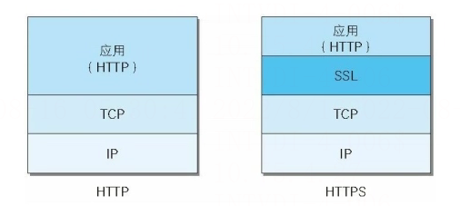
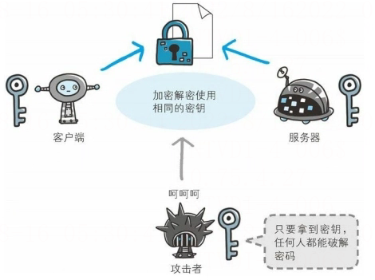
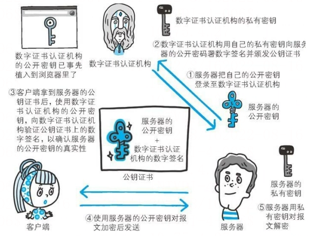
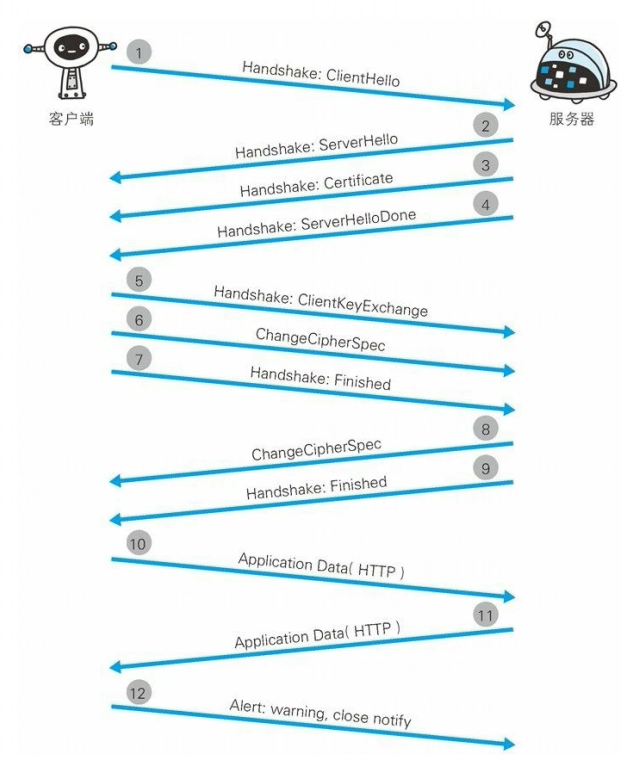
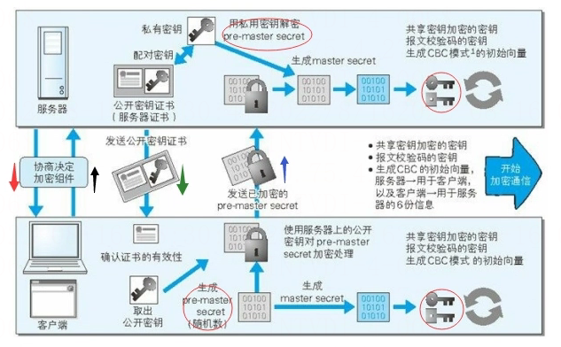

# HTTPS如何保证安全

## 什么是HTTPS

**[HTTPS](https://haicoder.net/https/https-tutorial.html)**（全称：HyperText Transfer Protocol over Secure Socket Layer），是为了保证客户端与服务器之间数据传输的安全。 近两年，Google、Baidu、Facebook 等这样的互联网巨头，不谋而合地开始大力推行 HTTPS， 国内外的大型互联网公司很多也都已经启用了全站 HTTPS，这也是未来互联网发展的趋势。

2021 年离全网使用 HTTPS 已经不远了，列举几个各大互联网公司为鼓励使用 HTTPS 而提出的要求：

1. Google 的搜索引擎算法，让采用 HTTPS 的网站在搜索中排名更靠前；
2. 苹果要求 App Store 中的所有应用都必须使用 HTTPS 加密连接；
3. 微信小程序也要求必须使用 HTTPS 协议；
4. 新一代的 HTTP/2 协议的支持需以 HTTPS 为基础；
5. 新版本 chrome 已将 HTTP 协议网站标记不安全。

## HTTP的不足

**[HTTP](https://haicoder.net/http/http-tutorial.html)** 协议从诞生至今已经具有相当优秀和方便的一面，然而 HTTP 并非只有好的一面，事物皆具两面性，它的不足之处也是很明显：

- 通信使用明文传输，内容可能会被窃听。
- 不验证通信方的身份，因此有可能遭遇伪装。
- 无法证明报文的完整性，所以有可能已经遭到篡改。

除此之外，HTTP 本身还有很多缺点。而且，还有像某些特定的 Web 服务器和特定的 Web 浏览器在实际应用中存在的不足（也可以说成是脆弱性或安全漏洞），另外，用 **[Java](https://haicoder.net/java/java-development.html)** 和 **[PHP](https://haicoder.net/php/php-tutorial.html)** 等编程语言开发的 Web 应用也可能存在安全漏洞。

### 通信使用明文可能会被窃听

由于 HTTP 本身不具备加密的功能，所以也无法做到对通信整体（使用 HTTP 协议通信的请求和响应的内容）进行加密。所以，HTTP 报文使用明文方式发送。如果要问为什么通信时不加密是一个缺点，这是因为，按 **[TCP/IP](https://haicoder.net/tcp/tcpip-tutorial.html)** 协议族的工作机制，通信内容在所有的通信线路上都有可能遭到窥视。

所谓互联网，是由能连通到全世界的网络组成，无论世界哪个角落的服务器在和客户端通信时，在此通信线路上的某些网络设备、光缆、计算机等都不可能是个人的私有物，所以不排除某个环节中会遭到恶意窥视行为。

即使已经过加密处理的通信，也会被窥视到通信内容，这点和未加密的通信是相同的。只是说如果通信经过加密，就有可能让人无法破解报文信息的含义，但加密处理后的报文信息本身还是会被看到。窃听相同段上的通信并非难事。只需要收集在互联网上流动的数据包就行。对于收集来的数据包的解析工作，可以交给那些抓包或嗅探工具。

### 不验证通信方的身份就可能遭到伪装

HTTP 协议中的请求和相应不会对通信方进行确认。也就是说存在 “服务器是否就是发送请求中 URI 真正指定的主机，返回的响应是否真的返回到实际提出请求的客户端” 等类似问题。

在 HTTP 协议通信时，由于不存在确认通信方的处理步骤，任何人都可以发送请求，同时，服务器只要接收到请求，只要发送端的 IP 地址和端口号没有被 Web 服务器设定限制访问，不管对方是谁都会返回一个响应，因此会存在以下各种隐患：

- 无法确定请求发送至目标的 Web 服务器是否是按真实意图返回响应的那台服务器，有可能是已伪装的 Web 服务器。
- 无法确定响应返回到的客户端是否是按真实意图接收响应的那个客户端，有可能是已伪装的客户端。
- 无法确定正在通信的对方是否具备访问权限。因为某些 Web 服务器上保存着重要的信息，指向发给特定用户通信的权限。
- 无法判定请求是来自何方、出自谁手。
- 即使是无意义的请求也会照单全收。无法阻止海量请求下的 DoS 攻击（Denial of Service,拒绝服务攻击）。

### 无法证明报文的完整性，可能已遭到篡改

所谓完整性是指信息的准确度。若无法证明其完整性，通常也就意味着无法判断信息是否准确。因此，在请求或响应送出之后知道对方接收之前的这段时间内，即使请求或相应的内容遭到篡改，也没有办法获悉。

换句话说，没有任何办法确认，发出的请求、响应和接收到的请求、响应是前后相同的。文件内容在传输中可能已经被村改为其他内容，像这样，请求或响应在传输途中遭攻击者拦截并篡改内容的攻击成为中间人攻击（Man-in-the-Middle attack,MITM)。

## 解决：HTTP+加密+认证+完整性保护=HTTPS

上面提了那么多 HTTP 的缺点自然在 HTTPS 中我们得解决它，下面我们来看看 HTTPS 是如何保证我们数据传输安全的。

### HTTPS其实是身披SSL外壳的HTTP

HTTPS 并非是应用层的一种新协议。只是 HTTP 通信接口部分用 SSL(Secure Socket Layer，安全套阶层)和 TLS（Transport Layer Security，安全传输层协议)协议代替而已。

通常，HTTP 直接和 TCP 通信。当使用 SSL 时，则变成先和 SSL 通信，再由 SSL 和 TCP 通信了。简单来说，与 SSL 组合使用的 HTTP 被称为 HTTPS（HTTP Secure,超文本传输安全协议）或 HTTP over SSL。

采用了 SSL 后，HTTP 就拥有了 HTTPS 的加密、证书和完整性保护这些功能。SSL 是独立于 HTTP 的协议，所以不光是 HTTP 协议，其它运行在应用层的 SMTP 和 Telnet 等协议均可配合 SSL 协议使用。可以说 SSL 是当今世界上应用最为广泛的网络安全技术。

### HTTPS的加密原理

近代的加密算法中加密算法是公开的，而密钥是保密的。通过这种方式来保持加密方法的安全性。

加密和解密要用到密钥，如果没有密钥就没有办法对密码解密。换句话来说，任何人只要持有密钥就能够对密文进行解密。

HTTPS 在加密过程中使用了非对称加密技术和对称加密技术。

#### 对称加密算法

采用单钥密码系统的加密方式，同一个密钥可以同时做信息的加密和解密，这种加密的方法称为对称加密，也称为单密钥加密。下面会把对称加密算法称为共享密钥加密算法。

假如现在，SSL 在通信过程中，使用了对称加密算法，也就是说客户端和服务器同时共享一个密钥。

于是，以共享密钥的方式加密，必须将密钥发给对方。这个时候，假如通信过程被监听，密钥被攻击者获取了，那么这个时候也就失去了加密的意义了。

那么，有没有办法解决这个问题呢？答案是肯定的，也就是使用两把密钥。下面先看使用两把密钥的非对称加密算法。

#### 非对称加密算法

与对称加密算法相反，非对称加密算法需要两个密钥来进行加密和解密，这两个密钥是配对的，分别是公开密钥（公钥）和私有密钥（私钥）。

一般情况下，公钥是可以被公开的，它主要用来加密明文。而相应的，私钥不能被公开，用来解密公钥加密的密文。值得注意的是：公钥加密后的密文只能通过对应的私钥来解密，而私钥加密的密文却可以通过对应的公钥来解密。

以上，公钥加密私钥解密用来加密，私钥加密公钥解密用来签名。相关用途后面会讲到。下面会把非对称加密算法称为公开密钥加密算法。

于是现在，假设现在由服务器来生成一对公钥和密钥。当客户端第一次发请求和服务器协商的时候，服务器就生成了一对公钥和私钥。紧接着，服务器把公钥发给客户端（明文，不需要做任何加密），客户端接收后，随机生成一个密钥，使用服务器发过来的公钥进行加密。

再接着，客户端把使用公钥加密的密钥发给服务器，服务器接收到了以后，用配对的私钥进行解密，就得到了客户端随机生成的那个密钥。这个时候，客户端和服务端所持的密钥都是相同的。此时，交换密钥环节就完成了。

于是通信开始时就可进行上面所述的共享密钥加密方式来进行加密。

#### 同时使用

可能，有小伙伴就会问，为什么要大费周章使用非对称加密的方式，然后再得到相同的密钥，进行共享密钥加密的通信呢？由于公开密钥加密处理起来比共享密钥加密方式更为复杂，因此在通信的时候使用公开密钥加密的方式，效率很低。

于是，我们需要使用非对称加密的方式来保证密钥共享的过程中密钥的安全性，而后在通信的过程中使用对称加密算法，这是最合理的设计方式，在保证安全性的同时又保证了性能。

所以，HTTPS 采用共享密钥加密和公开密钥加密两者并用的混合加密机制。在交换密钥使用环节使用公开密钥加密方式，之后建立的通信交换报文阶段则使用共享密钥加密方式。

以上，大概就是使用对称加密和非对称加密的过程。看似过程很完美，其实还存在着一个问题，就是：如何保证服务器传过来的公开密钥的正确性。换句话说，就是保证它不被拦截篡改。

#### 使用证书保证公钥的正确性

假如现在正准备和某台服务器建立公开密钥加密方式下的通信，如何证明客户端收到的公开密钥就是原本预想的那台服务器发行的公开密钥呢？或许，在公开密钥传输的过程中，真正的公开密钥可能已经被攻击者替换掉了。

为了解决这个问题，可以使用由数字证书机构和其相关颁发的公开密钥证书。下面阐述一下数字证书认证机构（简称CA）的业务流程：

首先，服务器的运营人员向数字证书机构提出公开密钥的申请。数字证书认证机构在判明提出申请者的身份之后，会对已申请的公开密钥做数字签名，然后分配这个已签名的公开密钥，并将该公开密钥放入公钥证书后绑定在一起。我们用白话文来翻译一下上面这段话：

首先，CA 会向申请者颁发一个证书，这个证书里面的内容有：签发者、证书用途、服务器申请的时候附带的公钥、服务器的加密算法、使用的 HASH 算法、证书到期的时间等等。紧接着，把上面所提到的内容，做一次 HASH 求值，得到一个 HASH 值。

再接着，用 CA 的私钥进行加密，这样就完成了数字签名。而用 CA 的私钥加密后，就生成了类似人体指纹的签名，任何篡改证书的尝试，都会被数字签名发现。最后，把数字签名，附在数字证书的末尾，传输回来给服务器。

接下来，服务器会把这份由数字证书认证机构颁发的公钥证书发给客户端。这个时候，客户端可以使用数字证书机构的公开密钥对其进行验证。一旦验证成功，客户端便能够确定这个公开密钥是可信的。我们再用白话文来翻译一下：

客户端拿到这个数字证书以后，用 CA 私钥对应的公钥，可以解密数字证书末尾的数字签名，得到原始的 HASH 值。紧接着，客户端按照证书中的 HASH 算法，对证书的内容求 HASH 值。如果通过 CA 公钥解密的 HASH 和通过计算求得的 HASH 值相同，那么认证通过，否则失败。

如果认证通过，就可以取得服务器的公开密钥。那客户端上面的 CA 公钥是从哪里来的呢？多数浏览器开发商发布版本时，会事先在内部植入常用认证机关的公开密钥。这样，就方便客户端对于数字证书真实性的验证。

其具体过程是这样子的（图中简化了数字签名的过程）：

这里其实就用到了非对称加密算法，只不过现在这个加密算法用来签名而不是加密。使用私钥加密，公钥解密，用于公钥的持有者验证通过私钥加密的内容是否被篡改，但是不用来保证内容是否被他人获得。

而使用公钥加密，私钥解密，则是相反的，它不保证信息被他人截获篡改，但是保证信息无法被中间人获得。

### 客户端证书

HTTPS 中不仅可以使用服务器证书，还可以使用客户端证书。以客户端证书进行客户端认证，它的作用与服务器证书是相同的。由于客户端获取证书需要用户自行安装客户端证书，同时也面临着费用的问题。

因此，现状是，安全性极高的认证机构可办法客户端证书但是仅用于特殊用途的业务。比如那些可支撑客户端证书支出费用的业务。

例如，银行的网上银行就采用了客户端证书。在登录网银时不仅要求用户确认输入 ID 和密码，还会要求用户的客户端证书，以确认用户是否从特定的终端访问网银。

## HTTPS的安全通信机制

为了更好的理解 HTTPS，下面给大家画了下图来一起观察一下 HTTPS 的通信步骤：

步骤1：客户端通过发送 Client Hello 报文开始 SSL 通信。报文中包含客户端支持的 SSL 的指定版本、加密组件列表（所使用的加密算法及密钥长度等）。

步骤2：服务器可进行 SSL 通信时，会以 Server Hello 报文作为应答。和客户端一样，在报文中包含 SSL 版本以及加密组件。服务器的加密组件内容是从接收到的客户端加密组件内筛选出来的。

步骤3：之后服务器发送 Certificate 报文。报文中包含公开密钥证书。

步骤4：最后服务器发送 Server Hello Done 报文通知客户端，最初阶段的 SSL 握手协商部分结束。

步骤5：SSL 第一次握手结束之后，客户端以 Client Key Exchange 报文做为回应。报文中包含通信加密中使用的一种被称为 Pre-master secret 的随机密码串。该报文已用步骤 3 中的公开密钥进行加密。

步骤6：接着客户端继续发送 Change Cipher Spec 报文。该报文会提示服务器，在此报文之后的通信会采用 Pre-master secret 密钥加密。

步骤7：客户端发送 Finished 报文。该报文包含连接至今全部报文的整体效验值。这次握手协商是否能够成功，要以服务器是否能够正确解密该报文作为判定标准。

步骤8：服务器同样发送 Change Cipher Spec 报文。

步骤9：服务器同样发送 Finished 报文。

步骤10：服务器和客户端的 Finished 报文交换完毕之后，SSL连接就算建立完成，当然，通信会受到 SSL 的保护。从此处开始进行应用层协议的通信，即发送 HTTP 请求。

步骤11：应用层协议通信，即发送 HTTP 响应。

步骤12：最后由客户端断开连接。断开连接时，发送 close_notify 报文。上图做了一些省略，这步之后再发送 TCP FIN 报文来关闭与 TCP 的通信。

在以上流程中，应用层发送数据时会附加一种叫做 MAC（Message Authentication Code）的报文摘要。MAC 能够查知报文是否遭到篡改，从而保护报文的完整性。

那现在有一个问题，整个过程中产生的三个随机数有什么用呢？还有，后面进行 HTTP 通信的时候，是用哪一个密钥进行加密，还有怎么保证报文的完整性。看下面这张图：

对于客户端：

当其生成了 Pre-master secret 之后，会结合原来的 A、B 随机数，用 DH 算法计算出一个 master secret，紧接着根据这个 master secret 推导出 hash secret 和 session secret。

对于服务端：

当其解密获得了 Pre-master secret 之后，会结合原来的 A、B 随机数，用 DH 算法计算出一个 master secret，紧接着根据这个 master secret 推导出 hash secret 和 session secret。

在客户端和服务端的 master secret 是依据三个随机数推导出来的，它是不会在网络上传输的，只有双方知道，不会有第三者知道。同时，客户端推导出来的 session secret 和 hash secret 与服务端也是完全一样的。

那么现在双方如果开始使用对称算法加密来进行通讯，使用哪个作为共享的密钥呢？过程是这样子的：

双方使用对称加密算法进行加密，用 hash secret 对 HTTP 报文做一次运算生成一个 MAC，附在 HTTP 报文的后面，然后用 session-secret 加密所有数据（HTTP+MAC），然后发送。

接收方则先用 session-secret 解密数据，然后得到 HTTP+MAC，再用相同的算法计算出自己的 MAC，如果两个 MAC 相等，证明数据没有被篡改。至此，整个过程介绍完毕。
