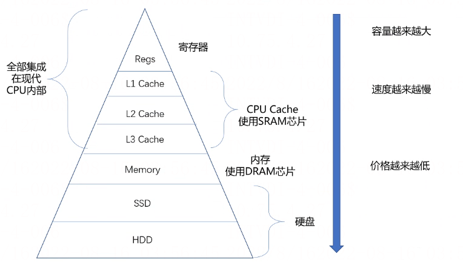

# 局部性原理

> GitHub 仓库源文件：[点击打开网页渲染版](https://github.com/ben2023niao/ben-ops-notes/blob/main/doc/md/202304141557-%E5%AE%89%E5%85%A8%E4%B8%8E%E5%A0%A1%E5%9E%92%E6%9C%BA%2B%E9%AB%98%E7%BA%A7%E5%AE%89%E5%85%A8%2BRedis%2B%E7%9F%A5%E8%AF%86%E7%AC%94%E8%AE%B0-%E5%B1%80%E9%83%A8%E6%80%A7%E5%8E%9F%E7%90%86.md)

## 什么是局部性原理

虚拟存储器的核心思路是根据程序运行时的局部性原理：一个程序运行时，在一小段时间内，只会用到程序和数据的很小一部分，仅把这部分程序和数据装入主存即可，更多的部分可以在需要用到时随时从辅存调入主存。在操作系统和相应硬件的支持下，数据在辅存和主存之间按程序运行的需要自动成批量地完成交换。

局部性原理是虚拟内存技术的基础，正是因为程序运行具有局部性原理，才可以只装入部分程序到内存就开始运行。早在 1968 年的时候，就有人指出我们的程序在执行的时候往往呈现局部性规律，也就是说在某个较短的时间段内，程序执行局限于某一小部分，程序访问的存储空间也局限于某个区域。

局部性原理表现在以下两个方面：

**时间局部性：** 如果程序中的某条指令一旦执行，不久以后该指令很可能再次执行；如果某数据被访问过，不久以后该数据很可能再次被访问。产生时间局部性的典型原因，是由于在程序中存在着大量的循环操作。时间局部性是通过将近来使用的指令和数据保存到高速缓存存储器中，并使用高速缓存的层次结构实现。

**空间局部性：** 一旦程序访问了某个存储单元，在不久之后，其附近的存储单元也将被访问，即程序在一段时间内所访问的地址，可能集中在一定的范围之内，这是因为指令通常是顺序存放、顺序执行的，数据也一般是以向量、数组、表等形式簇聚存储的。空间局部性通常是使用较大的高速缓存，并将预取机制集成到高速缓存控制逻辑中实现。虚拟内存技术实际上就是建立了 “内存-外存” 的两级存储器的结构，利用局部性原理实现髙速缓存。

基于局部性原理，在程序装入时，可以将程序的一部分装入内存，而将其他部分留在外存，就可以启动程序执行。由于外存往往比内存大很多，所以我们运行的软件的内存大小实际上是可以比计算机系统实际的内存大小大的。在程序执行过程中，当所访问的信息不在内存时，由操作系统将所需要的部分调入内存，然后继续执行程序。另一方面，操作系统将内存中暂时不使用的内容换到外存上，从而腾出空间存放将要调入内存的信息。

可见，内-外存交换技术本质是一种时间换空间的策略，你用 CPU 的计算时间，页的调入调出花费的时间，换来了一个虚拟的更大的空间来支持程序的运行。

## 示例

上面是通过理论来说明的，下面我们通过一段代码来看看局部性原理：

```
public int sum(int[] array) {
 int sum = 0;
 for (int i = 0; i < array.length; i++) {
 sum = sum + array[i];
 }
 return sum;
}
```

从上面的这段代码来看，就是一个很简单的数组元素求和，这里我们主要看 sum 和 array 两个变量，我们可以看到 sum 在每次循环中都会用到，另外它只是一个简单变量，所以我们可以看到，sum 是符合我们上面提到的时间局部性，再访问一次后还会被继续访问到，但是它不存在我们所说的空间局部性了。

相反的，array 数组中的每个元素只访问一次，另外数组底层的存储是连续的，所以 array 变量符合我们上面提到的空间局部性，但是不符合时间局部性。

这只是局部性原理的简单示例，对于局部性原理还有很多地方会用到，我们如果能熟练的掌握和使用，对我们的帮助会很大的。

## 相关应用

### CPU缓存

上面的示例其实很简单，相信大家都能理解，另外局部性原理其实在我们日常使用的软件中随处可见，并且在操作系统中也少不了。我们知道 CPU 的速度是非常快的，而且 CPU 与内存之间有多级缓存，如下图：


为了充分的利用 CPU，操作系统会利用局部性原理，将高频的数据从内存中加载的缓存中，从而加快 CPU 的处理速度。

### 广义局部性

其实我们的局部性原理不单单是上面提到的狭义性的局部性，还可以是广义的局部性。我们系统里面的热点数据，CDN 数据，微博的热点流量等等这些都利用了局部性原理。只是我们可能没有意识到而已，实际上已经在使用了。我们会通过 Redis 缓存热点数据，会通过 CDN 提前加载图片或者视频资源，等等，都是因为这些数据本身就符合局部性原理，合理的利用局部性可以得到了能效、成本上的提升。

### 利弊结合

任何事情都是多面性的，局部性原理虽然我们使用起来很不错，可以提高系统性能，但是在有些场景下，我们是需要避免局部性原理的出现的。或者说出现了这种情况，我们需要人工处理。我们可以试想一下，如果在我们的一个大数据处理平台上，由于局部性原理的存在，导致我们部分节点数据庞大运算吃力，部分节点数据量小十分空闲，这种情况自然是不合理，我们就需要把数据按照业务场景进行重新分配，以达到整个集群的最大利用。
