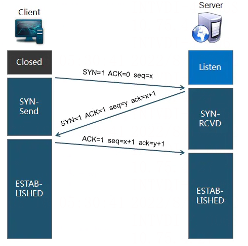
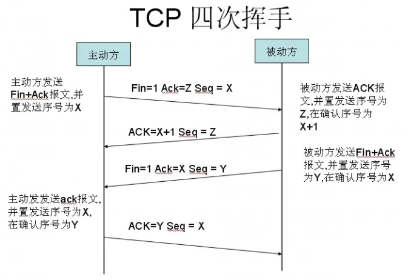

# 完整的HTTP请求过程

> GitHub 仓库源文件：[点击打开网页渲染版](https://github.com/ben2023niao/ben-ops-notes/blob/main/doc/md/202304141557-%E5%AE%89%E5%85%A8%E4%B8%8E%E5%A0%A1%E5%9E%92%E6%9C%BA%2B%E9%AB%98%E7%BA%A7%E5%AE%89%E5%85%A8%2BWindows%2BDNS-%E5%AE%8C%E6%95%B4%E7%9A%84HTTP%E8%AF%B7%E6%B1%82%E8%BF%87%E7%A8%8B.md)

当我们在浏览器栏输入一个网址，比如 `[www.haicoder.net](http://www.haicoder.net)` 的时候，具体发生了什么呢？这个请求是怎么到达服务器及返回结果的呢？

## 概述

1. 浏览器进行 DNS 域名解析，得到对应的 IP 地址
2. 根据这个 IP，找到对应的服务器建立连接（三次握手）
3. 建立 TCP 连接后发起 HTTP 请求（一个完整的 http 请求报文）
4. 服务器响应 HTTP 请求，浏览器得到 html 代码（服务器如何响应）
5. 浏览器解析 html 代码，并请求 html 代码中的资源（如js、css、图片等）
6. 浏览器对页面进行渲染呈现给用户
7. 服务器关闭 TCP 连接（四次挥手）

比如，我们现在使用浏览器访问 `[www.haicoder.net](http://www.haicoder.net)`，那么具体流程如下：

1. 对 `[www.haicoder.net](http://www.haicoder.net)` 这个网址进行 DNS 域名解析到 IP
2. 通过 IP，使用 ARP 地址解析协议，找到对应的服务器，发起 TCP 三次握手
3. 建立 TCP 请求后，发起 HTTP 请求（例如 TOMCAT 部署的 springMVC 程序）
4. 服务器响应 HTTP 请求，返回 RESPONSE
5. 游览器解析 response，并请求其它的资源文件（js、css等）
6. 游览器进行渲染界面

注：DNS 域名解析采用的是递归查询的方式，先从本地的 DNS 缓存中查找—>缓存中没有的话就去找根域名服务器—–>根域名服务器找不到继续找下一级，这样递归查找到再返回给游览器。

## HTTP请求完整流程详解

### 域名解析

以 Chrome 浏览器为例：

1. Chrome 浏览器会首先搜索浏览器自身的 DNS 缓存（缓存时间比较短，大概只有 1 分钟，且只能容纳 1000 条缓存），看自身的缓存中是否有 `<https://www.haicoder.net>` 对应的条目，而且没有过期，如果有且没有过期则解析到此结束。

注：我们怎么查看 Chrome 自身的缓存？可以使用 `<chrome://com-internals/#dns>` 来进行查看。
2. 如果浏览器自身的缓存里面没有找到对应的条目，那么 Chrome 会搜索操作系统自身的 DNS 缓存，如果找到且没有过期则停止搜索解析到此结束。

注：怎么查看操作系统自身的 DNS 缓存，以 Windows 系统为例，可以在命令行下使用 DC02onfig /displaydns 来进行查看。
3. 如果在 Windows 系统的 DNS 缓存也没有找到，那么尝试读取 hosts 文件（位于 C:\Windows\System32\drivers\etc），看看这里面有没有该域名对应的 IP 地址，如果有则解析成功。
4. 如果在 hosts 文件中也没有找到对应的条目，浏览器就会发起一个 DNS 的系统调用，就会向本地配置的首选 DNS 服务器（一般是电信运营商提供的，也可以使用像 Google 提供的 DNS 服务器）发起域名解析请求（通过的是 UDP 协议向 DNS 的 53 端口发起请求，这个请求是递归的请求，也就是运营商的 DNS 服务器必须得提供给我们该域名的 IP 地址），运营商的 DNS 服务器首先查找自身的缓存，找到对应的条目，且没有过期，则解析成功。如果没有找到对应的条目，则有运营商的 DNS 代我们的浏览器发起迭代 DNS 解析请求，它首先是会找根域的 DNS 的 IP 地址（这个 DNS 服务器都内置 13 台根域的 DNS 的 IP 地址），找打根域的 DNS 地址，就会向其发起请求（请问 `[www.haicoder.net](http://www.haicoder.net)` 这个域名的 IP 地址是多少啊？），根域发现这是一个顶级域 net 域的一个域名，于是就告诉运营商的 DNS 我不知道这个域名的 IP 地址，但是我知道 net 域的 IP 地址，你去找它去，于是运营商的 DNS 就得到了 net 域的 IP 地址，又向 net 域的 IP 地址发起了请求（请问 `[www.haicoder.net](http://www.haicoder.net)` 这个域名的 IP 地址是多少?）,net 域这台服务器告诉运营商的 DNS 我不知道 `[www.haicoder.net](http://www.haicoder.net)` 这个域名的 IP 地址，但是我知道 `[haicoder.net](http://haicoder.net)` 这个域的 DNS 地址，你去找它去，于是运营商的 DNS 又向 `[haicoder.net](http://haicoder.net)` 这个域名的 DNS 地址（这个一般就是由域名注册商提供的，像万网，新网等）发起请求（请问 `[www.haicoder.net](http://www.haicoder.net)` 这个域名的 IP 地址是多少？），这个时候 `[haicoder.net](http://haicoder.net)` 域的 DNS 服务器一查，诶，果真在我这里，于是就把找到的结果发送给运营商的 DNS 服务器，这个时候运营商的 DNS 服务器就拿到了 `[www.haicoder.net](http://www.haicoder.net)` 这个域名对应的 IP 地址，并返回给 Windows 系统内核，内核又把结果返回给浏览器，终于浏览器拿到了 `[www.haicoder.net](http://www.haicoder.net)` 对应的 IP 地址，该进行一步的动作了。

注：一般情况下是不会进行以下步骤的：

如果经过以上的 4 个步骤，还没有解析成功，那么会进行如下步骤（以下是针对 Windows 操作系统）：

	1. 操作系统就会查找 NetBIOS name Cache（NetBIOS 名称缓存，就存在客户端电脑中的），那这个缓存有什么东西呢？凡是最近一段时间内和我成功通讯的计算机的计算机名和 Ip 地址，就都会存在这个缓存里面。什么情况下该步能解析成功呢？就是该名称正好是几分钟前和我成功通信过，那么这一步就可以成功解析。
	2. 如果上一步也没有成功，那会查询 WINS 服务器（是 NETBIOS 名称和 IP 地址对应的服务器）
	3. 如果上一步也没有查询成功，那么客户端就要进行广播查找
	4. 如果上一步也没有成功，那么客户端就读取 LMHOSTS 文件（和 HOSTS 文件同一个目录下，写法也一样）

如果第八步还没有解析成功，那么就宣告这次解析失败，那就无法跟目标计算机进行通信。只要这八步中有一步可以解析成功，那就可以成功和目标计算机进行通信。

## 与服务器建立连接

### TCP连接的建立

客户端的请求到达服务器，首先就是建立 TCP 连接：

Client 首先发送一个连接试探，ACK=0 表示确认号无效，SYN = 1 表示这是一个连接请求或连接接受报文，同时表示这个数据报不能携带数据，seq = x 表示 Client 自己的初始序号（seq = 0 就代表这是第0号包），这时候 Client 进入 syn_sent 状态，表示客户端等待服务器的回复。

Server 监听到连接请求报文后，如同意建立连接，则向 Client 发送确认。TCP 报文首部中的 SYN 和 ACK 都置 1 ，ack = x + 1 表示期望收到对方下一个报文段的第一个数据字节序号是 x+1，同时表明 x 为止的所有数据都已正确收到（ack=1 其实是 ack=0+1,也就是期望客户端的第 1 个包），seq = y 表示 Server 自己的初始序号（seq=0 就代表这是服务器这边发出的第 0 号包）。这时服务器进入 syn_rcvd，表示服务器已经收到 Client 的连接请求，等待 client 的确认。

Client 收到确认后还需再次发送确认，同时携带要发送给 Server 的数据。ACK 置 1 表示确认号 ack= y + 1 有效（代表期望收到服务器的第 1 个包），Client 自己的序号 seq= x + 1（表示这就是我的第 1 个包，相对于第 0 个包来说的），一旦收到 Client 的确认之后，这个 TCP 连接就进入 Established 状态，就可以发起 http 请求了。

问题1：TCP 为什么需要 3 次握手？

两个计算机通信是靠协议（目前流行的 TCP/IP 协议）来实现,如果两个计算机使用的协议不一样，那是不能进行通信的，所以这个三次握手就相当于试探一下对方是否遵循 TCP/IP 协议，协商完成后就可以进行通信了，当然这样理解不是那么准确。

问题2：为什么 HTTP 协议要基于 TCP 来实现？

目前在 Internet 中所有的传输都是通过 TCP/IP 进行的，HTTP 协议作为 TCP/IP 模型中应用层的协议也不例外，TCP 是一个端到端的可靠的面向连接的协议，所以 HTTP 基于传输层 TCP 协议不用担心数据的传输的各种问题。

### TCP四次挥手

当客户端和服务器通过三次握手建立了 TCP 连接以后，当数据传送完毕，肯定是要断开 TCP 连接的啊。那对于 TCP 的断开连接，这里就有了神秘的 “四次分手”。

第一次分手：主机1（可以使客户端，也可以是服务器端），设置 Sequence Number，向主机 2 发送一个 FIN 报文段；此时，主机 1 进入 FIN_WAIT_1 状态；这表示主机 1 没有数据要发送给主机 2 了；

第二次分手：主机 2 收到了主机 1 发送的 FIN 报文段，向主机 1 回一个 ACK 报文段，Acknowledgment Number 为 Sequence Number 加 1；主机 1 进入 FIN_WAIT_2 状态；主机 2 告诉主机 1，我 “同意” 你的关闭请求；

第三次分手：主机 2 向主机 1 发送 FIN 报文段，请求关闭连接，同时主机 2 进入 LAST_ACK 状态；

第四次分手：主机 1 收到主机 2 发送的 FIN 报文段，向主机 2 发送 ACK 报文段，然后主机 1 进入 TIME_WAIT 状态；主机 2 收到主机 1 的 ACK 报文段以后，就关闭连接；此时，主机 1 等待 2MSL 后依然没有收到回复，则证明 Server 端已正常关闭，那好，主机 1 也可以关闭连接了。

问题1：为什么要四次分手？

TCP 协议是一种面向连接的、可靠的、基于字节流的运输层通信协议。TCP 是全双工模式，这就意味着，当主机 1 发出 FIN 报文段时，只是表示主机 1 已经没有数据要发送了，主机 1 告诉主机 2，它的数据已经全部发送完毕了；但是，这个时候主机 1 还是可以接受来自主机 2 的数据；当主机 2 返回 ACK 报文段时，表示它已经知道主机 1 没有数据发送了，但是主机 2 还是可以发送数据到主机 1 的；当主机 2 也发送了 FIN 报文段时，这个时候就表示主机 2 也没有数据要发送了，就会告诉主机 1，我也没有数据要发送了，之后彼此就会愉快的中断这次 TCP 连接。

### 发起HTTP请求

HTTP 是一个客户端和服务器端请求和应答的标准（TCP）。客户端是终端用户，服务器端是网站。通过使用 Web 浏览器、网络爬虫或者其它的工具，客户端发起一个到服务器上指定端口（默认端口为 80）的 HTTP 请求。

通俗来讲，他就是计算机通过网络进行通信的规则，是一个基于请求与响应，无状态的，应用层的协议，常基于 TCP/IP 协议传输数据。目前任何终端（手机，笔记本电脑。）之间进行任何一种通信都必须按照 Http 协议进行，否则无法连接。

### 服务器响应HTTP请求，浏览器得到html代码

接收到 HTTP 请求之后，就轮到负载均衡登场了，它位于网站的最前端，把短时间内较高的访问量分摊到不同机器上处理。负载均衡方案有软件、硬件两种。

### 浏览器解析html代码，并请求html代码中的资源

浏览器拿到 index.html 文件后，就开始解析其中的 html 代码，遇到 js/css/image 等静态资源时，就向服务器端去请求下载（会使用多线程下载，每个浏览器的线程数不一样），这个时候就用上 keep-alive 特性了，建立一次 HTTP 连接，可以请求多个资源，下载资源的顺序就是按照代码里的顺序，但是由于每个资源大小不一样，而浏览器又多线程请求请求资源，所以请求显示的顺序并不一定是代码里面的顺序。

浏览器在请求静态资源时（在未过期的情况下），向服务器端发起一个 http 请求（询问自从上一次修改时间到现在有没有对资源进行修改），如果服务器端返回 304 状态码（告诉浏览器服务器端没有修改），那么浏览器会直接读取本地的该资源的缓存文件。

### 浏览器对页面进行渲染呈现给用户

最后，浏览器利用自己内部的工作机制，把请求到的静态资源和 html 代码进行渲染，渲染之后呈现给用户。
