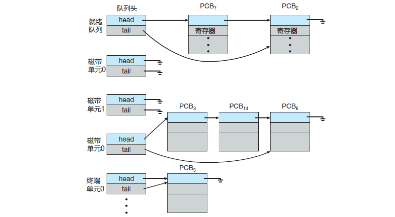
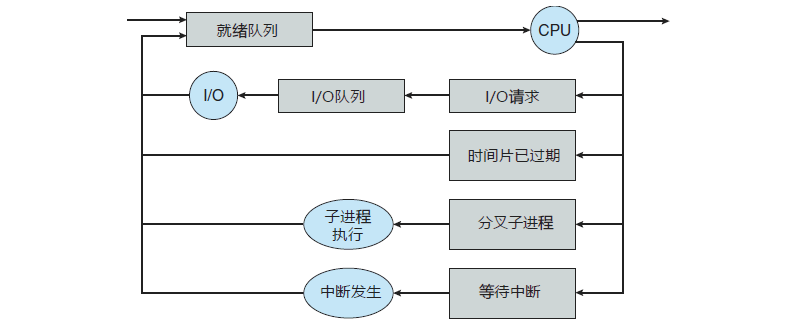

# 进程调度

多道程序设计的目标是，无论何时都有进程运行，从而最大化 CPU 利用率。分时系统的目的是在进程之间快速切换 CPU，以便用户在程序运行时能与其交互。

为了满足这些目标，进程调度器选择一个可用进程（可能从多个可用进程集合中）到 CPU 上执行。如果有多个进程，那么余下的需要等待 CPU 空闲并能重新调度。

## 调度队列

进程在进入系统时，会被加到作业队列，这个队列包括系统内的所有进程。驻留在内存中的、就绪的、等待运行的进程保存在就绪队列上。就绪队列通常用链表实现；其头节点有两个指针，用于指向链表的第一个和最后一个 PCB 块；每个 PCB 还包括一个指针，指向就绪队列的下一个 PCB，如下图。

系统还有其他队列。当一个进程被分配了 CPU 后，它执行一段时间，最终退出，或被中断，或等待特定事件发生如 I/O 请求的完成。假设进程向一个共享设备如磁盘发出 I/O 请求。由于系统具有许多进程，磁盘可能忙于其他进程的 I/O 请求，因此该进程可能需要等待磁盘。等待特定 I/O 设备的进程列表，称为设备队列。每个设备都有自己的设备队列。

进程调度通常用队列图来表示，如下图所示。每个矩形框代表一个队列；这里具有两种队列：就绪队列和设备队列。圆圈表示服务队列的资源；箭头表示系统内的进程流向。

最初，新进程被加到就绪队列；它在就绪队列中等待，直到被选中执行或被分派。当该进程分配到 CPU 并执行时，以下事件可能发生：

- 进程可能发出 I/O 请求，并被放到 I/O 队列。
- 进程可能创建一个新的子进程，并等待其终止。
- 进程可能由于中断而被强制释放 CPU，并被放回到就绪队列。

对于前面两种情况，进程最终从等待状态切换到就绪状态，并放回到就绪队列。进程重复这一循环直到终止；然后它会从所有队列中删除，其 PCB 和资源也被释放。

## 调度程序

进程在整个生命周期中，会在各种调度队列之间迁移。操作系统为了调度必须按一定方式从这些队列中选择进程。进程选择通过适当调度器或调度程序来执行。

通常，对于批处理系统，提交的进程多于可以立即执行的。这些进程会被保存到大容量存储设备（通常为磁盘）的缓冲池，以便以后执行。长期调度程序（或作业调度程序）从该池中选择进程，加到内存，以便执行。短期调度程序（或 CPU 调度程序）从准备执行的进程中选择进程，并分配 CPU。

两种调度程序的主要区别是执行频率：

- 短期调度程序必须经常为 CPU 选择新的进程。进程可能执行几毫秒，就会等待 I/O 请求。通常，短期调度程序每 100ms 至少 执行一次。由于执行之间的时间短，短期调度程序必须快速。如果花费 10ms 来确定执行一个运行 100ms 的进程，那么 10/(100 + 10) = 9% 的 CPU 时间会用（浪费）在调度工作上。
- 长期调度程序执行并不频繁；在新进程的创建之间，可能有几分钟间隔。长期调度程序控制多道程序程度(内存中的进程数量）。如果多道程序程度稳定，那么创建进程的平均速度必须等于进程离开系统的平均速度。因此，只有在进程离开系统时，才需要长期调度程序的调度。由于每次执行之间的更长时间间隔，长期调度程序可以负担得起更多时间，以便决定应该选择执行哪个进程。

重要的是，长期调度程序进行认真选择。通常，大多数进程可分为 I/O 为主或 CPU 为主，I/O 密集型进程执行 I/O 比执行计算需要花费更多时间。相反，CPU 密集型进程很少产生 I/O 请求，而是将更多时间用于执行计算。

长期调度程序应该选择 I/O 密集型和 CPU 密集型的合理进程组合。因为如果 所有进程都是 I/O 密集型的，那么就绪队列几乎总是为空，从而短期调度程序没有什么可做。如果所有进程都是 CPU 密集型的，那么 I/O 等待队列几乎总是为空，从而设备没有得到使用，因而系统会不平衡。

有的系统，可能没有或极少采用长期调度程序。例如，UNIX 或微软 Windows 的分时系统通常没有长期调度程序，只是简单将所有新进程放于内存，以供短期调度程序使用。这些系统的稳定性取决于物理限制（如可用的终端数）或用户的自我调整。如果多用户系统性能下降到令人难以接受，那么有的用户就会退出。

有的操作系统如分时系统，可能引入一个额外的中期调度程序，如下图所示：

中期调度程序的核心思想是可将进程从内存（或从 CPU 竞争）中移出，从而降低多道程序程度。之后，进程可被重新调入内存，并从中断处继续执行。这种方案称为交换。

通过中期调度程序，进程可换出，并在后来可换入。为了改善进程组合，或者由于内存需求改变导致过度使用内存从而需要释放内存，就有必要使用交换。

## 上下文切换

前面提过，中断会导致 CPU 从执行当前任务改变到执行内核程序。这种操作在通用系统中经常发生。当中断发生时，系统需要保存当前运行在 CPU 上的进程的上下文，以便在处理后能够恢复上下文，即先挂起进程，再恢复进程。

切换 CPU 到另一个进程需要保存当前进程状态和恢复另一个进程的状态，这个任务称为上下文切换。

当进行上下文切换时，内核会将旧进程状态保存在其 PCB 中，然后加载经调度而要执行的新进程的上下文。上下文切换的时间是纯粹的开销，因为在切换时系统并没有做任何有用工作。上下文切换的速度因机器不同而有所不同，它依赖于内存速度、必须复制的寄存器数量、是否有特殊指令（如加载或存储所有寄存器的单个指令)。典型速度为几毫秒。

上下文切换的时间与硬件支持密切相关。例如，有的处理器（如 Sun UltraSPARC）提供了多个寄存器组，上下文切换只需简单改变当前寄存器组的指针。当然，如果活动进程数量超过寄存器的组数，那么系统需要像以前一样在寄存器与内存之间进行数据复制。

不仅如此，操作系统越复杂，上下文切换所要做的就越多，高级的内存管理技术在每次上下文切换时，所需切换的数据会更多。例如，在使用下一个进程的地址空间之前，需要保存当前进程的地址空间。如何保存地址空间，需要做什么才能保存等，取决于操作系统的内存管理方法。
