# XSS 跨窗口劫持演示+原理讲解

> GitHub 仓库源文件：[点击打开网页渲染版](https://github.com/ben2023niao/ben-ops-notes/blob/main/doc/md/202304141557-%E5%AE%89%E5%85%A8%E4%B8%8E%E5%A0%A1%E5%9E%92%E6%9C%BA%2B%E9%AB%98%E7%BA%A7%E5%AE%89%E5%85%A8%2BXSS%2B%E5%A4%87%E4%BB%BD%E6%81%A2%E5%A4%8D-XSS%20%E8%B7%A8%E7%AA%97%E5%8F%A3%E5%8A%AB%E6%8C%81%E6%BC%94%E7%A4%BA%2B%E5%8E%9F%E7%90%86%E8%AE%B2%E8%A7%A3.md)

```
<script src="xss_ghost.js"></script>
<script>
 XssGhost.init({
 id: 'test-1', // 相同 id 的 payload 不会重复运行
 payload: function() {
 console.log('xss run');
 }
 });
</script>
```

将 XSS 注入到父窗口和子窗口，延长攻击时间演示：<http://www.etherdream.com/FunnyScript/XSSGhost/>

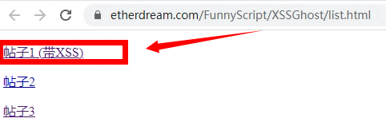
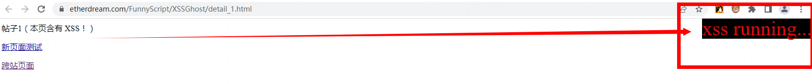
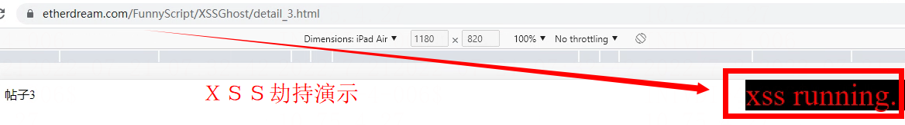
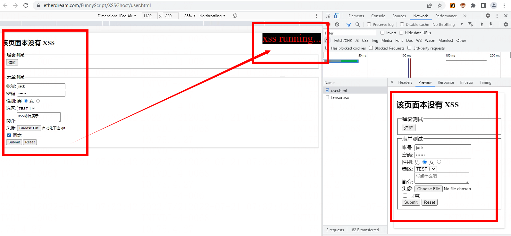
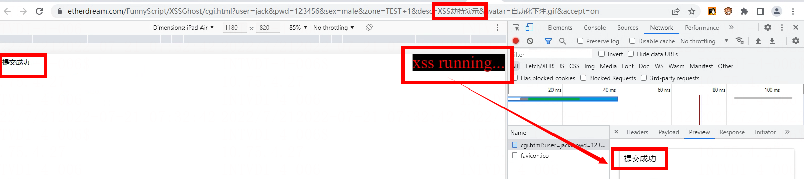

XSS劫持原理讲解

XSS 的本质仍是一段脚本。和其他文档元素一样，页面关了一切都销毁。除非能将脚本蔓延到页面以外的地方，那样才能获得更长的生命力。

庆幸的是，从 DOM 诞生的那一天起，就已为我们准备了这个特殊的功能，让脚本拥有突破当前页面的能力。

下面开始我们的续命黑魔法。

## 反向注入

一个不合理的标准，往往会埋下各种隐患。

浏览器提供了一个 opener 属性，供弹出的窗口访问来源页。但该规范设计的并不合理，导致通过超链接弹出的页面，也能使用 opener。

但按理来说，只有通过脚本弹出的子页面，才能拥有 opener 属性，这样可以相互访问和操作。

然而事实上，通过超链接点开的页面居然也有！这为 XSS 打开了一扇大门 —— XSS 不仅可以操控当前页面，甚至还能传染给同源的父页面。
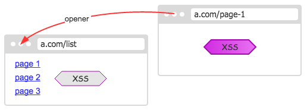

XSS 一旦感染到父页面里，战斗力就大幅提升了。

可以想象，只要看了一个带有 XSS 的帖子，即使立即关了，那么帖子列表页也会遭到感染。

更有趣的是，opener 这个属性不受同源策略限制。即使父页面不同源，但父页面的 opener 仍然可以访问。

我们可以顺着 opener.opener.opener... 一直往上试探，只要是和当前页面同源的，仍然能够进行操控 —— 尽管中间隔着其他不同源的页面。
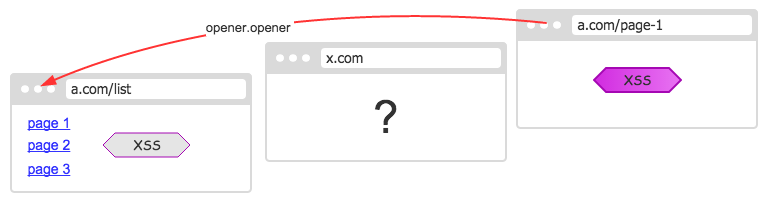

网站的主页面显然比详细页更受用户的信任，停留的时间也会更长，因此攻击力可成倍的增加。

## 正向注入

如果说反向注入是苟且偷生的话，那么正向注入就是当家做主翻身的机会了。

尽管我们能够控制父页面，但从父页面点开的网页仍然不受操控。如果具有控制子页面的能力，那就更完美了。

不幸的是，我们无法控制超链接打开的新页面。唯一能够操控的新页面，那就是 window.open 的弹框页。幸运的是，在绝大多数浏览器上，它们看起来的效果是一样的。

因此，我们可以在用户的点击瞬间，屏蔽掉默认的超链接行为，用弹框页取而代之，即可把 XSS 注入到 window.open 返回的新页面里了。

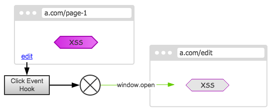
类似的，通过子页面递归打开的新页面，同样也无法逃脱。于是子子孙孙尽在我们的掌控之中。
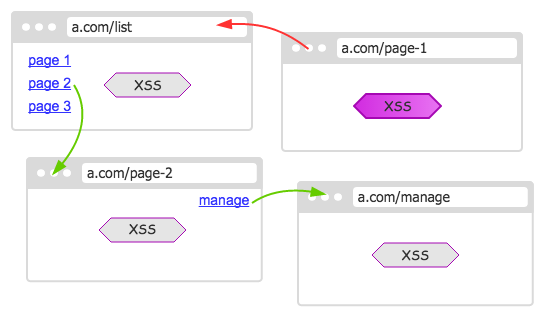

反向注入，让我们占据已有的地盘；正向注入，把我们的势力扩大蔓延出去。两者结合，即可占据半壁江山了。

> 值得注意的是，正向注入中有个细节问题。并非所有的超链接都是弹出型的（_blank），也有不少是在当前页面跳转的。若是想劫持的狠点，可以忽略这个问题；如果不想被细心的用户发现，那么可以判断下当前超链接以及`<base>`的 target 属性，决定是否劫持。

## 页面监督

上面提到，如果是在当前页面里跳转，那么还能继续感染吗？或者说，某个页面刷新之后，是否就丢失了？

答案是肯定的。如果我们不采取一些措施，任凭占据的地盘不断丢失，那么我们的势力范围就会越来越小，直到消亡。

相比进攻，防守则更为困难。我们不知何时会失去，因此必须定时去检查。
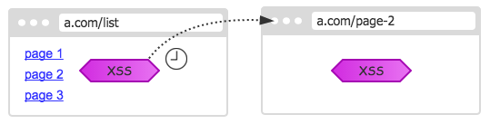
一旦发现对方已摆脱我们的控制，那么必须立即重新注入，以恢复我们的势力。
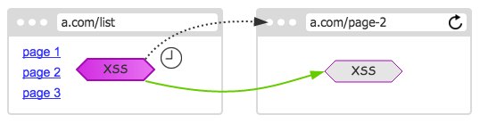

对于新页面的 XSS 来说，当然是注入的越早越好。越前面拥有越高的优先级，甚至可以拦截页面的正常业务功能。

为了能尽快获知页面刷新、跳转等行为，我们还可跟踪 `unload` 事件，在页面即将丢失的瞬间，将消息通知出去，让对方尽快来拯救自己。

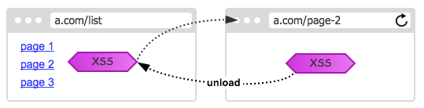

这样，就不必等待定时器了，可以最快的速度恢复。甚至能赶在页面的第一个脚本之前，运行我们的 XSS。

当然，并非任何情况都能收回的。如果跳转到了不同源的页面，那显然是无能为力了 —— 不过，就此而放弃它吗？回答是：决不妥协！

尽管页面已经和我们分道扬镳了，但所在的窗体仍然被我们掌控。我们可以跳转、关闭它，甚至还有可能出现奇迹：**只要页面跳转回我们的站点，又可被我们所收复！**

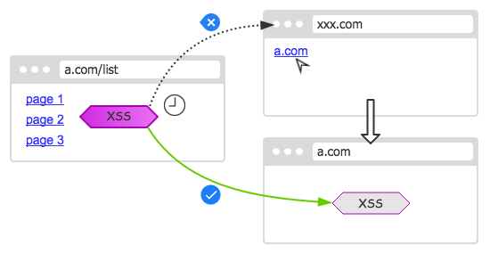

## 互相联结

不难发现，只要还有一个页面存在，就有可能收回曾经被占领的地盘。因此，我们要将可控的页面都联结起来，让每个页面都知晓并监督所有成员。

当有新成员加入时，通知给大家，记录在各自的页面里。

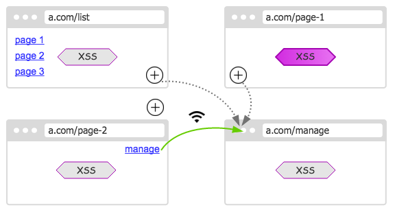

这样即使其中一个页面意外关闭了，也不会丢失重要的信息 —— 信息已被分布储存在各个页面里了。

因此，页面开的越多，相互联结就越牢固。
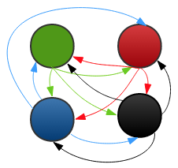

所以，把超链接都变成新页面中打开，还是有很大的优势的。

如果只剩最后一个页面，那么一旦刷新之后就没人来拯救了，于是就会消亡。

## 降域尝试

一些网站为了方便通信，将 document.domain 降到根域。例如支付宝网站的绝大部分页面，都是 [alipay.com](http://alipay.com)。这样原本不同源的子站，这时也能够相互操控了。

因此，遇到不同源的页面，可以尝试降低自身的域，再次发起操作，或许就能成功注入了。

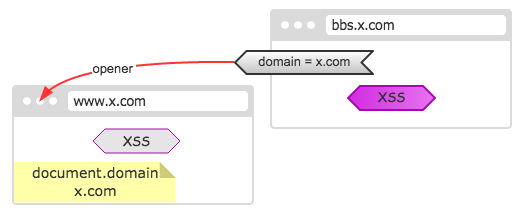

## 表单劫持

之前说到正向注入，是通过劫持超链接点击实现的。事实上，除了超链接外，还有个进入新页面的方式，那就是表单提交。

相比超链接，表单显得棘手一些。我们不仅得打开一个新页面，还要把表单里的数据也提交上去。如果把整个表单的元素克隆到新页面提交，一些数据又会丢失。

不过，仔细研究一下表单元素，会发现有一个非常简单的方法：原来 window.open 第二个参数可以赋予新窗口一个 name，然后将 name 赋予表单的 target 属性，即可在我们创建的新窗口里提交。这样就可以把 XSS 注入进去了。

## 框架注入

不同页面之间可以正反注入。同个页面中，可能存在多个框架页，因此还可以尝试框架页之间的上下注入。

也许，XSS 位于页面中某个小框架。如果只局限于自身页面，那么是毫无发展空间的。因此得跳出圈子，向更广阔的 parent 页面注入。

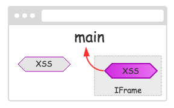

类似的，如果主页面仅仅是个外壳，实际内容运行在某个框架里，那么得注入到子框架中，才能获取更有意义的信息。
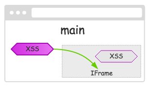
同样，我们还可以将上下注入结合，即可让 XSS 从某个框架页里破壳而出，感染到所有的框架页里。
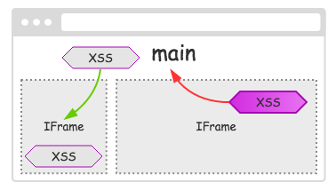

## 后记

尽管这些特征从 DOM 诞生起就已存在了，不过要写出一个完善的脚本并不容易。直到如今的 IE 11，不同窗体间的操作，仍有各种奇怪问题，更不用说那些非主流 IE 了。

不过好在除 IE 外的其他主流浏览器，都能很好的运行。下面分享一个 Demo，其中实现了上述部分功能：

[https://www.etherdream.com/FunnyScript/XSSGhost/](http://www.etherdream.com/FunnyScript/XSSGhost/)

当我们顺着超链接往前点，一旦进入有 XSS 的页面，先前的父页面都遭到感染。更严重的是，被感染的页面打开的子页面，也都无一幸免。即使刷新，也会被其他页面监控到，从而立即恢复。

正如幽灵鬼魂一般挥之不去。
