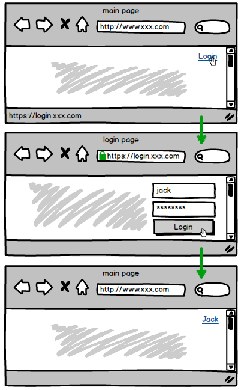
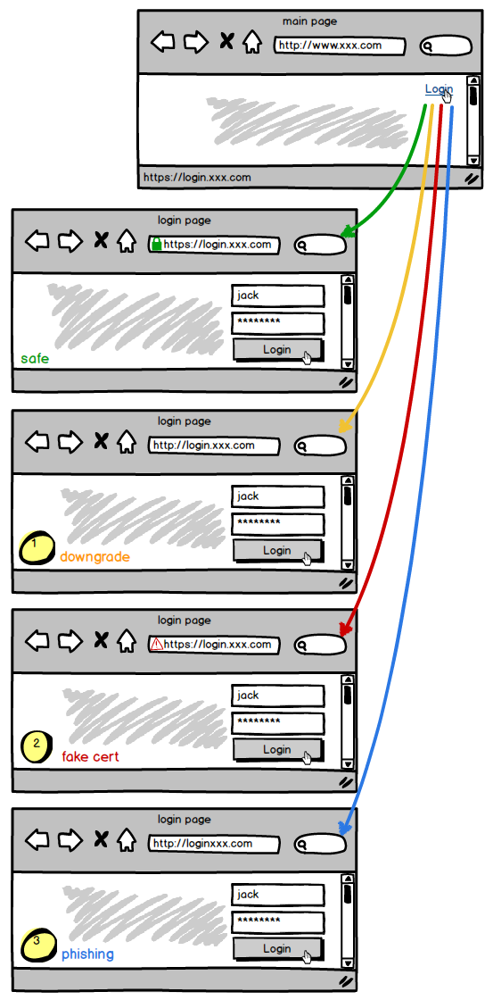
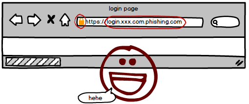
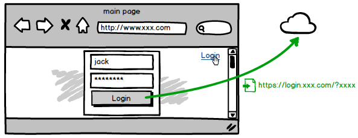
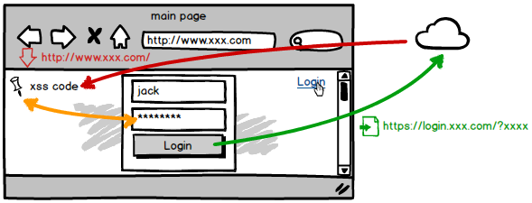
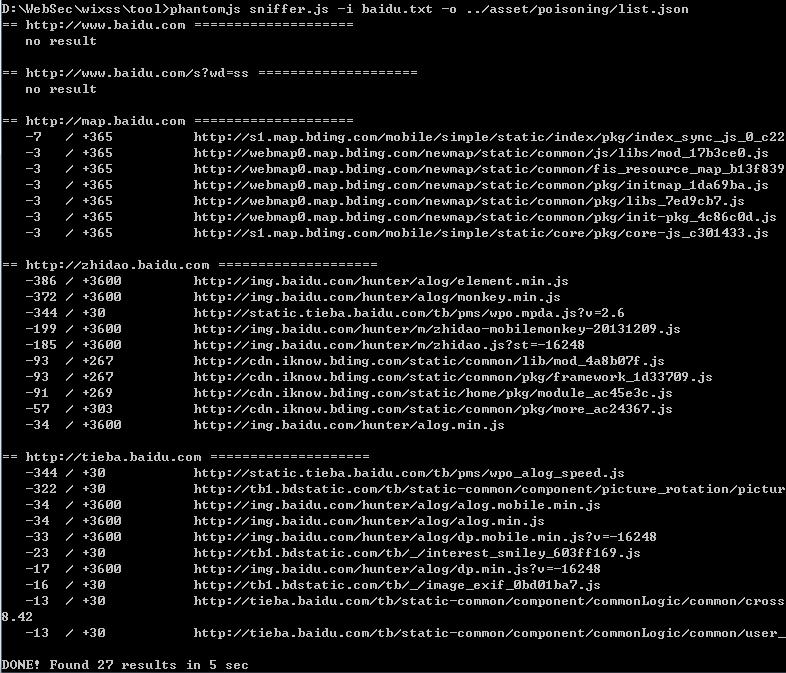
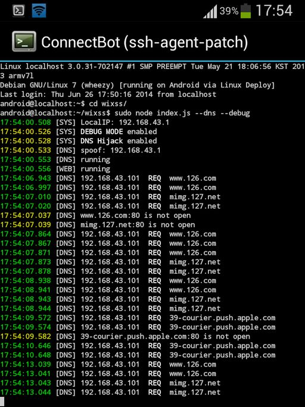
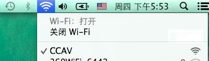
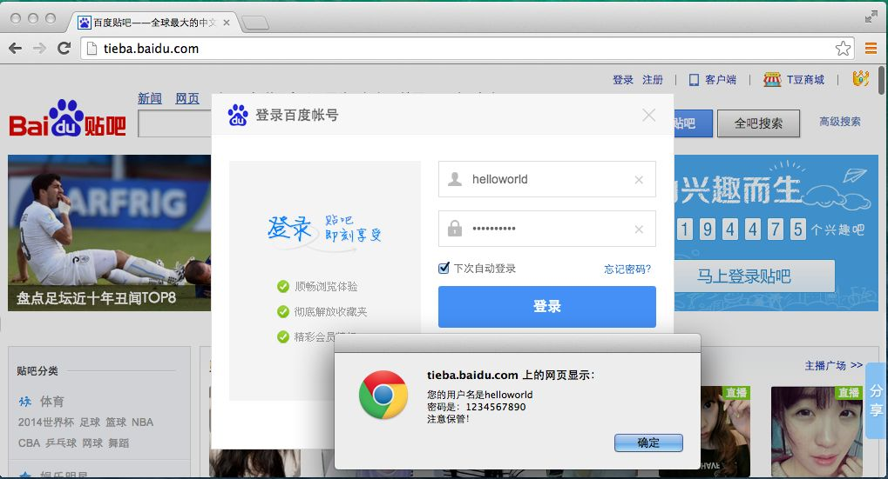

# 流量劫持 —— 浮层登录框的隐患

> GitHub 仓库源文件：[点击打开网页渲染版](https://github.com/ben2023niao/ben-ops-notes/blob/main/doc/md/202304141557-%E5%AE%89%E5%85%A8%E4%B8%8E%E5%A0%A1%E5%9E%92%E6%9C%BA%2B%E9%AB%98%E7%BA%A7%E5%AE%89%E5%85%A8%2BXSS%2B%E7%9F%A5%E8%AF%86%E7%AC%94%E8%AE%B0-%E6%B5%81%E9%87%8F%E5%8A%AB%E6%8C%81%20%E2%80%94%E2%80%94%20%E6%B5%AE%E5%B1%82%E7%99%BB%E5%BD%95%E6%A1%86%E7%9A%84%E9%9A%90%E6%82%A3.md)

## 传统的登录框

在之前的文章[流量劫持危害](https://www.cnblogs.com/index-html/p/traffic-hijack-2.html)详细讲解了 HTTP 的高危性，以至于重要的操作都使用 HTTPS 协议，来保障流量在途中的安全。

这是最经典的登录模式。尽管主页面并没有开启 HTTPS，但登录时会跳转到一个安全页面来进行，所以整个过程仍是比较安全的 —— 至少在登录页面是安全的。

对于这种安全页面的登录模式，黑客硬要下手仍是有办法的。在之前的文章里也列举了几种最常用的方法：拦截 HTTPS 向下转型、伪造证书、跳转钓鱼网站。

其中转型 HTTPS 的手段最为先进，甚至一些安全意识较强的用户也时有疏忽。

然而，用户的意识和知识总是在不断提升的。尤其在如今各种网上交易的时代，安全常识广泛普及，用户在账号登录时会格外留心，就像过马路时那样变得小心翼翼。

久而久之，用户的火眼金睛一扫地址栏即可识别破绽。

因此，这种传统的登录模式，仍具备一定的安全性，至少能给用户提供识别真假的机会。

## 华丽的登录框

不知从何时起，人们开始热衷在网页里模仿传统应用程序的界面。无论控件、窗口还是交互体验，纷纷向着本地程序靠拢，效果越做越绚。

然而华丽的背后，其本质仍是一个网页，自然掩盖不了网页的安全缺陷。

当网页特效蔓延到一些重要数据的交互 —— 例如账号登录时，风险也随之产生。因为它改变了用户的使用习惯，同时也彻底颠覆了传统的意识。

乍一看，似乎也没什么问题。虽然未使用登录页跳转，但数据仍通过 HTTPS 传输，途中还是无法被截获。

## HTTP 页面用 HTTPS 有意义吗？

如果认为这类登录框没什么大问题，显然还没领悟到『流量劫持』的精髓 —— 流量不是单向的，而是有进也有出。

能捕获你『出流量』的黑客，大多也有办法控制你的『入流量』。这在流量劫持[第一篇](https://fex.baidu.com/blog/2014/04/traffic-hijack/)里也详细列举了。

使用 HTTPS 确实能保障通信的安全。但在这个场合里，它只能保障『发送』的数据，对于『接收』的流量，则完全不在其保护范围内。

因为整个登录框都当作『虚拟窗口』嵌套在主页面里的，因此其中的一切都在同个页面环境里。而主页面使用的仍是不安全的 HTTP 协议，所以注入的 XSS 代码能轻而易举的控制登录框。

当然，或许你会说这只是设计缺陷。若是直接嵌入 HTTPS 登录页的 iframe 框架，那就会因同源策略而无法被 XSS 控制了。

这样的改进确实能提高一些安全性，但也只是略微的。既然我们能控制主页面，里面显示什么内容完全可以由 XSS 说了算。不论什么登录框、框架页，甚至安全插件，我们都可以将其删除，用看起来完全相同的文本框代替。得到账号后，通过后台反向代理实现登录，然后通知前端脚本伪造一个登录成功的界面。

所以，HTTPS 被用在 HTTP 页面里，意义就大幅下降了。

## 和『缓存投毒』配合出击

在流量劫持[第二篇](https://www.cnblogs.com/index-html/p/traffic-hijack-2.html)里提到『HTTP 缓存投毒』这一概念，只要流量暂时性的被劫持，都可导致缓存长期感染。但这种攻击有个前提，必须事先找到站点下较稳定的脚本资源，做投毒的对象。

### 传统登录

在传统的登录模式里，缓存投毒非常难以利用：

HTTPS 资源显然无法被感染。

而使用 HTTPS 向下转型的方案，也会因为离开劫持环境，而无法访问中间人的 HTTP 版登陆页面，导致缓存失效；或者这个真实的 HTTP 版的登录页面根本就不接受你的本地缓存，直接重定向到正常的 HTTPS 页面。

因此只有在主页面上，修改链接地址，让用户跳转到钓鱼网站去登录，才能勉强利用。

### 浮层登录

制作一个精良的浮层登录框，需要不少的界面代码，所以经常引用 jQuery 这类通用脚本库。而这些脚本往往是长久不会修改的，因此是缓存投毒的绝好原料。

所以，浮层登录框的存在，让『缓存投毒』有了绝佳的用武之地。

再之前的文章 WiFi流量劫持 —— JS脚本缓存投毒，演示了如何利用 [www.163.com](http://www.163.com) 下的某个长缓存脚本进行投毒，最终利用网易的浮层登录框获取账号。尽管网易也使用 HTTPS 传输账号数据，但在流量攻击面前不堪一击。

尽管这种登录模式风险重重，但最近百度也升级成浮层登录框，并且还是所有产品。所以，我们再次尝试那套的古老方法，看看在如今是否仍能发起攻击。

我们选几个最常用的产品线，进行一次缓存扫描：

果然，每个产品线里都有长期未修改、并且缓存很久的脚本库。

接着开启我们的钓鱼热点，让前来连接的用户，访问任何一个页面都能中毒。

为了让钓鱼热点更隐蔽，这次我们不再使用路由器，而是利用报废的安卓手机（下一篇文章详细讲解如何实现）。

为了不影响附近办公，本文就不演示同名热点钓鱼了，所以随便取了个名字。

接着让『受害者』来连一下我们的热点：

之前正好开着网页，所以很快收到了 HTTP 请求。我们在任何网页里注入 XSS，进行缓存投毒。

（由于原理和之前讲一样，所以这里就省略步骤了）

然后重启电脑，连上正常的 WiFi（模拟用户回到安全的场合）。

打开 [tiebai.baidu.com](http://tiebai.baidu.com)，一切正常。

开始登录了。。。

看看这种浮层登录框，能否躲避我们的从沉睡中唤起的 XSS 脚本：

奇迹依然发生！

由于之前有过详细的原理讲解，因此这里就不再累述了。不过在实战中，缓存投毒+非安全页面登录框，是批量获取明文账号的最理想手段。

## 不可逆的记忆

如果现在再将登录模式换回传统的，还来得及吗？显然，为时已晚。

当网站第一次从传统登录，升级到浮层登录时，用户大多不会立即输入，而是『欣赏』下这个新版本的创意。确认不是病毒广告弹出的窗口，而是真的官方设计的，才开始登录。

当用户多次使用浮层登录框之后，慢慢也就接受了这种新模式。

即使未来，网站取消了浮层登录，黑客使用 XSS 创建一个类似的浮层，用户仍会毫不犹豫的输入账号。因为在他们的记忆里，官方就曾使用过，仍然对其保留着对其信任度。

## 安全性升级

既然这个过程是不可逆的，撤回传统模式意义也不大。事实上，使用浮层的用户体验还是不错的，对于不了解安全性的用户来说，还是喜欢华丽的界面。

要保留体验，又得考虑安全性，最好的解决方案就是将所有的页面都使用 HTTPS，将站点武装到牙齿，不留一丝安全缝隙。这也是未来网站的趋势。
