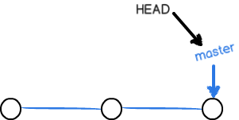
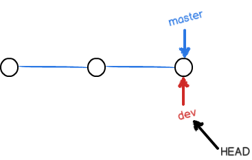
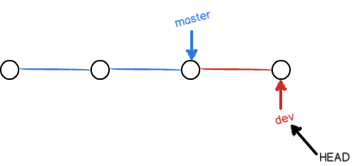
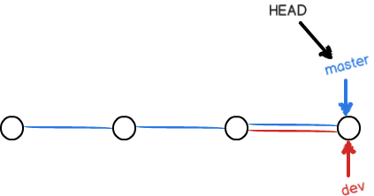
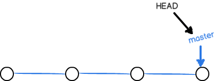
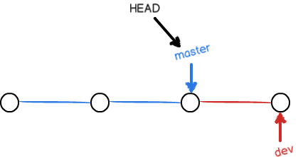

# Git分支管理

其他版本控制系统如 SVN 等都有分支管理，但是用过之后你会发现，这些版本控制系统创建和切换分支比蜗牛还慢，简直让人无法忍受，结果分支功能成了摆设，大家都不去用。

但 **[Git](https://haicoder.net/git/git-tutorial.html)** 的分支是与众不同的，无论创建、切换和删除分支，Git 在 1 秒钟之内就能完成！无论你的版本库是 1 个文件还是 1 万个文件。

## 创建与合并分支

在版本回退里，你已经知道，每次提交，Git 都把它们串成一条时间线，这条时间线就是一个分支。截止到目前，只有一条时间线，在 Git 里，这个分支叫主分支，即 master 分支。HEAD 严格来说不是指向提交，而是指向master，master 才是指向提交的，所以，HEAD 指向的就是当前分支。

一开始的时候，master 分支是一条线，Git 用 master 指向最新的提交，再用 HEAD 指向 master，就能确定当前分支，以及当前分支的提交点：

每次提交，master 分支都会向前移动一步，这样，随着你不断提交，master 分支的线也越来越长。当我们创建新的分支，例如 dev 时，Git 新建了一个指针叫 dev，指向 master 相同的提交，再把 HEAD 指向 dev，就表示当前分支在 dev 上：


你看，Git 创建一个分支很快，因为除了增加一个 dev 指针，改改 HEAD 的指向，工作区的文件都没有任何变化！

不过，从现在开始，对工作区的修改和提交就是针对 dev 分支了，比如新提交一次后，dev 指针往前移动一步，而 master 指针不变：

假如我们在 dev 上的工作完成了，就可以把 dev 合并到 master 上。Git 怎么合并呢？最简单的方法，就是直接把 master 指向 dev 的当前提交，就完成了合并：

所以 Git 合并分支也很快！就改改指针，工作区内容也不变！合并完分支后，甚至可以删除 dev 分支。删除 dev 分支就是把 dev 指针给删掉，删掉后，我们就剩下了一条 master 分支：



## 分支管理案例

```
首先，我们创建 dev 分支，然后切换到 dev 分支：

$ git checkout -b dev
git checkout 命令加上 -b 参数表示创建并切换，相当于以下两条命令：

$ git branch dev
$ git checkout dev
然后，用 git branch 命令查看当前分支：

$ git branch
输出如下：

*dev
master
git branch 命令会列出所有分支，当前分支前面会标一个 * 号。然后，我们就可以在 dev 分支上正常提交，比如对 readme.txt 做个修改，然后提交：

$ git add readme.txt
$ git commit -m "branch test"
现在，dev 分支的工作完成，我们就可以切换回 master 分支：

$ git checkout master
切换回 master 分支后，再查看一个 readme.txt 文件，刚才添加的内容不见了！因为那个提交是在 dev 分支上，而 master 分支此刻的提交点并没有变：
```

## 

```
现在，我们把 dev 分支的工作成果合并到 master 分支上：

$ git merge dev
git merge 命令用于合并指定分支到当前分支。合并后，再查看 readme.txt 的内容，就可以看到，和 dev 分支的最新提交是完全一样的。

合并完成后，就可以放心地删除 dev 分支了：

$ git branch -d dev
删除后，查看 branch，就只剩下 master 分支了：

$ git branch
输出如下：

* master
因为创建、合并和删除分支非常快，所以 Git 鼓励你使用分支完成某个任务，合并后再删掉分支，这和直接在master 分支上工作效果是一样的，但过程更安全。

冲突解决
Git 用 <<<<<<<，=======，>>>>>>> 标记出不同分支的内容，我们手动修改后保存：

$ git add readme.txt
$ git commit -m "conflict fixed"
分支管理策略
通常，合并分支时，如果可能，Git 会用 Fast forward 模式，但这种模式下，删除分支后，会丢掉分支信息。如果要强制禁用 Fast forward 模式，Git 就会在 merge 时生成一个新的 commit，这样，从分支历史上就可以看出分支信息。

$ git merge --no-ff -m "merge with no-ff" dev
在实际开发中，我们应该按照几个基本原则进行分支管理：

首先，master 分支应该是非常稳定的，也就是仅用来发布新版本，平时不能在上面干活；
那在哪干活呢？干活都在 dev 分支上，也就是说，dev 分支是不稳定的，到某个时候，比如 1.0 版本发布时，再把 dev 分支合并到 master 上，在 master 分支发布 1.0 版本；
你和你的小伙伴们每个人都在 dev 分支上干活，每个人都有自己的分支，时不时地往 dev 分支上合并就可以了。
Bug分支
软件开发中，bug 就像家常便饭一样。有了 bug 就需要修复，在 Git 中，由于分支是如此的强大，所以，每个 bug 都可以通过一个新的临时分支来修复，修复后，合并分支，然后将临时分支删除。

当你接到一个修复一个代号 101 的 bug 的任务时，很自然地，你想创建一个分支 issue-101 来修复它，但是，等等，当前正在 dev 上进行的工作还没有提交：并不是你不想提交，而是工作只进行到一半，还没法提交，预计完成还需 1 天时间。但是，必须在两个小时内修复该 bug，怎么办？

幸好，Git 还提供了一个 stash 功能，可以把当前工作现场 “储藏” 起来，等以后恢复现场后继续工作：

$ git stash
现在，用 git status 查看工作区，就是干净的（除非有没有被 Git 管理的文件），因此可以放心地创建分支来修复 bug。

首先确定要在哪个分支上修复 bug，假定需要在 master 分支上修复，就从 master 创建临时分支：

$ git checkout master
$ git checkout -b issue-101
现在修复 bug，然后提交：

$ git add readme.txt
$ git commit -m "fix bug 101"
修复完成后，切换到 master 分支，并完成合并，最后删除 issue-101 分支：

$ git checkout master

$ git merge --no-ff -m "merged bug fix 101" issue-101
$ git branch -d issue-101
现在，是时候接着回到 dev 分支干活了！

$ git checkout dev
$ git status
工作区是干净的，刚才的工作现场存到哪去了？用 git stash list 命令看看：

$ git stash list
输出如下：

stash@{0}: WIP on dev: 6224937 add merge
工作现场还在，Git 把 stash 内容存在某个地方了，但是需要恢复一下，有两个办法：

一是用 git stash apply 恢复，但是恢复后，stash 内容并不删除，你需要用 git stash drop 来删除；

另一种方式是用 git stash pop，恢复的同时把 stash 内容也删了：

 $ git stash pop
再用 git stash list 查看，就看不到任何 stash 内容了：

$ git stash list
你可以多次 stash，恢复的时候，先用 git stash list 查看，然后恢复指定的 stash，用命令：

$ git stash apply stash@{0}
Feature分支
添加一个新功能时，你肯定不希望因为一些实验性质的代码，把主分支搞乱了，所以，每添加一个新功能，最好新建一个 feature 分支，在上面开发，完成后，合并，最后，删除该 feature 分支。

如果开发到一半，发现这个 feature 不用了，那么不需要合并，直接强制删除：

git branch -D feature-vulcan
```

---
