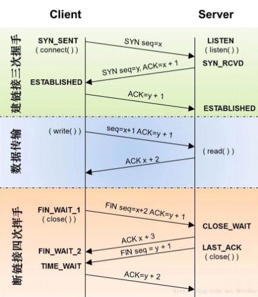

# TCP与UDP协议对比

## TCP/UDP概述

UDP 是一个简单的面向数据报的传输层协议：进程的每个输出操作都正好产生一个 UDP 数据报，并组装成一份待发送的 IP 数据报。

UDP 不提供可靠性：它把应用程序传给 IP 层的数据发送出去，但是并不保证它们能到达目的地。应用程序必须关心 IP 数据报的长度。如果它超过网络的 MTU，那么就要对 IP 数据报进行分片。

传输层主要为两台主机上的应用程序提供端到端的通信。在 TCP/IP 协议族中，有两个互不相同的传输协议： TCP（传输控制协议）和 UDP（用户数据报协议）。

TCP 为两台主机提供高可靠性的数据通信。它所做的工作包括把应用程序交给它的数据分成合适的小块交给下面的网络层，确认接收到的分组，设置发送最后确认分组的超时时钟等。由于传输层提供了高可靠性的端到端的通信，因此应用层可以忽略所有这些细节。

而另一方面， UDP 则为应用层提供一种非常简单的服务。它只是把称作数据报的分组从一台主机发送到另一台主机，但并不保证该数据报能到达另一端。任何必需的可靠性必须由应用层来提供。

## 建立连接方式

### TCP

说到 TCP 建立连接，相信大多数人脑海里肯定可以浮现出一个词，没错就是–“三次握手”。TCP 通过 “三次握手” 来建立连接，再通过 “四次挥手” 断开一个连接。在每次挥手中 TCP 做了哪些操作呢？继续往下看：

上图就从客户端和服务端的角度，清楚的展示了 TCP 的三次握手和四次挥手。可以看到，当 TCP 试图建立连接时，三次握手指的是客户端主动触发了两次，服务端触发了一次。

我们可以先明确一下 TCP 建立连接并且初始化的目标是什么呢？1. 初始化资源 2. 告诉对方我的序列号。所以三次握手的次序是这样子的：

1. client 端首先发送一个 SYN 包告诉 Server 端我的初始序列号是 X。
2. Server 端收到 SYN 包后回复给 client 一个 ACK 确认包，告诉 client 说我收到了。
3. 接着 Server 端也需要告诉 client 端自己的初始序列号，于是 Server 也发送一个 SYN 包告诉 client 我的初始序列号是 Y。
4. Client 收到后，回复 Server 一个 ACK 确认包说我知道了。

其中的 2 、3 步骤可以简化为一步，也就是说将 ACK 确认包和 SYN 序列化包一同发送给 Client 端。到此我们就比较简单的解释了 TCP 建立连接的 “三次握手”。

### UDP

我们都知道 TCP 是面向连接的、可靠的、有序的传输层协议，而 UDP 是面向数据报的、不可靠的、无序的传输协议，所以 UDP 压根不会建立什么连接。

就好比发短信一样，UDP 只需要知道对方的 ip 地址，将数据报一份一份的发送过去就可以了，其他的作为发送方，都不需要关心。

## 数据发送

关于 TCP、UDP 之间数据发送的差异，可以体现二者最大的不同之处：

### TCP

由于 TCP 是建立在两端连接之上的协议，所以理论上发送的数据流不存在大小的限制。但是由于缓冲区有大小限制，所以你如果用 TCP 发送一段很大的数据，可能会截断成好几段，接收方依次的接收。

### UDP

由于 UDP 本身发送的就是一份一份的数据报，所以自然而然的就有一个上限的大小，这个每次 UDP 发送的数据报大小由哪些因素共同决定呢？

1. UDP 协议本身，UDP 协议中有 16 位的 UDP 报文长度，那么 UDP 报文长度不能超过 2^16=65536。
2. 以太网(Ethernet)数据帧的长度，数据链路层的 MTU(最大传输单元)。
3. socket 的 UDP 发送缓存区大小。

先来看第一个因素，UDP 本身协议的报文长度为 2^16 - 1，UDP 包头占 8 个字节，IP 协议本身封装后包头占 20 个字节，所以最终长度为： 2^16 - 1 - 20 - 8 = 65507 字节。

只看第一个因素有点理想化了，因为 UDP 属于不可靠协议，我们应该尽量避免在传输过程中，数据包被分割。所以这里有一个非常重要的概念 MTU – 也就是最大传输单元。

在 Internet 下 MTU 的值为 576 字节，所以在 internet 下使用 UDP 协议，每个数据报最大的字节数为： 576 - 20 - 8 = 548

### TCP

我们再来谈谈数据的有序性。对于 TCP 来说，本身 TCP 有着超时重传、错误重传、还有等等一系列复杂的算法保证了 TCP 的数据是有序的，假设你发送了数据 1、2、3，则只要发送端和接收端保持连接时，接收端收到的数据始终都是 1、2、3。

### UDP

而 UDP 协议则要奔放的多，无论 server 端无论缓冲池的大小有多大，接收 client 端发来的消息总是一个一个的接收。并且由于 UDP 本身的不可靠性以及无序性，如果 client 发送了 1、2、3 这三个数据报过来，server 端接收到的可能是任意顺序、任意个数三个数据报的排列组合。

## 可靠性

其实大家都知道 TCP 本身是可靠的协议，而 UDP 是不可靠的协议。

### TCP

TCP 内部的很多算法机制让他保持连接的过程中是很可靠的。比如：TCP 的超时重传、错误重传、TCP 的流量控制、阻塞控制、慢热启动算法、拥塞避免算法、快速恢复算法等等。

所以 TCP 是一个内部原理复杂，但是使用起来比较简单的这么一个协议。

### UDP

UDP 是一个面向非连接的协议，UDP 发送的每个数据报带有自己的 IP 地址和接收方的 IP 地址，它本身对这个数据报是否出错，是否到达不关心，只要发出去了就好了。所以来研究下，什么情况会导致 UDP 丢包：

- 数据报分片重组丢失

在文章之前我们就说过，UDP 的每个数据报大小多少最合适，事实上 UDP 协议本身规定的大小是 64kb，但是在数据链路层有 MTU 的限制，大小大概在 5kb，所以当你发送一个很大的 UDP 包的时候，这个包会在 IP 层进行分片，然后重组。这个过程就有可能导致分片的包丢失。UDP 本身有 CRC 检测机制，会抛弃掉丢失的 UDP 包。
- UDP 缓冲区填满

当 UDP 的缓冲区已经被填满的时候，接收方还没有处理这部分的 UDP 数据报，这个时候再过来的数据报就没有地方可以存了，自然就都被丢弃了。

## 使用场景

在文章最后的一部分，聊聊 TCP、UDP 使用场景。

先来说 UDP 的吧，有很多人都会觉得 UDP 与 TCP 相比，在性能速度上是占优势的。因为 UDP 并不用保持一个持续的连接，也不需要对收发包进行确认。但事实上经过这么多年的发展 TCP 已经拥有足够多的算法和优化，在网络状态不错的情况下，TCP 的整体性能是优于 UDP 的。

那在什么时候我们非用 UDP 不可呢？

- 对实时性要求高

比如实时会议，实时视频这种情况下，如果使用 TCP，当网络不好发生重传时，画面肯定会有延时，甚至越堆越多。如果使用 UDP 的话，即使偶尔丢了几个包，但是也不会影响什么，这种情况下使用 UDP 比较好。
- 多点通信

TCP 需要保持一个长连接，那么在涉及多点通讯的时候，肯定需要和多个通信节点建立其双向连接，然后有时在 NAT 环境下，两个通信节点建立其直接的 TCP 连接不是一个容易的事情，而 UDP 可以无需保持连接，直接发就可以了，所以成本会很低，而且穿透性好。这种情况下使用 UDP 也是没错的。

## TCP与UDP对比总结

|  | UDP | TCP |

| --- | --- | --- |

| 是否连接 | 无连接 | 面向连接 |

| 是否可靠 | 不可靠传输，不使用流量控制和拥塞控制 | 可靠传输，使用流量控制和拥塞控制 |

| 连接对象个数 | 支持一对一，一对多，多对一和多对多交互通信 | 只能是一对一通信 |

| 传输方式 | 面向报文 | 面向字节流 |

| 首部开销 | 首部开销小，仅8字节 | 首部最小20字节，最大60字节 |

| 适用场景 | 适用于实时应用（IP电话、视频会议、直播等） | 适用于要求可靠传输的应用，例如文件传输 |

## 总结

1. TCP 向上层提供面向连接的可靠服务 ，UDP 向上层提供无连接不可靠服务。
2. 虽然 UDP 并没有 TCP 传输来的准确，但是也能在很多实时性要求高的地方有所作为。
3. 对数据准确性要求高，速度可以相对较慢的，可以选用 TCP。
